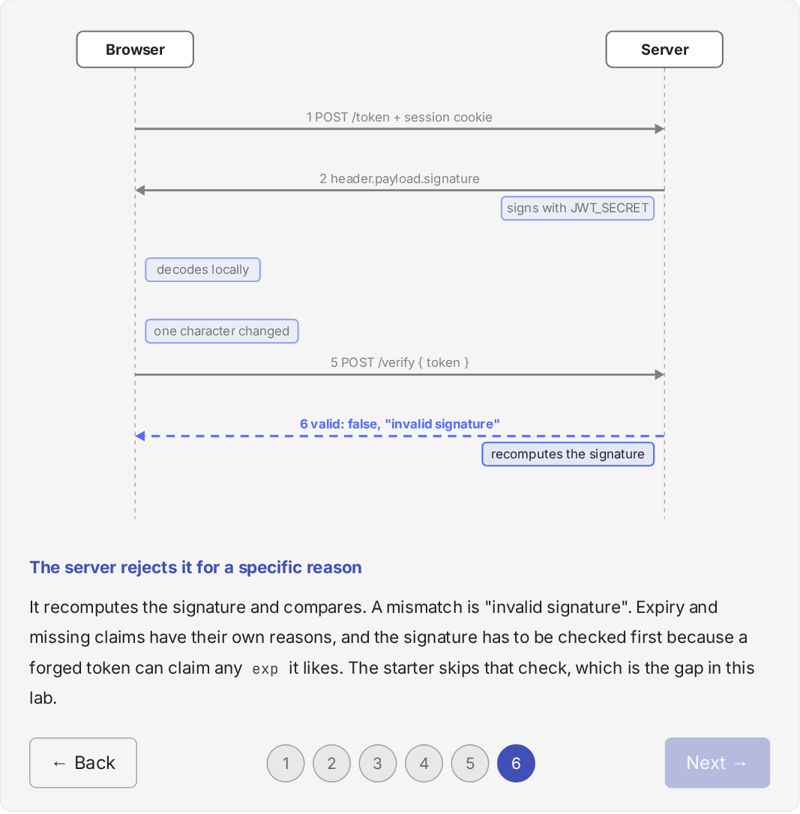

# Agent Auth Lab

A 14-lab course that teaches authentication and authorization by building one
system, one lab at a time: from a hand-rolled session login, through OAuth2 and
OIDC, to autonomous agents that act on a person's behalf. Every lab ends with
something you can watch happen, such as a forged token being rejected, a denied
request or a trace of who did what.

**Read the course: <https://leejianrong.github.io/agent-auth-lab/>**



## How it works

You don't restart for each lab. Lab 00's solution is lab 01's starting point,
and so on up to lab 13, so by the end you've built the thing you'd otherwise
only configure.

- `starter/` is a working system with one deliberate gap, marked `TODO(lab-NN)`.
- The handout explains the idea, then points you at the function to fix.
- A pytest self-check tells you when you're done. Nothing is graded or submitted.
- `solution/` is the reference answer, and the next lab's starter is generated
  from it.

| Labs | Arc |
|------|-----|
| 00-03 | Sessions, JWTs, RBAC and ABAC/ReBAC, with no agents yet |
| 04-06 | A small OIDC identity provider, consent and revocation, service-to-service tokens |
| 07-13 | Agents with their own identity, scoped tools enforced by OPA, delegation on behalf of a person, human approval, confused-deputy attacks, one audit trace, and an open capstone |

Several labs start from deliberately vulnerable code (session fixation,
privilege escalation, a confused deputy). It is labelled, meant for localhost
only, and always paired with its fix in the same lab (ADR-0008). Don't deploy it.

## Quick start

You need Python 3.12, [`uv`](https://docs.astral.sh/uv/) and Node.js (built on
Node 24). Labs 08 and later also need the [OPA](https://www.openpolicyagent.org/)
binary on your `PATH`, and from lab 06 each handout offers `docker compose up`
as an alternative to starting the services by hand.

```sh
git clone https://github.com/leejianrong/agent-auth-lab.git
cd agent-auth-lab
make lab00-setup   # install lab 00's backend and frontend dependencies
make lab00-run     # starter backend on :8000, frontend on :5173
make lab00-test    # self-check suite (it runs against the solution, so it passes)
```

Open <http://localhost:5173>, then follow
[Lab 00](https://leejianrong.github.io/agent-auth-lab/lab-00-sessions-cookies/).
Each later handout lists its own setup. To read the handouts offline, run
`make docs-serve`.

## Repo layout

- `labs/lab-NN-slug/{starter,solution}/`: one folder per lab.
- `shared/observability-harness/`: the audit log, trace ids and dashboard
  every lab imports.
- `docs/course/`: the handouts (Zensical source), with their steppers in
  `flows/` and interactive widgets in `widgets/`.
- `docs/adr/`: why each architectural decision was made.
- `scripts/`: the starter generator and the stepper generator.

## Working on the course

Read `PLAN.md` first, then `docs/adr/`, then `SLICES.md` for the build plan.
`AGENTS.md` holds the repo conventions, for people and for coding agents.
Before opening a PR, `make docs-build`, `make check-starters` and
`make stepper-check` should all pass, and CI runs the same checks. Found a
mistake in a handout? [Open an issue](https://github.com/leejianrong/agent-auth-lab/issues).

## Licence

[Apache-2.0](LICENSE).
