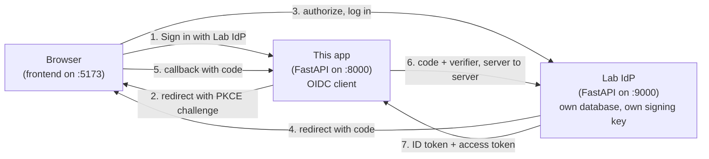
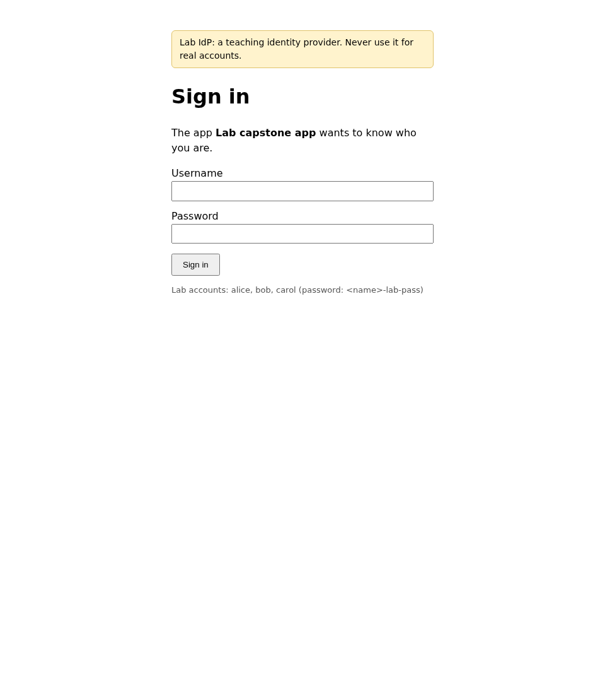
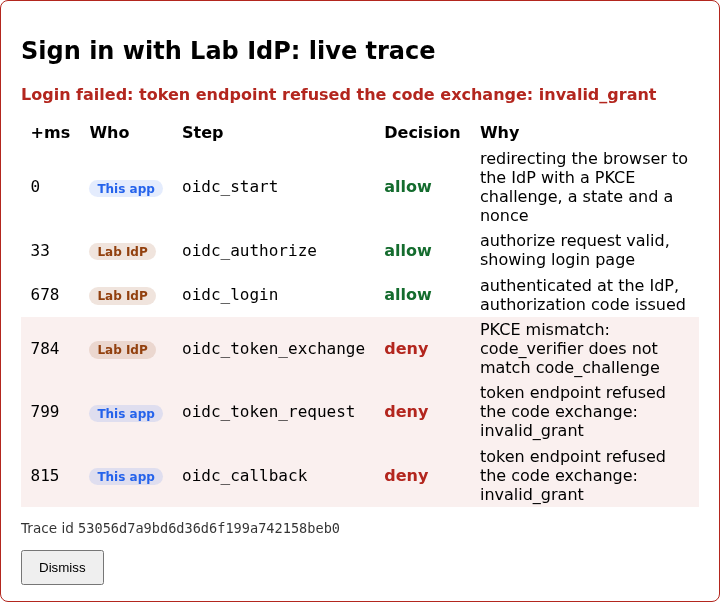
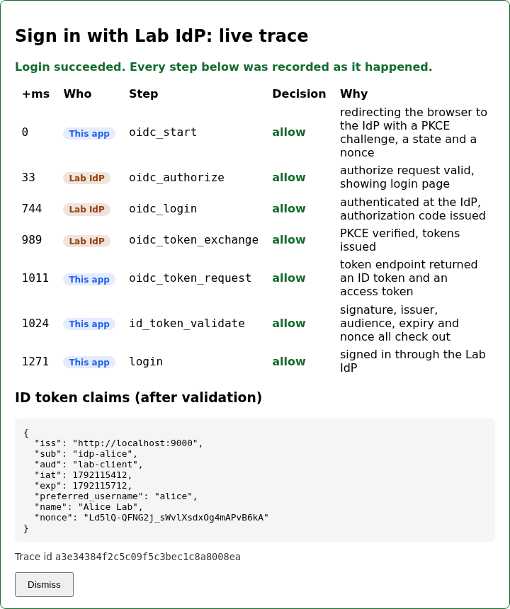

# Lab 04: Sign in with an identity provider

Until now this app has checked passwords itself. This lab hands that job to a
separate service. You'll build a small identity provider (the Lab IdP), let
users sign in there, and have the app accept the result without ever seeing
a password. When it works, you can watch the whole login as one timeline in
the browser: the app's steps and the IdP's steps, interleaved, each marked
allow or deny.

You'll also break it on purpose. A login that skips one check still looks
fine in the browser, so the lab is mostly about learning which checks those
are and seeing what each one stops.

## What you'll learn

- Why the authorization code flow sends the browser through the IdP instead
  of having the app collect credentials
- What PKCE adds, and the exact step where a stolen authorization code stops
  working
- Which checks make an ID token trustworthy: signature, issuer, audience,
  expiry and nonce, and what an attacker gets from each one you skip

!!! warning "The Lab IdP is for learning only"
    It implements just enough of OAuth 2.0 and OpenID Connect to drive the
    rest of the course. It has one hard-coded signing key file, fixed demo
    accounts and no rate limiting. Never point real users at it, and don't
    lift it into a real project. ADR-0004 explains why we build one anyway,
    and the further reading names the real ones to use.

??? note "Closing the loop on lab 03 (skip this if you finished it)"

    ### The ownership fix

    Lab 03's starter compared a note's `owner_id` to itself, which is always
    true, so every signed-in user passed `owner-full-access`. The fix is to
    compare the caller to the resource:

    ```python title="solution/backend/app/policy.py"
    def _is_owner(subject: Subject, resource: ResourceAttrs, action: str) -> bool:
        return subject.id == resource.owner_id
    ```

    Here is the same request, bob reading alice's note, before and after:

    | | Before | After |
    |---|---|---|
    | What `owner-full-access` compares | `owner_id == owner_id` | `bob.id == alice.id` |
    | Result of that comparison | always true | false |
    | Rule that decides | `owner-full-access` | `default-deny` |
    | Outcome | allow (the bypass) | deny |

    Nothing else moved. `RULES`, `evaluate()` and the endpoints are
    identical in both runs, which is why the bug is easy to miss: the code
    type-checks, returns a bool, and still denies callers who aren't signed
    in at all.

    ### Discussing lab 03's going further questions

    One perspective, not a graded answer key.

    **Sharing a note with one other person.** You need a place to record the
    grant, so a `note_shares(note_id, user_id)` table, and a third rule that
    asks whether the caller has a row there for this note. That still fits a
    flat list of independent rules. It stops fitting when shares can be
    shared onward, or when a share to a group should reach its members,
    because now the answer depends on walking a graph, and a list of
    one-line conditions can't express that well.

    **Rule order.** Order only matters when two rules can both match the same
    request and disagree. Here `admin-full-access` and `owner-full-access`
    both allow, so swapping them changes the reported rule id and nothing
    else. Put a deny rule above an allow and order changes the outcome. A
    useful test pins a request that two rules match and asserts which id wins,
    so a reorder fails loudly.

    **Attributes that aren't in the database.** Time of day and recent denial
    counts are context, not stored facts. The evaluator would need a third
    input beyond subject and resource, and every caller of `evaluate()` would
    have to supply it honestly. The harder part is that the decision stops
    being reproducible from the database alone, which matters when someone
    asks later why a request was denied.

    **Promoting `rule_id` to a column.** You'd gain cheap queries like "every
    denial by `default-deny` this week". You'd pay by making the harness know
    about one lab's concept, when it currently treats metadata as an opaque
    blob for every lab. A reasonable middle is a generic indexed `reason_code`
    column that any lab can fill.

## The flow, one message at a time

Three parties take part: the browser, this app, and the Lab IdP. The app
never touches the password. It sends the browser to the IdP, gets a
single-use code back, and swaps that code for tokens over a direct
connection. Step through it and watch which message lights up.

<!-- stepper: flows/pkce.flow -->
<div class="stepper" markdown>

<figure class="stepper-diagram">
<svg class="flow" viewBox="0 0 700 536" role="img" aria-label="Sequence diagram: Browser, Client app, Lab IdP">
<g class="actor"><rect x="45" y="8" width="110" height="34" rx="6"/><text x="100" y="30" text-anchor="middle">Browser</text></g>
<g class="actor"><rect x="295" y="8" width="110" height="34" rx="6"/><text x="350" y="30" text-anchor="middle">Client app</text></g>
<g class="actor"><rect x="545" y="8" width="110" height="34" rx="6"/><text x="600" y="30" text-anchor="middle">Lab IdP</text></g>
<line class="life" x1="100" y1="42" x2="100" y2="526"/>
<line class="life" x1="350" y1="42" x2="350" y2="526"/>
<line class="life" x1="600" y1="42" x2="600" y2="526"/>
<g class="msg" id="m1"><line x1="100" y1="100" x2="341" y2="100"/><polygon points="350,100 341,95 341,105"/><text x="225" y="93" text-anchor="middle">1 click &quot;Log in&quot;</text></g>
<g class="msg" id="m2"><line x1="350" y1="158" x2="109" y2="158"/><polygon points="100,158 109,153 109,163"/><text x="225" y="151" text-anchor="middle">2 redirect + code_challenge</text></g>
<g class="secret" id="s2_1"><rect x="360" y="164" width="174" height="22"/><text x="447" y="179" text-anchor="middle">keeps code_verifier secret</text></g>
<g class="msg" id="m3"><line x1="100" y1="216" x2="591" y2="216"/><polygon points="600,216 591,211 591,221"/><text x="350" y="209" text-anchor="middle">3 GET /authorize?code_challenge=...</text></g>
<g class="secret" id="s3_1"><rect x="446" y="222" width="144" height="22"/><text x="518" y="237" text-anchor="middle">stores code_challenge</text></g>
<g class="msg" id="m4"><line x1="600" y1="274" x2="109" y2="274"/><polygon points="100,274 109,269 109,279"/><text x="350" y="267" text-anchor="middle">4 login + consent, redirect with ?code=</text></g>
<g class="msg" id="m5"><line x1="100" y1="332" x2="341" y2="332"/><polygon points="350,332 341,327 341,337"/><text x="225" y="325" text-anchor="middle">5 GET /callback?code=...</text></g>
<g class="msg" id="m6"><line x1="350" y1="390" x2="591" y2="390"/><polygon points="600,390 591,385 591,395"/><text x="475" y="383" text-anchor="middle">6 POST /token (code + verifier)</text></g>
<g class="msg" id="m7"><line x1="600" y1="448" x2="359" y2="448"/><polygon points="350,448 359,443 359,453"/><text x="475" y="441" text-anchor="middle">7 ID token + access token</text></g>
</svg>
</figure>

<div class="step" data-title="The user asks to log in" data-hl="m1" markdown>
The user clicks "Log in" on the client app. At this point the app knows
nothing about them, and it never will see their password.
</div>

<div class="step" data-title="The app invents a secret and shows only its fingerprint" data-hl="m2 s2_1" markdown>
The app generates a random `code_verifier`, hashes it into a
`code_challenge`, and redirects the browser to the IdP carrying only the
challenge. The verifier stays on the app's side.

Notice that someone who intercepts this redirect learns the hash, not the
secret.
</div>

<div class="step" data-title="The browser carries the request to the IdP" data-hl="m3 s3_1" markdown>
The IdP stores the challenge next to the pending request. It will compare
it against whatever shows up at the token endpoint later.
</div>

<div class="step" data-title="The user authenticates at the IdP, not the app" data-hl="m4" markdown>
Login and consent happen on the IdP's own pages. The IdP then redirects
back with a short-lived, single-use `code`. A code on its own is useless;
that is the point of the next two steps.
</div>

<div class="step" data-title="The code lands on the app&#x27;s callback" data-hl="m5" markdown>
The code travelled through the browser, so treat it as exposed. If an
attacker grabbed it here, what would stop them from redeeming it?
</div>

<div class="step" data-title="The app proves it started the flow" data-hl="m6" markdown>
The app posts the code together with the original `code_verifier`. The IdP
hashes the verifier and compares it with the stored challenge. A thief with
only the code fails this check, which is exactly the lab's PKCE-mismatch
rejection.
</div>

<div class="step" data-title="Tokens come back over the direct channel" data-hl="m7" markdown>
Tokens only ever travel on the app-to-IdP request, never through the
browser's address bar. Open the trace panel and find these seven messages
in the live trace.
</div>

</div>
<!-- /stepper -->

Here is the same thing as running services, so you know what you'll start:



Two ideas carry the whole lab.

**PKCE binds the code to whoever started the flow.** The authorization code
travels through the browser, so assume someone can copy it. The app
therefore invents a secret (the verifier) before leaving, tells the IdP only
its SHA-256 hash (the challenge), and proves it knows the secret when
redeeming the code. A copied code is useless without the verifier.

**The ID token is only a claim until you check it.** It is a signed JWT
saying who logged in. Unlike lab 01's token, the IdP signs it with a private
key and publishes the public half at `/jwks.json`, so the app can verify it
without holding any secret. Verifying means checking that the right key
signed it, that this IdP issued it, that it was issued for this app, that it
hasn't expired, and that it answers this login attempt (the nonce).

## Prerequisites and setup

- Python 3.12, Node.js (any recent version, built on Node 24), `uv` or `pip`
- Lab 03 completed, since this lab's starter is lab 03's solution plus the
  IdP and three gaps

You'll run three processes. Check that ports 5173, 8000 and 9000 are free,
then:

```sh
cd labs/lab-04-oidc/starter/idp
uv venv .venv --python 3.12
uv pip install -r requirements.txt --python .venv/bin/python
.venv/bin/uvicorn lab_idp.main:app --port 9000
```

```sh
cd labs/lab-04-oidc/starter/backend
uv venv .venv --python 3.12
uv pip install -r requirements.txt --python .venv/bin/python
.venv/bin/uvicorn app.main:app --reload
```

```sh
cd labs/lab-04-oidc/starter/frontend
npm install
npm run dev
```

The IdP has three demo accounts: `alice`, `bob` and `carol`, each with the
password `<name>-lab-pass`. They live in the IdP's own database, separate
from this app's users. The seeded local `admin` from lab 02 still works with
the normal login form. Same caveat as before: fixed, checked-in, localhost
only, never reuse them.

## Your tasks

Three gaps, in this order. The order matters, because fixing one reveals
the next.

!!! danger "Intentionally vulnerable code: localhost teaching only"
    The starter is a login that accepts forged and stolen credentials. That
    is the point of the exercise, and ADR-0008 covers why it is safe here:
    localhost only, no real accounts. Fix each gap in the same lab you meet
    it, and never copy the starter's versions anywhere real.

### Task 1: make the IdP check the PKCE verifier

Open `starter/idp/lab_idp/oauth.py` and find `verify_pkce`:

```python title="starter/idp/lab_idp/oauth.py"
def verify_pkce(code_verifier: str, code_challenge: str) -> bool:
    """Does `code_verifier` hash to the `code_challenge` the client sent when
    it started the flow? This is the one check that stops someone who stole
    the authorization code from redeeming it."""
    # TODO(lab-04): this accepts every verifier, so a stolen authorization
    # code can be redeemed by anyone who intercepts it. Recompute the S256
    # challenge from `code_verifier` (the `s256_challenge` helper above does
    # the hashing) and compare it to `code_challenge`. Use a constant-time
    # comparison, not `==`.
    return True
```

Make it recompute the S256 challenge from the verifier and compare it to the
stored challenge. The helper above it already does the hashing. Use a
constant-time comparison from the standard library, not `==`, so the
comparison time can't leak how much of a guess was right.

??? question "Before you fix anything: log in once with the starter as it is. Does it succeed, and what does the trace say?"
    It succeeds, and every row says `allow`. The IdP accepts any verifier,
    and the app's own challenge is wrong too (task 2), so two broken checks
    cancel out. The login looks perfect, which is what makes a missing check
    dangerous: nothing fails until someone attacks.

Try it. Open the frontend, click **Sign in with Lab IdP**, and sign in as
`alice` on the IdP's page:



Back in the app you'll see the trace panel. Now fix `verify_pkce`, restart
the IdP, and log in again.

??? question "With only task 1 done, what happens on the next login?"
    It fails. The IdP now checks the verifier, but the app is still sending
    the verifier itself as its challenge, which never hashes to itself. The
    IdP's row says `deny` with `PKCE mismatch`, while the app's rows only say
    `invalid_grant`. The IdP records the specific reason and tells the caller
    almost nothing, so the audit log is where the real answer lives.



### Task 2: derive the challenge properly in the app

Open `starter/backend/app/oidc_client.py` and find `make_pkce_pair`:

```python title="starter/backend/app/oidc_client.py"
def make_pkce_pair() -> tuple[str, str]:
    """Return `(code_verifier, code_challenge)` for one login attempt.

    The verifier is a high-entropy secret the app keeps. The challenge is
    what it sends to the IdP up front: the SHA-256 hash of the verifier,
    base64url-encoded without padding (the S256 method from RFC 7636).
    """
    # TODO(lab-04): this sends the verifier itself as the challenge (the
    # "plain" method). Anyone who sees the authorize redirect then holds the
    # secret too, which defeats the point of PKCE, and the IdP only accepts
    # S256. Derive the challenge by hashing the verifier with SHA-256 and
    # encoding the digest as base64url with the "=" padding stripped.
    verifier = secrets.token_urlsafe(48)
    return verifier, verifier
```

The IdP only accepts the S256 method. Derive the challenge by hashing the
verifier with SHA-256 and encoding the digest as base64url with the `=`
padding stripped (RFC 7636 section 4.2). Leave the verifier generation as it
is: 48 random bytes of URL-safe text is well inside the 43 to 128 character
range the spec requires.

Restart the backend and log in again. This time every row should say
`allow`, and the trace ends with the ID token's claims:



### Task 3: validate the ID token before trusting it

Open the same file and find `validate_id_token`:

```python title="starter/backend/app/oidc_client.py"
def validate_id_token(id_token: str, *, expected_nonce: str) -> dict:
    """Check an ID token before believing anything in it, and return its
    claims. Raise `OidcError` (with a specific reason) if it fails any check.

    An ID token is only evidence of who logged in if: the IdP's key really
    signed it, it was issued by the IdP we expect, it was issued for *this*
    app, it hasn't expired, and it answers *this* login attempt (the nonce).
    """
    # TODO(lab-04): this reads the claims without checking anything, so a
    # forged or replayed token logs the attacker in. Before trusting the
    # claims you need to:
    #   1. read the header and refuse any `alg` other than RS256
    #   2. get the IdP's public key for the header's `kid` (`_signing_key_for`)
    #   3. verify the signature, `iss`, `aud` and `exp` in one `jwt.decode`
    #   4. compare the `nonce` claim to `expected_nonce`
    # Raise `OidcError("...")` with a specific reason for each failure; the
    # self-check tests look at which check fired.
    return jwt.decode(id_token, options={"verify_signature": False})
```

??? question "Before you change it: which of these forged tokens does the starter accept? A token signed by a random key, one issued for a different app, an expired one, one with someone else's nonce."
    All of them. The starter only decodes the payload, and decoding needs no
    key, so any text shaped like a JWT passes. The browser flow can't show
    you this, because the real IdP never sends a bad token. Only the
    self-check tests forge one.

Implement the four steps in the comment. Two notes:

- Pin the algorithm to RS256 and refuse anything else. A verifier that lets
  the token choose its own algorithm can be tricked into treating the
  IdP's public key as an HMAC secret, or into skipping the signature
  entirely with `alg: none`.
- `_signing_key_for` is already written. It finds the public key for the
  token's `kid` and refetches the JWKS once if it doesn't recognise the id.
  Let PyJWT check `iss`, `aud` and `exp` in the same `decode` call, and raise
  `OidcError` with a specific reason for each failure so the audit log can
  tell them apart.

## You're done when

Run the self-check suite from `starter/backend`:

```sh
.venv/bin/pytest tests/ -v
```

- [ ] `test_verify_pkce_rejects_a_different_verifier`,
      `test_token_endpoint_rejects_a_stolen_code_without_the_verifier` and
      `test_pkce_mismatch_is_audited_with_a_specific_reason` pass: a code
      redeemed with the wrong verifier is refused, and the audit log says
      why
- [ ] `test_an_authorization_code_can_only_be_redeemed_once` passes: a
      failed attempt burns the code
- [ ] `test_make_pkce_pair_challenge_is_the_s256_hash_of_the_verifier` and
      `test_the_authorize_redirect_carries_the_challenge_never_the_verifier`
      pass
- [ ] Every `test_a_token_...` test passes: wrong signer, wrong audience,
      wrong issuer, expired, wrong nonce, missing nonce, `alg: none`,
      HS256 with the public key as secret, and an unpublished `kid` are all
      rejected, each for its own reason
- [ ] Every other test still passes, including everything from labs 00-03
- [ ] In the browser, signing in as `alice` ends with a trace of seven
      `allow` rows, two of them from the IdP, and the signed-in panel
      shows `alice@lab-idp` with role `user`

## Going further

No self-check for these.

1. The app checks `state` on the callback and the IdP checks the PKCE
   verifier. Describe one attack each of them stops that the other doesn't.
2. The IdP also issues an access token, and this lab never uses it. What
   would a separate API need to check before accepting it, and how does that
   differ from what the app checked on the ID token?
3. `_signing_key_for` refetches the JWKS once when it sees an unknown `kid`.
   What goes wrong during a key rotation without that, and what could an
   attacker do to a client that refetches on every unknown `kid`?
4. `GET /oidc/trace/{trace_id}` has no authentication, on the grounds that
   trace ids are unguessable and the events hold no secrets. What would you
   have to change to lock it down and still show a failed login to the person
   who just attempted one?

## Further reading

- [RFC 7636: Proof Key for Code Exchange (PKCE)](https://datatracker.ietf.org/doc/html/rfc7636)
- [OpenID Connect Core 1.0, section 3.1: authentication using the authorization code flow](https://openid.net/specs/openid-connect-core-1_0.html#CodeFlowAuth)
- [OAuth 2.0 Security Best Current Practice (RFC 9700)](https://datatracker.ietf.org/doc/html/rfc9700)
- [Keycloak](https://www.keycloak.org/documentation), the open-source IdP you'd reach for in a real project
