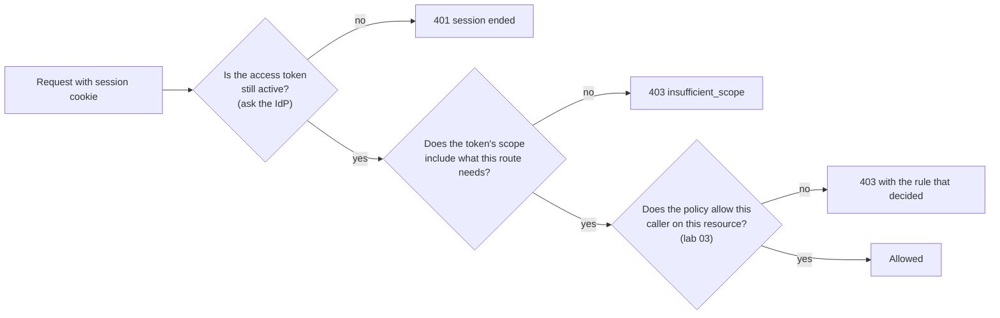
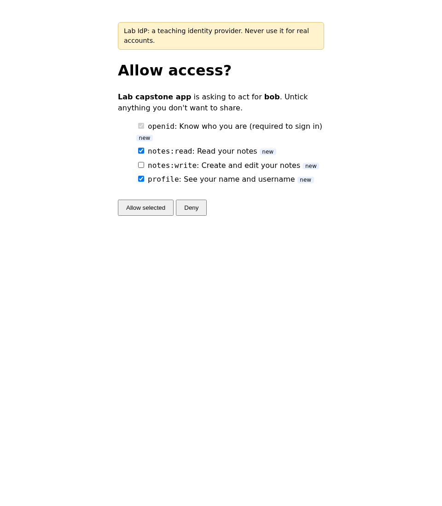
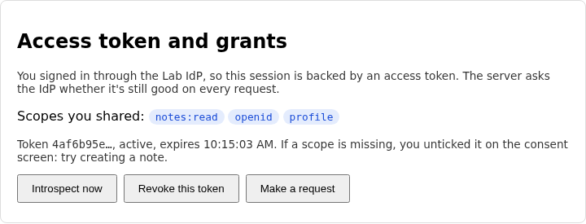
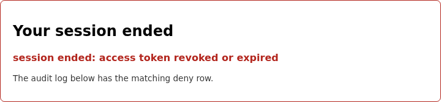
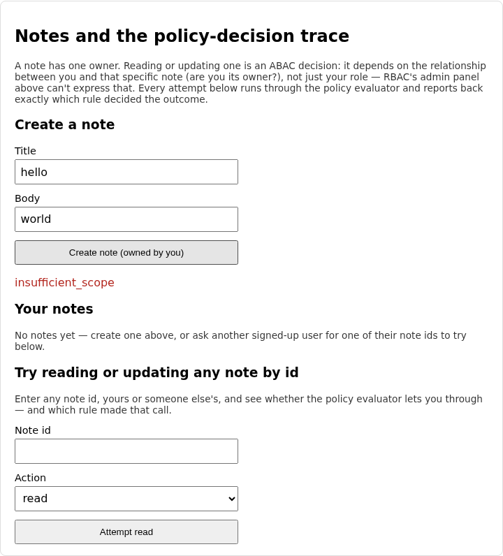

# Lab 05: consent, scopes and revocation

Lab 04 let people sign in through the Lab IdP, but the app still got
everything it asked for and a login lasted until the token ran out. This
lab changes both. The IdP will ask the user which permissions to hand over,
and the app will only get the ones they tick. Then you'll add a way to take
a token back, and watch a live session die on the user's next click.

You can see it all happen: a consent screen where unticking a box changes
what the app can do, a panel showing the scopes the IdP actually granted,
and a session that ends with a deny row in the audit log the moment you
revoke.

## What you'll learn

- How a consent screen turns the user's choices into the `scope` of an
  access token, and why the IdP, not the app, must decide what's granted
- What incremental consent means: asking again only when the app wants
  something new
- Why a signed token isn't enough on its own when you need revocation, and
  what introspection costs and buys
- Why checking a scope means comparing whole names, not searching a string

??? note "Closing the loop on lab 04 (skip this if you finished it)"

    ### The three fixes

    **The IdP's PKCE check.** The starter accepted every verifier. The fix
    recomputes the S256 challenge and compares it in constant time:

    ```python title="solution/idp/lab_idp/oauth.py"
    def verify_pkce(code_verifier: str, code_challenge: str) -> bool:
        """Does `code_verifier` hash to the `code_challenge` the client sent when
        it started the flow? This is the one check that stops someone who stole
        the authorization code from redeeming it."""
        return hmac.compare_digest(s256_challenge(code_verifier), code_challenge)
    ```

    `compare_digest` takes about the same time however many leading
    characters match, so a guesser can't learn the challenge one byte at a
    time from response timing. The code is single use and burned on the first
    attempt, which already limits guessing, but the constant-time habit
    costs nothing.

    **The app's challenge.** The starter sent the verifier as its own
    challenge. The fix hashes it:

    ```python title="solution/backend/app/oidc_client.py"
    def make_pkce_pair() -> tuple[str, str]:
        """Return `(code_verifier, code_challenge)` for one login attempt.

        The verifier is a high-entropy secret the app keeps. The challenge is
        what it sends to the IdP up front: the SHA-256 hash of the verifier,
        base64url-encoded without padding (the S256 method from RFC 7636).
        """
        verifier = secrets.token_urlsafe(48)
        digest = hashlib.sha256(verifier.encode("ascii")).digest()
        challenge = base64.urlsafe_b64encode(digest).rstrip(b"=").decode("ascii")
        return verifier, challenge
    ```

    **ID token validation.** The starter decoded the claims without checking
    anything. The fix does five checks, and the order is deliberate: look at
    the header before trusting any of it, pin the algorithm, only then fetch a
    key and let PyJWT verify signature, issuer, audience and expiry together,
    and finally compare the nonce:

    ```python title="solution/backend/app/oidc_client.py"
    def validate_id_token(id_token: str, *, expected_nonce: str) -> dict:
        """Check an ID token before believing anything in it, and return its
        claims. Raise `OidcError` (with a specific reason) if it fails any check.

        An ID token is only evidence of who logged in if: the IdP's key really
        signed it, it was issued by the IdP we expect, it was issued for *this*
        app, it hasn't expired, and it answers *this* login attempt (the nonce).
        """
        try:
            header = jwt.get_unverified_header(id_token)
        except jwt.InvalidTokenError as e:
            raise OidcError("ID token is not well-formed") from e
        if header.get("alg") != "RS256":
            raise OidcError(f"unexpected signing algorithm {header.get('alg')!r}, expected RS256")
        key = _signing_key_for(header.get("kid"))
        try:
            claims = jwt.decode(
                id_token,
                key=key,
                algorithms=["RS256"],
                audience=CLIENT_ID,
                issuer=ISSUER,
                options={"require": ["exp", "iat", "iss", "aud", "sub"]},
            )
        except jwt.ExpiredSignatureError as e:
            raise OidcError("ID token expired") from e
        except jwt.InvalidAudienceError as e:
            raise OidcError("ID token audience is not this client") from e
        except jwt.InvalidIssuerError as e:
            raise OidcError("ID token issuer is not the Lab IdP") from e
        except jwt.InvalidSignatureError as e:
            raise OidcError("ID token signature is invalid") from e
        except jwt.InvalidTokenError as e:
            raise OidcError(f"ID token rejected: {e}") from e
        if not secrets.compare_digest(str(claims.get("nonce", "")), expected_nonce):
            raise OidcError("ID token nonce does not match this login attempt")
        return claims
    ```

    Every `raise` has its own reason string. That's what lets the self-check
    tests, and later the audit log, say which check caught an attack instead
    of just "login failed".

    ### Discussing lab 04's going further questions

    One perspective, not a graded answer key.

    **`state` against PKCE.** They stop different attackers. `state` stops
    login CSRF: someone gets your browser to finish *their* login, so you end
    up signed in to their account. It ties the callback to the browser that
    started the flow. PKCE stops code interception: someone who copies the
    code from a redirect can't redeem it without the verifier. A callback
    with a stolen but valid code and no matching `state` fails the first. A
    legitimate `state` with a stolen code fails the second. Neither covers
    the other.

    **Using the access token.** A separate API has to check the signature
    and issuer like the app did, and check `aud` too, but the audience it
    wants is itself, not the client. It must never accept an ID token as an
    API credential: an ID token says who logged in to *the client*, and
    nothing about what the holder may do. Lab 05 starts down this road, with
    the added twist that the API asks the IdP instead of verifying locally.

    **JWKS refetching.** Without the refetch, a key rotation breaks every
    login until the cache is cleared. With an unlimited one, an attacker can
    send tokens with random `kid` values and make the app hammer the IdP. The
    middle path is a refetch at most every few seconds, with unknown ids
    remembered as unknown. This lab's version refetches once per validation,
    which an attacker can still amplify. It's fine for a lab and wrong for
    production.

    **Locking down the trace endpoint.** The cleanest fix is a cookie. When
    the login starts, set an `HttpOnly` cookie holding the trace id, and
    serve a trace only to a browser that presents the matching cookie. A
    failed login has no session, but it does have that cookie, so the person
    who just failed can still see why, and nobody else can.

## The flow, one message at a time

Three new things happen on top of lab 04's login: the user is asked what to
share, the token carries the answer, and the app keeps asking the IdP
whether the token is still good. Step through it, and pay attention to
where the decision about each scope gets made.

<!-- stepper: flows/consent-revocation.flow -->
<div class="stepper" markdown>

<figure class="stepper-diagram">
<svg class="flow" viewBox="0 0 700 652" role="img" aria-label="Sequence diagram: Browser, Client app, Lab IdP">
<g class="actor"><rect x="45" y="8" width="110" height="34" rx="6"/><text x="100" y="30" text-anchor="middle">Browser</text></g>
<g class="actor"><rect x="295" y="8" width="110" height="34" rx="6"/><text x="350" y="30" text-anchor="middle">Client app</text></g>
<g class="actor"><rect x="545" y="8" width="110" height="34" rx="6"/><text x="600" y="30" text-anchor="middle">Lab IdP</text></g>
<line class="life" x1="100" y1="42" x2="100" y2="642"/>
<line class="life" x1="350" y1="42" x2="350" y2="642"/>
<line class="life" x1="600" y1="42" x2="600" y2="642"/>
<g class="msg" id="m1"><line x1="100" y1="100" x2="591" y2="100"/><polygon points="600,100 591,95 591,105"/><text x="350" y="93" text-anchor="middle">1 username + password</text></g>
<g class="msg" id="m2"><line x1="600" y1="158" x2="109" y2="158"/><polygon points="100,158 109,153 109,163"/><text x="350" y="151" text-anchor="middle">2 consent screen</text></g>
<g class="secret" id="s2_1"><rect x="452" y="164" width="138" height="22"/><text x="521" y="179" text-anchor="middle">checks saved consent</text></g>
<g class="msg" id="m3"><line x1="100" y1="216" x2="591" y2="216"/><polygon points="600,216 591,211 591,221"/><text x="350" y="209" text-anchor="middle">3 ticked boxes only</text></g>
<g class="secret" id="s3_1"><rect x="464" y="222" width="126" height="22"/><text x="527" y="237" text-anchor="middle">grants only ticked</text></g>
<g class="msg" id="m4"><line x1="600" y1="274" x2="359" y2="274"/><polygon points="350,274 359,269 359,279"/><text x="475" y="267" text-anchor="middle">4 access token + scope</text></g>
<g class="msg" id="m5"><line x1="350" y1="332" x2="591" y2="332"/><polygon points="600,332 591,327 591,337"/><text x="475" y="325" text-anchor="middle">5 POST /introspect</text></g>
<g class="msg" id="m6"><line x1="600" y1="390" x2="359" y2="390"/><polygon points="350,390 359,385 359,395"/><text x="475" y="383" text-anchor="middle">6 active + scopes</text></g>
<g class="msg" id="m7"><line x1="350" y1="448" x2="591" y2="448"/><polygon points="600,448 591,443 591,453"/><text x="475" y="441" text-anchor="middle">7 POST /revoke</text></g>
<g class="secret" id="s7_1"><rect x="470" y="454" width="120" height="22"/><text x="530" y="469" text-anchor="middle">remembers the jti</text></g>
<g class="msg" id="m8"><line x1="350" y1="506" x2="591" y2="506"/><polygon points="600,506 591,501 591,511"/><text x="475" y="499" text-anchor="middle">8 POST /introspect</text></g>
<g class="msg" id="m9"><line x1="600" y1="564" x2="359" y2="564"/><polygon points="350,564 359,559 359,569"/><text x="475" y="557" text-anchor="middle">9 active = false</text></g>
</svg>
</figure>

<div class="step" data-title="The user signs in at the IdP" data-hl="m1" markdown>
Same as lab 04: the password goes to the IdP and nowhere else. What's new
is what happens next.
</div>

<div class="step" data-title="The IdP asks what the app may do" data-hl="m2 s2_1" markdown>
The app asked for four scopes. The IdP compares them with what this user
has already agreed to share with this app. Anything new means a consent
screen. A user who has already agreed to everything skips it.
</div>

<div class="step" data-title="The user decides, scope by scope" data-hl="m3 s3_1" markdown>
Each box is a scope. The IdP keeps only the ones that were requested,
known and ticked. Whatever it keeps goes into the access token, so this
is the moment a permission is given or withheld.
</div>

<div class="step" data-title="The scopes travel inside the token" data-hl="m4" markdown>
After the usual code and PKCE exchange, the app receives an access
token. Its `scope` claim lists exactly what the user agreed to. The app
never gets to widen that list.
</div>

<div class="step" data-title="The app checks the token on every request" data-hl="m5" markdown>
The token is a signed JWT, so the app could just verify it locally. It
asks the IdP instead, because only the IdP knows whether the token was
revoked after it was signed.
</div>

<div class="step" data-title="The IdP answers with the live state" data-hl="m6" markdown>
An active token comes back with its scopes, and the app checks the
route's required scope against them. This round trip is the price of being
able to revoke.
</div>

<div class="step" data-title="The user revokes the token" data-hl="m7 s7_1" markdown>
Revocation writes the token's `jti` (its unique id) to a list. The token
itself still verifies and hasn't expired. Nothing about it changed.
</div>

<div class="step" data-title="The next request finds the token dead" data-hl="m8" markdown>
The app asks again, exactly as it does on every request.
</div>

<div class="step" data-title="The IdP says the token is no longer active" data-hl="m9" markdown>
The app ends the session and records a deny in the audit log. Revocation
took effect within one request, with no waiting for the token to expire.
</div>

</div>
<!-- /stepper -->

Once a request reaches an endpoint, it has to clear three gates in order.
Lab 03's policy evaluator is still the last one:



Two ideas carry the lab.

**A scope is a ceiling the user sets, not a permission.** It says what the
user lets this app do on their behalf. It doesn't say the user may do that
thing. A user with `notes:write` granted still can't edit someone else's
note, because the policy gate still runs. And a user with full rights who
ticks only `notes:read` has made the app read-only, whatever they could do
themselves.

**Revocation costs a round trip.** A signed token is valid anywhere, any time
before it expires, with no one to ask. That's its strength and the reason
revoking it is hard. To honour a revocation, the app has to ask somebody who
knows, and that is what introspection is for. You pay one request to the IdP
per request to the app, and in exchange a revoked token stops working on the
very next click instead of at expiry.

Try the whole chain in this widget before you write any code. The app asks,
the user ticks, the IdP grants, and the app checks. Your task: ask for
`notes:write-all`, tick only `notes:read`, and see what the routes allow.
Then switch on each "starter behaviour" box, one at a time, and watch which
bug lets the extra scope through.

<iframe class="widget-frame" src="../widgets/consent-scopes.html" title="Interactive: scopes, consent and revocation" height="640" loading="lazy"></iframe>

## Prerequisites and setup

- Python 3.12, Node.js (any recent version, built on Node 24), `uv` or `pip`
- Lab 04 completed, since this lab's starter is lab 04's solution plus the
  consent screen, introspection and revocation endpoints, and three gaps

You'll run the same three processes as lab 04. Check that ports 5173, 8000
and 9000 are free, then:

```sh
cd labs/lab-05-consent-revocation/starter/idp
uv venv .venv --python 3.12
uv pip install -r requirements.txt --python .venv/bin/python
.venv/bin/uvicorn lab_idp.main:app --port 9000
```

```sh
cd labs/lab-05-consent-revocation/starter/backend
uv venv .venv --python 3.12
uv pip install -r requirements.txt --python .venv/bin/python
.venv/bin/uvicorn app.main:app --reload
```

```sh
cd labs/lab-05-consent-revocation/starter/frontend
npm install
npm run dev
```

The IdP remembers consent in its own database. To see the consent screen
again for an account that has already agreed, stop the IdP and delete
`lab05-idp.db` in the `idp` folder. The demo accounts are unchanged from lab
04: `alice`, `bob` and `carol`, password `<name>-lab-pass`, fixed and
localhost only.

## Your tasks

Three gaps, each behind something you can see.

!!! danger "Intentionally vulnerable code: localhost teaching only"
    The starter lets an app grant itself any scope, keeps honouring revoked
    tokens, and matches scopes by substring. They are real authorization
    holes, in the spirit of ADR-0008. Fix each in this lab, and never copy
    the starter's versions anywhere real.

### Task 1: grant only what the user approved

Open `starter/idp/lab_idp/oauth.py` and find `granted_scopes`:

```python title="starter/idp/lab_idp/oauth.py"
def granted_scopes(requested: set[str], approved: set[str]) -> set[str]:
    """Which scopes does the app actually get? Only ones it asked for, the
    user approved, and this IdP knows about. `openid` is always included when
    requested: without it there is no sign-in to consent to."""
    # TODO(lab-05): this hands the app everything it asked for, ignoring
    # both the boxes the user left unticked and scopes this IdP has never
    # heard of. The result is what goes into the access token, so an app can
    # grant itself any permission by simply requesting it. Return only the
    # requested scopes that are known (see SCOPES) AND approved by the user,
    # always keeping the required ones (REQUIRED_SCOPES).
    return set(requested)
```

??? question "Before you fix it: sign in as `bob`, untick `notes:write` on the consent screen, and allow. Can bob create a note?"
    Yes. The checkbox does nothing, because the starter returns whatever the
    app requested. The consent screen is theatre until this function does
    its job. You'll see `notes:write` in the scope list on the token panel
    even though you unticked it.

Sign in through the app as `bob` and look at the consent screen:



Make the function return only scopes that were requested, that this IdP
knows about (the `SCOPES` table above it), and that the user approved.
The required scopes always stay. Restart the IdP after your change and try
again with a fresh `lab05-idp.db`. This time the token panel should list
only what you left ticked:



### Task 2: make introspection notice revoked tokens

In the same file, find `is_revoked`:

```python title="starter/idp/lab_idp/oauth.py"
def is_revoked(conn: sqlite3.Connection, jti: str) -> bool:
    """Has the token with this `jti` been revoked?"""
    # TODO(lab-05): this says no token has ever been revoked, so introspection
    # keeps reporting a revoked token as active until it expires on its own.
    # Look the jti up in the `revoked_tokens` table.
    return False
```

Introspection already checks the signature, the issuer, the audience and
the expiry. It also calls this function, and the starter's answer is always
no. Look the token's `jti` up in the `revoked_tokens` table, which
`revoke_token` just above already fills in.

??? question "With the starter as it is, click Revoke this token and then Make a request. What happens to the session?"
    Nothing. The revoke call succeeds and the IdP records it, but
    introspection never looks at the list, so the token stays active and the
    session carries on. A revocation that doesn't revoke looks exactly like
    one that does until somebody checks.

Fix it, restart the IdP, and sign in again. Click **Revoke this token**,
then **Make a request**. The session ends, and the banner says why:



### Task 3: compare scopes by whole name

Open `starter/backend/app/oidc_client.py` and find `has_scope`:

```python title="starter/backend/app/oidc_client.py"
def has_scope(granted: str, required: str) -> bool:
    """Does the space-delimited `granted` string include the scope `required`?"""
    # TODO(lab-05): this asks whether `required` appears anywhere inside the
    # granted *string*, so a token holding `notes:write-all` (or just
    # `xnotes:write`) passes a check for `notes:write`. Scopes are a
    # space-delimited list of whole names: compare against the list, not the
    # raw text.
    return required in granted
```

??? question "Which of these would the starter wrongly accept for a route that needs `notes:write`: a token holding `notes:write-all`, one holding `xnotes:write`, one holding `notes:read`?"
    The first two. `required in granted` is a substring search on the raw
    string, so any scope that merely *contains* the name passes. The third
    fails correctly. Substring bugs like this are how a scope called
    `notes:write-all` or a vendor's `adminnotes:write` ends up opening doors
    it shouldn't.

A scope string is a space-separated list of whole names (RFC 6749 section
3.3). Compare against the list, not the text. The self-check includes the
look-alike cases, and the effect in the browser is the denial you'll see
when bob, who withheld `notes:write`, tries to create a note:



(That screenshot needs task 1 done as well, since without it bob always has
the scope.)

## You're done when

Run the self-check suite from `starter/backend`:

```sh
.venv/bin/pytest tests/ -v
```

- [ ] The four `test_granted_scopes_...` tests pass, and
      `test_an_unticked_scope_is_missing_from_the_access_token` and
      `test_the_consent_decision_is_audited_with_what_was_withheld` pass:
      only ticked, known, requested scopes reach the token, and the audit
      log names what was withheld
- [ ] `test_is_revoked_reports_revoked_and_unknown_tokens_correctly` and
      `test_a_revoked_token_introspects_as_inactive` pass
- [ ] `test_revoking_from_the_app_ends_the_session_on_the_next_request` and
      `test_the_denial_after_revocation_is_audited` pass: revocation takes
      effect within one request and leaves a deny row
- [ ] `test_has_scope_matches_whole_scope_names_only` passes, and so do the
      two `insufficient_scope` tests
- [ ] Every other test still passes, including everything carried over from
      labs 00-04
- [ ] In the browser, a user who unticks `notes:write` is denied with
      `insufficient_scope` when creating a note, can still list notes, and
      sees only the ticked scopes on the token panel
- [ ] In the browser, Revoke this token followed by Make a request ends the
      session with a banner, and the audit log shows the matching deny row

## Going further

No self-check for these.

1. The consent screen records what the user agreed to, but there's no page
   where they can see or withdraw it later. What would that page need to
   read and write, and what should happen to tokens already issued under a
   consent the user just withdrew?
2. Introspection is one round trip per request. Name two ways to cut that
   cost, and say what each one gives up in how fast a revocation takes
   effect.
3. The app fails closed: if it can't reach the IdP, it treats the token as
   inactive. Describe a scenario where that is the right call and one where
   it would cause real harm.
4. A scope says what the user lets the app do. The policy evaluator from lab
   03 says what the user may do. Give an example where the scope check and
   the policy check disagree, and say which one should win.

## Further reading

- [RFC 7662: OAuth 2.0 Token Introspection](https://datatracker.ietf.org/doc/html/rfc7662)
- [RFC 7009: OAuth 2.0 Token Revocation](https://datatracker.ietf.org/doc/html/rfc7009)
- [RFC 6749 section 3.3: Access Token Scope](https://datatracker.ietf.org/doc/html/rfc6749#section-3.3)
- [OAuth 2.0 Security Best Current Practice (RFC 9700)](https://datatracker.ietf.org/doc/html/rfc9700)
