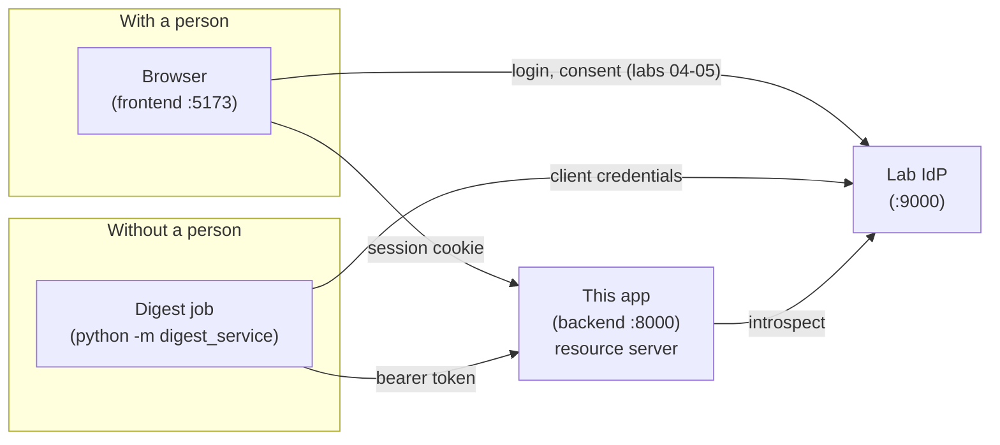
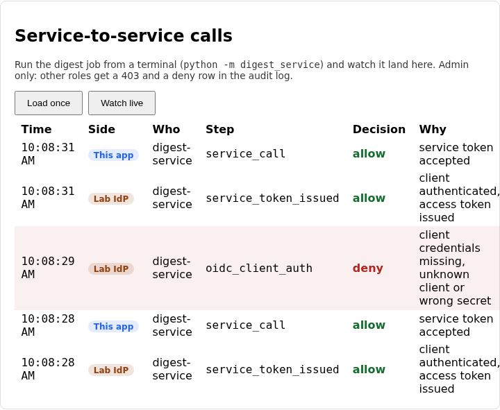

# Lab 06: service-to-service authentication

So far every caller has been a person. This lab adds one that isn't: a
nightly digest job that wakes up on a schedule, with nobody to type a
password, and needs the app's numbers. It has to prove who it is and be
limited to what it was set up to do, and the app has to be able to refuse it
and show why.

You'll run the job from a terminal and watch each attempt land in an admin
panel from both sides at once: what the IdP decided about the job's
credentials, and what the app decided about its token. Give the job a wrong
secret and a deny row appears. Ask for more than it's allowed and watch the
IdP quietly hand back less.

## What you'll learn

- How the client credentials flow lets a service get a token as itself, and
  what is missing from it compared with the login flow (no browser, no
  user, no consent)
- Why a client id isn't a credential, and why services need their scopes
  fixed at registration rather than chosen at run time
- Why a service endpoint has to check what kind of token it was handed, not
  only that the token is valid
- How to run several services together with docker-compose, and why each
  still runs on its own

??? note "Closing the loop on lab 05 (skip this if you finished it)"

    ### The three fixes

    **Granting only what was approved.** The starter returned whatever the
    app asked for. The fix keeps a scope only if it was requested, is known to
    the IdP, and was either ticked or required:

    ```python title="solution/idp/lab_idp/oauth.py"
    def granted_scopes(requested: set[str], approved: set[str]) -> set[str]:
        """Which scopes does the app actually get? Only ones it asked for, the
        user approved, and this IdP knows about. `openid` is always included when
        requested: without it there is no sign-in to consent to."""
        allowed = {s for s in requested if s in SCOPES}
        return {s for s in allowed if s in approved or s in REQUIRED_SCOPES}
    ```

    The consent screen only mattered once this function stopped trusting the
    request. Until then, unticking a box changed the page and nothing else.

    **Honouring revocation.** The starter said no token had ever been
    revoked. The fix looks the token's `jti` up in the table `revoke_token`
    writes to:

    ```python title="solution/idp/lab_idp/oauth.py"
    def is_revoked(conn: sqlite3.Connection, jti: str) -> bool:
        """Has the token with this `jti` been revoked?"""
        return conn.execute("SELECT 1 FROM revoked_tokens WHERE jti = ?", (jti,)).fetchone() is not None
    ```

    The token's signature never stopped verifying and its expiry never
    passed. Revocation is a fact held outside the token, which is why
    introspection has to ask somebody.

    **Matching scopes by whole name.** The starter searched the raw string.
    The fix splits it into the list it really is:

    ```python title="solution/backend/app/oidc_client.py"
    def has_scope(granted: str, required: str) -> bool:
        """Does the space-delimited `granted` string include the scope `required`?"""
        return required in granted.split()
    ```

    ### Discussing lab 05's going further questions

    One perspective, not a graded answer key.

    **Withdrawing consent later.** The page needs to read the `consents`
    table for the signed-in user and delete a row when they withdraw. The
    harder question is the tokens already issued. With 15-minute access
    tokens you can let them expire and accept a short tail. If that isn't
    acceptable, the IdP has to remember which tokens it issued under each
    consent (their `jti`s) so withdrawing can revoke them too.

    **Cutting the introspection cost.** One way is to cache each answer for a
    few seconds, which cuts the traffic and means a revocation can take up to
    that long to land. Another is to verify the JWT locally for ordinary reads
    and introspect only for sensitive actions, which makes revocation slow for
    the ordinary ones. A third, more work, is for the IdP to push revocations
    to the services that cache. You always trade freshness for load.

    **Failing closed.** It's right when the data is sensitive and an outage
    that locks people out is safer than a hole, which describes most of this
    course. It does real harm when availability is the safety property, such as
    an emergency lookup, or for public read-only content where a revoked
    token isn't worth taking the site down. A common middle path is to fail
    closed for writes and serve cached answers for reads.

    **Scope against policy.** Neither wins, because the effective permission is
    the intersection. A scope of `notes:write` doesn't let you edit someone
    else's note, since the policy says no. A user who may edit a note but
    ticked only `notes:read` can't edit it through this app either, since the
    scope says no. Both gates have to say yes.

## The flow, one message at a time

Three parties this time, and none of them is a browser: the digest job, the
IdP and the app. Step through it and notice how much of lab 04's login
machinery isn't here, and which new questions take its place.

<!-- stepper: flows/client-credentials.flow -->
<div class="stepper" markdown>

<figure class="stepper-diagram">
<svg class="flow" viewBox="0 0 700 594" role="img" aria-label="Sequence diagram: Digest job, Lab IdP, This app">
<g class="actor"><rect x="45" y="8" width="110" height="34" rx="6"/><text x="100" y="30" text-anchor="middle">Digest job</text></g>
<g class="actor"><rect x="295" y="8" width="110" height="34" rx="6"/><text x="350" y="30" text-anchor="middle">Lab IdP</text></g>
<g class="actor"><rect x="545" y="8" width="110" height="34" rx="6"/><text x="600" y="30" text-anchor="middle">This app</text></g>
<line class="life" x1="100" y1="42" x2="100" y2="584"/>
<line class="life" x1="350" y1="42" x2="350" y2="584"/>
<line class="life" x1="600" y1="42" x2="600" y2="584"/>
<g class="msg" id="m1"><line x1="100" y1="100" x2="341" y2="100"/><polygon points="350,100 341,95 341,105"/><text x="225" y="93" text-anchor="middle">1 POST /token, id + secret</text></g>
<g class="secret" id="s2_1"><rect x="360" y="164" width="120" height="22"/><text x="420" y="179" text-anchor="middle">checks the secret</text></g>
<g class="secret" id="s3_1"><rect x="360" y="222" width="168" height="22"/><text x="444" y="237" text-anchor="middle">keeps allowed scopes only</text></g>
<g class="msg" id="m4"><line x1="350" y1="274" x2="109" y2="274"/><polygon points="100,274 109,269 109,279"/><text x="225" y="267" text-anchor="middle">4 access token + stats:read</text></g>
<g class="msg" id="m5"><line x1="100" y1="332" x2="591" y2="332"/><polygon points="600,332 591,327 591,337"/><text x="350" y="325" text-anchor="middle">5 GET /internal/stats + token</text></g>
<g class="msg" id="m6"><line x1="600" y1="390" x2="359" y2="390"/><polygon points="350,390 359,385 359,395"/><text x="475" y="383" text-anchor="middle">6 POST /introspect</text></g>
<g class="msg" id="m7"><line x1="350" y1="448" x2="591" y2="448"/><polygon points="600,448 591,443 591,453"/><text x="475" y="441" text-anchor="middle">7 active, sub, scope</text></g>
<g class="msg" id="m8"><line x1="600" y1="506" x2="109" y2="506"/><polygon points="100,506 109,501 109,511"/><text x="350" y="499" text-anchor="middle">8 200 + the numbers</text></g>
<g class="secret" id="s8_1"><rect x="440" y="512" width="150" height="22"/><text x="515" y="527" text-anchor="middle">service token + scope?</text></g>
</svg>
</figure>

<div class="step" data-title="A job with no human asks for a token" data-hl="m1" markdown>
The nightly digest job wakes up on a schedule. No browser, no login page,
no consent screen: nobody is there. It does the only thing it can, which is
to present its own credentials and ask for an access token.
</div>

<div class="step" data-title="The IdP checks who is calling" data-hl="s2_1" markdown>
A client id is a name, not a secret. It shows up in logs, config files
and URLs. The proof is the secret, which the IdP stores only as a hash and
compares in constant time.
</div>

<div class="step" data-title="The IdP decides what the job may hold" data-hl="s3_1" markdown>
The job asked for some scopes. The IdP intersects them with the list the
job was registered with. The job's permissions come from that registration,
never from what it asks for on the day.
</div>

<div class="step" data-title="The token comes back with no user in it" data-hl="m4" markdown>
The token's `sub` is the job's own client id, because the job is acting
as itself. That detail matters in step 7.
</div>

<div class="step" data-title="The job calls the app with the token" data-hl="m5" markdown>
The token travels in an `Authorization: Bearer` header. The app has
never heard of this job, so everything it learns comes from the token.
</div>

<div class="step" data-title="The app asks the IdP whether to believe it" data-hl="m6" markdown>
Same call as lab 05, with the app authenticating as a resource server.
This is also what makes revocation work for services: revoke the token and
the very next call fails.
</div>

<div class="step" data-title="The IdP describes the token" data-hl="m7" markdown>
The answer says the token is active and gives its `sub`, `client_id` and
`scope`. A user's token and a service's token both look like this. The app
has to tell them apart itself.
</div>

<div class="step" data-title="The app lets the call through, or doesn&#x27;t" data-hl="m8 s8_1" markdown>
Three checks, in order: the token is active, it was issued to a service
(not a person), and it holds `stats:read`. Skip the middle one and a
human's token with the right scope opens a door built for machines.
</div>

</div>
<!-- /stepper -->

Here is what you'll be running. Every box is its own process, and they all
talk over HTTP:



Two ideas carry the lab.

**A service has no one to vouch for it, so its registration does.** A person
ticks boxes at a consent screen. A service can't, so what it may hold is
decided ahead of time and written down at the IdP as an allow-list. If the
job asks for more, it gets the overlap and nothing else. That makes the
registration the place to review, and it makes a stolen job credential only
as dangerous as the job was.

**Valid isn't the same as meant for this.** The IdP issues access tokens to
people and to services, and introspection answers the same way for both. An
endpoint built for machines can't stop at "the token is active". It has to
check that the token was issued to a service acting as itself (a person's
token has a `sub` that is a user, a service's has `sub` equal to its own
client id) and that it holds the scope this endpoint needs.

!!! note "Why a secret and not a certificate"
    Production systems often authenticate services with mutual TLS or a
    signed assertion instead of a shared secret, because a secret can be
    copied. This lab uses a secret held as a hash, which is the simplest
    thing that shows the whole flow. The going further questions pick up
    the alternatives.

## Prerequisites and setup

- Python 3.12, Node.js (any recent version, built on Node 24), `uv` or `pip`
- Lab 05 completed, since this lab's starter is lab 05's solution plus the
  client credentials grant, the digest service, and three gaps
- Optional: Docker, if you'd rather start everything with one command

Check that ports 5173, 8000 and 9000 are free. You can run each piece on
its own, as in the last two labs:

```sh
cd labs/lab-06-service-to-service/starter/idp
uv venv .venv --python 3.12
uv pip install -r requirements.txt --python .venv/bin/python
.venv/bin/uvicorn lab_idp.main:app --port 9000
```

```sh
cd labs/lab-06-service-to-service/starter/backend
uv venv .venv --python 3.12
uv pip install -r requirements.txt --python .venv/bin/python
.venv/bin/uvicorn app.main:app --reload
```

```sh
cd labs/lab-06-service-to-service/starter/frontend
npm install
npm run dev
```

The digest job needs only `httpx`. Install it into the backend's
environment, or its own:

```sh
cd labs/lab-06-service-to-service/starter/digest
uv venv .venv --python 3.12
uv pip install -r requirements.txt --python .venv/bin/python
.venv/bin/python -m digest_service
```

Or run the three services together with Docker, from
`labs/lab-06-service-to-service/starter`:

```sh
docker compose up --build              # idp, backend, frontend
docker compose run --rm digest         # run the job once
```

Compose is a convenience: nothing in the labs needs it, and each service
behaves identically either way. To watch the job's calls, sign in as the
seeded `admin` (password `lab02-admin-do-not-reuse`, fixed and localhost
only) and open the **Service-to-service calls** panel.

## Your tasks

Three gaps, in the order the request meets them.

!!! danger "Intentionally vulnerable code: localhost teaching only"
    The starter lets anyone who knows a client id get a token, lets the job
    hold any scope it asks for, and opens a service-only endpoint to any
    active token. They are real holes, in the spirit of ADR-0008. Fix each
    one here and never copy the starter's versions anywhere real.

### Task 1: check the service's secret

Open `starter/idp/lab_idp/oauth.py` and find `authenticate_client`:

```python title="starter/idp/lab_idp/oauth.py"
def authenticate_client(client_id: str, presented_secret: str) -> bool:
    """Is this a registered service client presenting its real secret?"""
    # TODO(lab-06): this lets in anyone who knows a service client's id, which
    # is not a secret (it appears in logs and URLs). Check the presented secret
    # too: hash it with SHA-256 and compare it to the client's stored
    # `secret_sha256`, using a constant-time comparison.
    return client_id in SERVICE_CLIENTS
```

??? question "Before you fix anything: run the job with a wrong secret (`python -m digest_service --secret wrong-secret`). Does it succeed?"
    Yes, it prints the numbers. The starter only checks that the client id
    is registered, and the id is public. Anyone who has seen the job's
    config can mint tokens as it. A credential check that never looks at the
    credential is the lab 04 PKCE bug again, in a new place.

The client's secret is stored only as a SHA-256 hash in `SERVICE_CLIENTS`.
Hash what was presented and compare the two with a constant-time
comparison. Restart the IdP, run the job with the wrong secret again, and
check the panel:



### Task 2: narrow what the service may hold

In the same file, find `scopes_for_service`:

```python title="starter/idp/lab_idp/oauth.py"
def scopes_for_service(client_id: str, requested: set[str]) -> set[str]:
    """Which of the requested scopes may this service client actually hold?"""
    # TODO(lab-06): this grants whatever the service asks for, so a compromised
    # digest job could ask for `notes:write` and get it. A service client's
    # permissions come from what it was registered for (`allowed_scopes`),
    # never from what it requests at run time. Narrow the request to that list.
    return set(requested)
```

??? question "Run `python -m digest_service --scope \"stats:read notes:write\"`. What does the line `scope granted:` print with the starter?"
    Both scopes. The job asked for a permission it was never registered for
    and got it, because the starter takes the request at its word. A
    compromised job could now ask for anything the IdP knows about.

A service's permissions come from its registration, `allowed_scopes` in
`SERVICE_CLIENTS`, and the request can only narrow them. Restart the IdP and
run the same command: the granted line should show just `stats:read`, and the
IdP's audit row names what was withheld.

### Task 3: accept only service tokens

Open `starter/backend/app/oidc_client.py` and find `service_token_allowed`:

```python title="starter/backend/app/oidc_client.py"
def service_token_allowed(result: dict, required_scope: str) -> tuple[bool, str]:
    """Should a request carrying this introspected token be let in to a
    service-only endpoint? Returns `(allowed, reason)`; the reason goes to
    the audit log either way.

    Service tokens and user tokens come from the same IdP and look alike, so
    "the IdP says it's active" isn't enough: the endpoint also has to confirm
    the token was issued to a service acting as itself (a human's token has a
    `sub` that is a user, a service's has `sub` equal to its own client id)
    and that it holds the scope this endpoint needs.
    """
    # TODO(lab-06): this lets in any active token, whoever it was issued to
    # and whatever it grants. That means a human's access token, or a
    # service token for some other job, opens an endpoint it was never meant
    # for. Check three things, in this order, and return a specific reason
    # for each failure: the token is active; it was issued to a service
    # (`sub` equal to `client_id`, not a user); it holds `required_scope`
    # (use `has_scope`).
    return bool(result.get("active")), "token is active"
```

??? question "Which of these would the starter let through to `/internal/stats`: a token issued to alice when she logged in, a service token for a different job, a revoked token?"
    The first two. The starter checks only that the token is active, and
    alice's login token is active. Only the revoked one is stopped, and only
    because the IdP's answer already says so. Valid is not the same as meant
    for this endpoint.

Implement the three checks in the order the comment gives, each with its own
reason string, because the audit log records that string for every decision.
The self-check feeds this function hand-built introspection results, so it
covers cases (a human's token holding `stats:read`) that you can't easily
produce from the browser.

## You're done when

Run the self-check suite from `starter/backend`:

```sh
.venv/bin/pytest tests/ -v
```

- [ ] The `test_authenticate_client_...` tests, the two
      `test_token_endpoint_refuses_...` tests and
      `test_a_refused_client_is_audited_as_a_deny` pass: a wrong or missing
      secret is refused with 401 and audited
- [ ] The `test_scopes_for_service_...` tests and the three tests about
      extra, refused and withheld scopes pass
- [ ] Every `test_service_token_allowed_...` test passes, along with
      `test_a_humans_access_token_cannot_open_the_stats_endpoint`
- [ ] `test_the_digest_job_completes_end_to_end` and
      `test_one_trace_id_connects_the_idp_and_the_app` pass
- [ ] Every other test still passes, including everything carried over from
      labs 00-05
- [ ] From a terminal, `python -m digest_service` prints the numbers and
      `scope granted: stats:read`; with `--secret wrong-secret` it fails at
      the token request
- [ ] As the seeded admin, the Service-to-service calls panel shows both
      sides of each attempt, and a signed-in non-admin gets a 403 there

## Going further

No self-check for these.

1. The job's secret sits in an environment variable and a hash sits at the
   IdP. A stolen copy of the secret works from anywhere, any time. Describe
   what mutual TLS or a signed client assertion changes about that, and what
   new thing you'd have to manage in exchange.
2. A service token lives five minutes. The job runs once a night. Should it
   cache the token between runs, and what should it do if the app rejects a
   token it believes is still fresh?
3. `/internal/stats` introspects every call. A service that calls a hundred
   times a second makes the IdP part of every request. Where would you put
   a limit, and what should the app do when the IdP is slow rather than
   down?
4. Today the app trusts `sub == client_id` to mean "this is a service". What
   would break if a user could register an account whose username equals a
   service's client id, and how would you close that off at the IdP?

## Further reading

- [RFC 6749 section 4.4: Client Credentials Grant](https://datatracker.ietf.org/doc/html/rfc6749#section-4.4)
- [RFC 8705: OAuth 2.0 Mutual-TLS Client Authentication](https://datatracker.ietf.org/doc/html/rfc8705)
- [RFC 7523: JWT Profile for Client Authentication](https://datatracker.ietf.org/doc/html/rfc7523)
- [Docker Compose overview](https://docs.docker.com/compose/)
