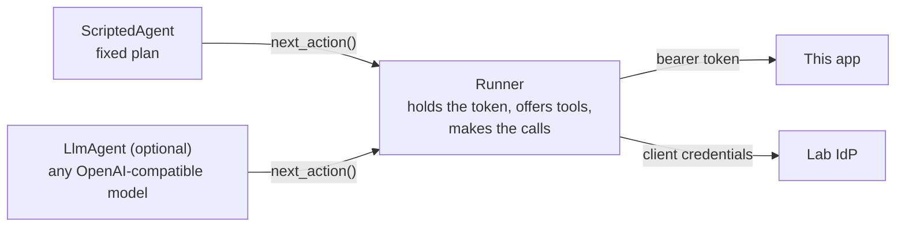
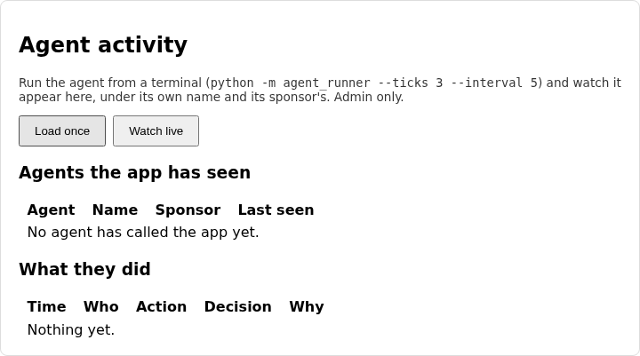
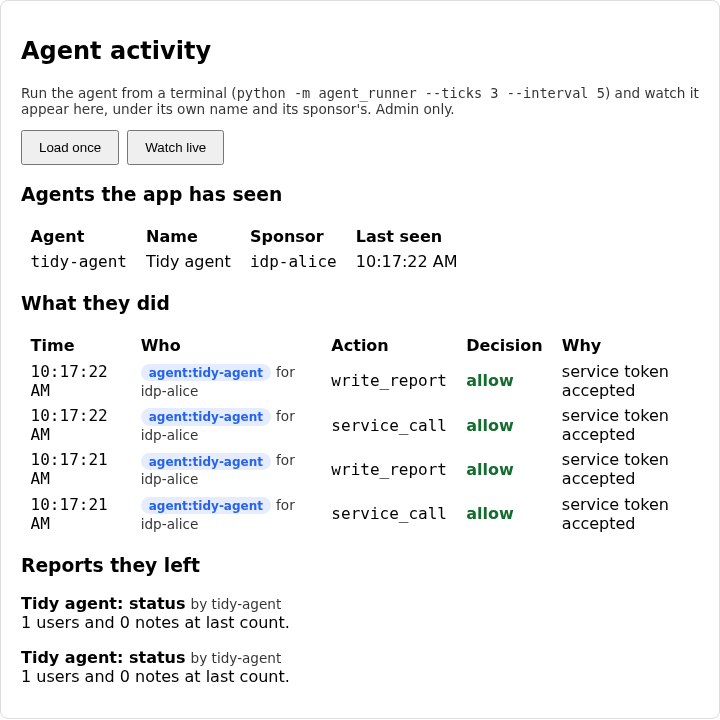

# Lab 07: an agent with its own identity

Everything so far has had either a person behind it or a job doing exactly
one fixed thing. An agent is different. It decides what to do next, it runs
without anyone watching, and it can be wrong, manipulated or compromised in
ways a script can't. Before you give one any tools, it needs to be a proper
identity: something you can name, hold to account and switch off.

This lab adds that identity, a small agent that uses it, and a dashboard to
watch it work. The agent is deterministic by default, a fixed script with no
language model, so every check in the lab is exact. A real model can drive it
instead through a clearly optional stretch path, and nothing in the lab
requires it.

## What you'll learn

- Why an agent is an identity of its own rather than a user with a flag, and
  what the app needs to record about it
- Why every agent needs a human sponsor, and how that shows up in the audit
  trail
- Why an agent that runs unattended has to refresh its own token before it
  expires
- The difference between a tool an agent is *offered* and one it would be
  *allowed* to use, and why you want both

??? note "Closing the loop on lab 06 (skip this if you finished it)"

    ### The three fixes

    **Authenticating the service.** The starter checked only that the client
    id was registered. The fix hashes what was presented and compares it to
    the stored hash in constant time:

    ```python title="solution/idp/lab_idp/oauth.py"
    def authenticate_client(client_id: str, presented_secret: str) -> bool:
        """Is this a registered service client presenting its real secret?"""
        # LAB:SOLUTION >>>
        client = SERVICE_CLIENTS.get(client_id)
        if client is None:
            return False
        presented = hashlib.sha256(presented_secret.encode()).hexdigest()
        return hmac.compare_digest(presented, client["secret_sha256"])
        # LAB:SOLUTION <<<
        # LAB:STARTER >>>
        # TODO(lab-06): this lets in anyone who knows a service client's id, which
        # is not a secret (it appears in logs and URLs). Check the presented secret
        # too: hash it with SHA-256 and compare it to the client's stored
        # `secret_sha256`, using a constant-time comparison.
        return client_id in SERVICE_CLIENTS
        # LAB:STARTER <<<
    ```

    A client id appears in config files, logs and URLs, so it only ever says
    who the caller claims to be. The secret is the proof.

    **Narrowing the scopes.** The starter granted whatever the job asked for.
    The fix intersects the request with the registered allow-list:

    ```python title="solution/idp/lab_idp/oauth.py"
    def scopes_for_service(client_id: str, requested: set[str]) -> set[str]:
        """Which of the requested scopes may this service client actually hold?"""
        # LAB:SOLUTION >>>
        return requested & SERVICE_CLIENTS[client_id]["allowed_scopes"]
        # LAB:SOLUTION <<<
        # LAB:STARTER >>>
        # TODO(lab-06): this grants whatever the service asks for, so a compromised
        # digest job could ask for `notes:write` and get it. A service client's
        # permissions come from what it was registered for (`allowed_scopes`),
        # never from what it requests at run time. Narrow the request to that list.
        return set(requested)
        # LAB:STARTER <<<
    ```

    The job's permissions are a fact about its registration. The request can
    only ever ask for less.

    **Accepting only service tokens.** The starter let any active token
    through. The fix checks three things in order, each with its own reason:

    ```python title="solution/backend/app/oidc_client.py"
    def service_token_allowed(result: dict, required_scope: str) -> tuple[bool, str]:
        """Should a request carrying this introspected token be let in to a
        service-only endpoint? Returns `(allowed, reason)`; the reason goes to
        the audit log either way.

        Service tokens and user tokens come from the same IdP and look alike, so
        "the IdP says it's active" isn't enough: the endpoint also has to confirm
        the token was issued to a service acting as itself (a human's token has a
        `sub` that is a user, a service's has `sub` equal to its own client id)
        and that it holds the scope this endpoint needs.
        """
        # LAB:SOLUTION >>>
        if not result.get("active"):
            return False, "token is not active (expired, revoked or invalid)"
        if result.get("sub") != result.get("client_id"):
            return False, "token was issued on behalf of a user, not to a service"
        if not has_scope(result.get("scope", ""), required_scope):
            return False, f"insufficient_scope: needs '{required_scope}', token grants '{result.get('scope', '')}'"
        return True, "service token accepted"
        # LAB:SOLUTION <<<
        # LAB:STARTER >>>
        # TODO(lab-06): this lets in any active token, whoever it was issued to
        # and whatever it grants. That means a human's access token, or a
        # service token for some other job, opens an endpoint it was never meant
        # for. Check three things, in this order, and return a specific reason
        # for each failure: the token is active; it was issued to a service
        # (`sub` equal to `client_id`, not a user); it holds `required_scope`
        # (use `has_scope`).
        return bool(result.get("active")), "token is active"
        # LAB:STARTER <<<
    ```

    The middle check is the subtle one. A person's token and a service's token
    are both valid and both carry scopes, so "valid" can't be the whole test.

    ### Discussing lab 06's going further questions

    One perspective, not a graded answer key.

    **Mutual TLS or a signed assertion instead of a secret.** A shared secret
    can be copied from anywhere it's stored, and the IdP has to store a hash of
    it. With mutual TLS, or a signed client assertion, the service holds a
    private key that is never sent anywhere. It proves it has it by signing,
    and the IdP only needs the public half. A leaked copy of the IdP's
    database gives an attacker nothing to impersonate with. What you take on in
    exchange is key issuance, rotation and revocation, which means running
    some kind of certificate authority.

    **Caching the token.** Yes, for its lifetime minus a little slack, since a
    token is good until it expires. If the app rejects a token the job thinks
    is fresh, the job should fetch a new one and retry exactly once. More than
    that and it's hammering the IdP over a problem a retry won't fix. This is
    the behaviour you'll write for the agent this lab.

    **Introspecting every call.** Put a short timeout on it, so a slow IdP
    can't tie up every request. You can cache a positive answer for a few
    seconds and accept that a revocation takes that long to land, and you can
    rate-limit per client id at the edge. When the IdP is slow, answer 503, not
    401, so well-behaved callers back off and retry instead of concluding their
    credentials are bad.

    **A user named like a service.** Today `sub == client_id` is the test, so a
    user who registered the name `digest-service` could confuse it. The IdP
    should keep the two namespaces apart, which it already half does by giving
    users a prefix, and better, say what kind of caller it is in the token
    itself. That is what `client_type` does in this lab.

## The flow, one message at a time

The agent has two halves: the part that decides (the agent) and the part that
acts (the runner, which holds the credentials and makes the calls). This
stepper treats them as one box on the left. Step through, and watch where the
agent's identity, its sponsor and its tools each get attached.

<!-- stepper: flows/agent-run.flow -->
<div class="stepper" markdown>

<figure class="stepper-diagram">
<svg class="flow" viewBox="0 0 700 652" role="img" aria-label="Sequence diagram: Agent runner, Lab IdP, This app">
<g class="actor"><rect x="45" y="8" width="110" height="34" rx="6"/><text x="100" y="30" text-anchor="middle">Agent runner</text></g>
<g class="actor"><rect x="295" y="8" width="110" height="34" rx="6"/><text x="350" y="30" text-anchor="middle">Lab IdP</text></g>
<g class="actor"><rect x="545" y="8" width="110" height="34" rx="6"/><text x="600" y="30" text-anchor="middle">This app</text></g>
<line class="life" x1="100" y1="42" x2="100" y2="642"/>
<line class="life" x1="350" y1="42" x2="350" y2="642"/>
<line class="life" x1="600" y1="42" x2="600" y2="642"/>
<g class="msg" id="m1"><line x1="100" y1="100" x2="341" y2="100"/><polygon points="350,100 341,95 341,105"/><text x="225" y="93" text-anchor="middle">1 POST /token, agent id + secret</text></g>
<g class="secret" id="s2_1"><rect x="360" y="164" width="132" height="22"/><text x="426" y="179" text-anchor="middle">adds type + sponsor</text></g>
<g class="msg" id="m3"><line x1="350" y1="216" x2="109" y2="216"/><polygon points="100,216 109,211 109,221"/><text x="225" y="209" text-anchor="middle">3 token, 2 min, 2 scopes</text></g>
<g class="secret" id="s4_1"><rect x="110" y="280" width="144" height="22"/><text x="182" y="295" text-anchor="middle">offers matching tools</text></g>
<g class="msg" id="m5"><line x1="100" y1="332" x2="591" y2="332"/><polygon points="600,332 591,327 591,337"/><text x="350" y="325" text-anchor="middle">5 GET /internal/stats + token</text></g>
<g class="msg" id="m6"><line x1="600" y1="390" x2="359" y2="390"/><polygon points="350,390 359,385 359,395"/><text x="475" y="383" text-anchor="middle">6 POST /introspect</text></g>
<g class="msg" id="m7"><line x1="350" y1="448" x2="591" y2="448"/><polygon points="600,448 591,443 591,453"/><text x="475" y="441" text-anchor="middle">7 active + agent + sponsor</text></g>
<g class="msg" id="m8"><line x1="600" y1="506" x2="109" y2="506"/><polygon points="100,506 109,501 109,511"/><text x="350" y="499" text-anchor="middle">8 200 + the numbers</text></g>
<g class="secret" id="s8_1"><rect x="440" y="512" width="150" height="22"/><text x="515" y="527" text-anchor="middle">audit: agent for alice</text></g>
<g class="secret" id="s9_1"><rect x="110" y="570" width="120" height="22"/><text x="170" y="585" text-anchor="middle">token near expiry</text></g>
</svg>
</figure>

<div class="step" data-title="The agent asks for a token as itself" data-hl="m1" markdown>
The agent has its own client id and secret, registered at the IdP like
lab 06's digest job. Nobody logs in for it. The runner is the program that
holds those credentials and carries out whatever the agent decides.
</div>

<div class="step" data-title="The IdP records what kind of caller this is" data-hl="s2_1" markdown>
The token will say `client_type: agent` and name a human `sponsor`, taken
from the registration. Those claims are how everything downstream can tell an
agent from a job, and find the person who answers for it.
</div>

<div class="step" data-title="The token comes back short-lived" data-hl="m3" markdown>
Agent tokens live two minutes, against five for an ordinary service.
What an agent does next isn't fixed in advance, so a stolen token should
be worth less.
</div>

<div class="step" data-title="The runner decides which tools the agent may even see" data-hl="s4_1" markdown>
The runner compares the token's scopes with its list of tools and offers
only the ones that match. An agent can only ask for tools it knows about,
so this is the first line of defence. The API is the second.
</div>

<div class="step" data-title="The agent picks an action and the runner calls the app" data-hl="m5" markdown>
The agent chose `get_stats`. The runner makes the call, attaching the
agent's bearer token. The agent itself never touches the credential.
</div>

<div class="step" data-title="The app asks the IdP about the token" data-hl="m6" markdown>
Same introspection as labs 05 and 06. The app trusts nothing in the
request except what the IdP says about the token.
</div>

<div class="step" data-title="The IdP says what kind of caller it is" data-hl="m7" markdown>
Along with `active` and the scopes, the answer now carries `client_type`,
`client_name` and `sponsor`.
</div>

<div class="step" data-title="The app files the call under the right identity" data-hl="m8 s8_1" markdown>
The audit row says an agent did this, which agent, and who sponsors it.
Misfile it as a plain service and the dashboard has nothing to show.
</div>

<div class="step" data-title="Minutes later, the runner refreshes before the token dies" data-hl="s9_1" markdown>
The agent runs unattended, so no one is around to log in again. The
runner checks the clock before each call and fetches a new token while the
old one still has a little life left, instead of finding out from a 401.
</div>

</div>
<!-- /stepper -->

The agent is built behind an interface, so the scripted version and the
optional model-driven one are interchangeable, and neither can bypass the
runner:



Three ideas carry the lab.

**An agent is its own kind of identity.** It has its own credentials, a type
the rest of the system can read, and a row in the app's `agents` table. It is
not a user with the password written on a sticky note. When something goes
wrong you need to ask "what did this agent do", and a user account can't answer
that cleanly.

**Someone answers for it.** Each agent names a human sponsor at the IdP, and
that name travels in the token and lands in every audit row. An agent whose
actions can't be traced to a person is an agent nobody feels responsible for.

**Offered is not the same as allowed.** The API will refuse a call outside the
agent's scopes. But an agent, and especially a model, can only ask for tools it
has been told exist. Offering fewer tools cuts down what it can attempt, keeps
the logs quiet, and means a refusal is a real signal rather than noise. The API
check stays as the second line, not the only one.

## Prerequisites and setup

- Python 3.12, Node.js (any recent version, built on Node 24), `uv` or `pip`
- Lab 06 completed, since this lab's starter is lab 06's solution plus agent
  identities, the agent runner, and three gaps

Check that ports 5173, 8000 and 9000 are free. The IdP, backend and frontend
start exactly as in labs 04 to 06:

```sh
cd labs/lab-07-agent-identity/starter/idp
uv venv .venv --python 3.12
uv pip install -r requirements.txt --python .venv/bin/python
.venv/bin/uvicorn lab_idp.main:app --port 9000
```

```sh
cd labs/lab-07-agent-identity/starter/backend
uv venv .venv --python 3.12
uv pip install -r requirements.txt --python .venv/bin/python
.venv/bin/uvicorn app.main:app --reload
```

```sh
cd labs/lab-07-agent-identity/starter/frontend
npm install
npm run dev
```

The agent runner needs only `httpx`:

```sh
cd labs/lab-07-agent-identity/starter/agent
uv venv .venv --python 3.12
uv pip install -r requirements.txt --python .venv/bin/python
.venv/bin/python -m agent_runner --ticks 3 --interval 5
```

(Or `docker compose up --build` and `docker compose run --rm agent` from
`labs/lab-07-agent-identity/starter`, as in lab 06.) To watch it, sign in as
the seeded `admin` (password `lab02-admin-do-not-reuse`, fixed and localhost
only) and open the **Agent activity** panel. The agent's credentials are
`tidy-agent` and `tidy-agent-secret-do-not-reuse`, the same kind of fixed demo
secret as the digest job's.

## Your tasks

Three gaps, each showing up somewhere different.

!!! danger "Intentionally vulnerable code: localhost teaching only"
    The starter misfiles agents as ordinary services, offers an agent every
    tool, and only refreshes a token once it has died. They are real flaws,
    in the spirit of ADR-0008. Fix each one here, and never copy the starter's
    versions anywhere real.

### Task 1: recognise an agent in the app

Open `starter/backend/app/oidc_client.py` and find `actor_from_token`:

```python title="starter/backend/app/oidc_client.py"
def actor_from_token(result: dict) -> Actor:
    """Work out who an introspected token belongs to. The audit trail is only
    useful if an agent's actions say "agent", name the agent, and name the
    person responsible for it, rather than blending in with every other
    caller that holds a token."""
    # TODO(lab-07): this files every token under "service", so an agent's
    # actions look like any other job's and nothing says who is responsible
    # for it. Introspection now returns `client_type` ("agent" or "service"),
    # `client_name` and `sponsor`. Return an agent Actor, with its sponsor and
    # name, when `client_type` is "agent"; a service Actor when `sub` equals
    # `client_id`; and a human Actor otherwise.
    return Actor("service", result.get("client_id") or "unknown")
```

??? question "With the starter as it is, run the agent once. What does the terminal say, and what does the Agent activity panel show?"
    The agent's first action works and its second fails:

    ```text
    run 1: offered tools: get_stats, write_report, list_users
      get_stats: ok
      write_report: FAILED 403: only an agent may write reports
    ```

    The app can't tell this caller is an agent, so when `write_report` asks
    "is this an agent?" the answer is no. The panel is empty for the same
    reason: it lists agent events, and the app filed this agent's calls under
    "service". One missing recognition step breaks the feature and hides the
    evidence.



Introspection now returns `client_type`, `client_name` and `sponsor`. Return an
agent actor when the type says so, with its sponsor and name. Anything else
that is a service keeps its type, and a person's token becomes a human actor.
Restart the backend and run the agent again. Both actions succeed, and the
panel shows the agent, its sponsor and what it did:



### Task 2: refresh the token before it dies

Open `starter/agent/agent_runner/auth.py` and find `needs_new_token`:

```python title="starter/agent/agent_runner/auth.py"
def needs_new_token(expires_at: float | None, now: float) -> bool:
    """Should the agent fetch a fresh token before its next call?"""
    # TODO(lab-07): this only refreshes once the token has already expired.
    # A token that is valid now can be dead by the time a request reaches the
    # server (clocks differ, calls take time), and an unattended agent then
    # fails with a 401 and no one to retry it. Refresh when the token is
    # within TOKEN_REFRESH_SKEW_SECONDS of expiring, and when there is no
    # token at all (`expires_at` is None).
    return expires_at is None or now >= expires_at
```

??? question "The starter refreshes exactly when the token expires. Why can a token that is still valid on the agent's clock fail when it reaches the app?"
    Time passes between the check and the request, and the two machines'
    clocks never agree exactly. A token with half a second left is valid when
    the agent checks and expired by the time the app reads it. A person would
    just log in again. An unattended agent gets a 401 and, unless you wrote
    a retry, stops.

The constant `TOKEN_REFRESH_SKEW_SECONDS` above it says how early to refresh.
Make the function true when there is no token yet and when the token is within
that margin of expiring. There's no browser check for this one: the self-check
uses a fake clock, so you can test the boundary without waiting two minutes.

### Task 3: offer only the tools the token grants

Open `starter/agent/agent_runner/tools.py` and find `tools_for_scopes`:

```python title="starter/agent/agent_runner/tools.py"
def tools_for_scopes(tools: tuple[Tool, ...], granted_scope: str) -> tuple[Tool, ...]:
    """Which tools should this agent be offered, given the scopes on its token?

    "Offered" is stricter than "will be allowed": an agent, especially one
    driven by a language model, can only ask for tools it has been told exist.
    """
    # TODO(lab-07): this offers every tool no matter what the token grants. The
    # API would still refuse the ones outside the agent's scopes, but an
    # agent that can see `list_users` will try it, and a model will be
    # tempted by it. Offer only the tools whose `scope` appears in the
    # space-separated `granted_scope` string (compare whole scope names).
    return tools
```

??? question "The agent's token grants `stats:read` and `reports:write`. Which tools does the starter offer it?"
    All three, including `list_users`, which needs a scope no agent in this
    course is ever given. Look at the first line of the agent's output above:
    `offered tools: get_stats, write_report, list_users`. The API would refuse
    `list_users`, but a model that sees it will try it, and every refusal is a
    row you now have to read past.

Offer only the tools whose scope appears in the token's granted scopes. Scopes
are a space-separated list of whole names, as in lab 05. Run the agent again
and the offered list should shrink to the two it can use.

!!! note "Optional stretch: let a model choose"
    `python -m agent_runner --llm` swaps the scripted agent for a language
    model, through any OpenAI-compatible endpoint. Install
    `requirements-llm.txt` and set `LAB_LLM_BASE_URL`, `LAB_LLM_API_KEY` and
    `LAB_LLM_MODEL`. The model gets the same identity, the same token and the
    same offered tools, and its actions land in the same audit trail, so you
    can watch a model get refused when it asks for a tool it was never offered.
    It costs money and varies between runs, which is why nothing in the lab or
    its self-check needs it.

## You're done when

Run the self-check suite from `starter/backend`:

```sh
.venv/bin/pytest tests/ -v
```

- [ ] The three `test_actor_from_token_...` tests pass, and so do
      `test_an_agents_actions_are_audited_as_an_agent_with_its_sponsor` and
      `test_the_app_keeps_a_record_of_each_agent_it_has_seen`
- [ ] The `test_needs_new_token_...` tests and
      `test_the_token_manager_refreshes_once_the_token_nears_expiry` pass
- [ ] The three `test_tools_for_scopes_...` tests pass, along with
      `test_the_runner_offers_the_agent_only_what_its_token_allows` and
      `test_a_tool_that_was_never_offered_is_refused_before_it_reaches_the_api`
- [ ] `test_the_scripted_agent_reads_the_stats_then_writes_a_report` and
      `test_the_report_an_agent_writes_is_visible_to_an_admin` pass
- [ ] The three tests about the model-driven agent pass, using a fake model
      with no network
- [ ] Every other test still passes, including everything carried over from
      labs 00-06
- [ ] From a terminal, `python -m agent_runner` prints
      `offered tools: get_stats, write_report` and both actions as `ok`
- [ ] As the seeded admin, the Agent activity panel lists `tidy-agent` with
      sponsor `idp-alice`, its allow rows, and the report it wrote

## Going further

No self-check for these.

1. The sponsor is a claim the IdP puts in the token. What should happen to an
   agent's tokens when its sponsor leaves the organisation, and where would
   you have to hook that in?
2. Agent tokens live two minutes and a service's live five. How would you pick
   a lifetime for a new agent, and what does a short one cost an agent that
   makes a slow call?
3. If the API refuses out-of-scope calls anyway, what do you gain by offering
   fewer tools? Name one benefit for a scripted agent and one that only
   matters for a model.
4. The model-driven agent gets the same identity and audit as the script. What
   can a model do that a script can't, which scopes alone won't stop?

## Further reading

- [RFC 6749 section 4.4: Client Credentials Grant](https://datatracker.ietf.org/doc/html/rfc6749#section-4.4)
- [OWASP Top 10 for LLM Applications](https://genai.owasp.org/llm-top-10/), especially the entry on excessive agency
