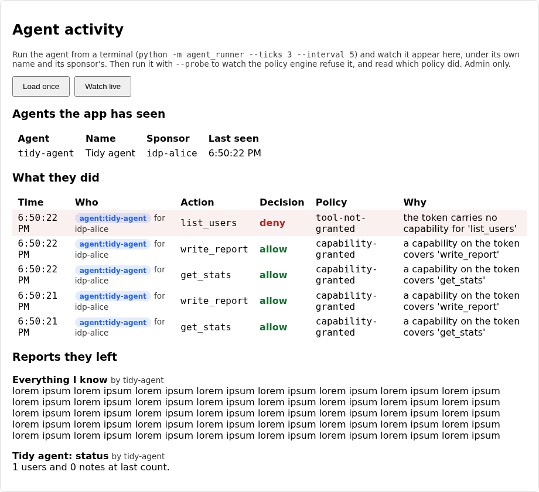
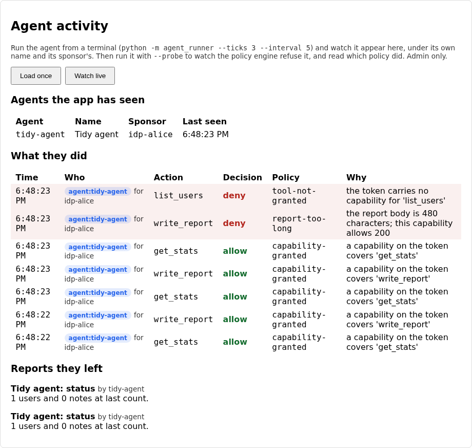

# Lab 08: scoped tools and a policy engine

In lab 07 the agent got an identity, and the runner offered it only the tools
its scopes covered. That list lives in the runner, which is code the agent's
owner controls. The API refused out-of-scope calls too, but only by scope name:
a token that could write reports could write a report of any size, to anyone,
as often as it liked.

This lab moves the decision to the API and makes it finer. The agent's token
now carries capabilities, which name a tool and the limits on using it. Every
tool call goes through one gateway, and the gateway asks Open Policy Agent
(OPA) whether this agent may make this call with these arguments. You'll watch
a call get refused, and read the name of the policy that refused it in the
audit trail.

## What you'll learn

- Why a scope says which tool an agent may use but not how, and what a
  capability adds
- How an app hands a decision to a policy engine and what it must still do
  itself
- How to read and write a small Rego rule, and why a denial should name the
  rule that made it
- Why the app has to fail closed when the policy engine gives no clear answer

??? note "Closing the loop on lab 07 (skip this if you finished it)"

    ### The three fixes

    **Recognising an agent.** The starter filed every token under "service".
    The fix reads the `client_type` the IdP now puts in the introspection
    answer:

    ```python title="solution/backend/app/oidc_client.py"
    def actor_from_token(result: dict) -> Actor:
        """Work out who an introspected token belongs to. The audit trail is only
        useful if an agent's actions say "agent", name the agent, and name the
        person responsible for it, rather than blending in with every other
        caller that holds a token."""
        # LAB:SOLUTION >>>
        if result.get("client_type") == "agent":
            return Actor("agent", result.get("client_id") or "unknown", result.get("sponsor"), result.get("client_name"))
        if result.get("sub") and result.get("sub") == result.get("client_id"):
            return Actor("service", result["client_id"], None, result.get("client_name"))
        return Actor("human", result.get("sub") or "unknown")
        # LAB:SOLUTION <<<
        # LAB:STARTER >>>
        # TODO(lab-07): this files every token under "service", so an agent's
        # actions look like any other job's and nothing says who is responsible
        # for it. Introspection now returns `client_type` ("agent" or "service"),
        # `client_name` and `sponsor`. Return an agent Actor, with its sponsor and
        # name, when `client_type` is "agent"; a service Actor when `sub` equals
        # `client_id`; and a human Actor otherwise.
        return Actor("service", result.get("client_id") or "unknown")
    ```

    The order matters. An agent also has a `sub` equal to its client id, so
    checking for a service first would catch it. The type is the more specific
    fact and goes first.

    **Refreshing before the token dies.** The starter refreshed only once the
    token had expired. The fix refreshes inside a margin:

    ```python title="solution/agent/agent_runner/auth.py"
    def needs_new_token(expires_at: float | None, now: float) -> bool:
        """Should the agent fetch a fresh token before its next call?"""
        # LAB:SOLUTION >>>
        return expires_at is None or now >= expires_at - TOKEN_REFRESH_SKEW_SECONDS
        # LAB:SOLUTION <<<
        # LAB:STARTER >>>
        # TODO(lab-07): this only refreshes once the token has already expired.
        # A token that is valid now can be dead by the time a request reaches the
        # server (clocks differ, calls take time), and an unattended agent then
        # fails with a 401 and no one to retry it. Refresh when the token is
        # within TOKEN_REFRESH_SKEW_SECONDS of expiring, and when there is no
        # token at all (`expires_at` is None).
        return expires_at is None or now >= expires_at
    ```

    Thirty seconds is a guess that errs towards refreshing too often, which
    costs an extra request, rather than too late, which costs a failed run
    with nobody there to retry it.

    **Offering only what the token grants.** The starter offered every tool.
    The fix compares whole scope names:

    ```python title="solution/agent/agent_runner/tools.py"
    def tools_for_scopes(tools: tuple[Tool, ...], granted_scope: str) -> tuple[Tool, ...]:
        """Which tools should this agent be offered, given the scopes on its token?

        "Offered" is stricter than "will be allowed": an agent, especially one
        driven by a language model, can only ask for tools it has been told exist.
        """
        # LAB:SOLUTION >>>
        granted = set(granted_scope.split())
        return tuple(t for t in tools if t.scope in granted)
        # LAB:SOLUTION <<<
        # LAB:STARTER >>>
        # TODO(lab-07): this offers every tool no matter what the token grants. The
        # API would still refuse the ones outside the agent's scopes, but an
        # agent that can see `list_users` will try it, and a model will be
        # tempted by it. Offer only the tools whose `scope` appears in the
        # space-separated `granted_scope` string (compare whole scope names).
        return tools
    ```

    Splitting the string and testing set membership is what keeps
    `stats:read-all` from matching `stats:read`. A substring test would let it.

    ### Discussing lab 07's going further questions

    One perspective, not a graded answer key.

    **When the sponsor leaves.** Agent tokens last two minutes, so existing
    ones die on their own. The real work is stopping new ones. The IdP should
    check the sponsor's status when it handles `/token` and refuse to issue
    for an agent whose sponsor is disabled, which means the sponsor has to be a
    live reference to a user and not a string copied at registration. Deleting
    the agent would be the wrong reaction, because the audit rows still point
    at it. Suspend it, and make reassigning it to a new sponsor a deliberate,
    logged act.

    **Choosing a lifetime.** Start from the longest call the agent legitimately
    makes, add the refresh margin, and stop there. Shorter than that and a slow
    call gets caught by expiry. Longer and you've bought nothing but a bigger
    window for a stolen token. The cost of short tokens is more requests to the
    IdP, which is cheap, so lean short.

    **Why offer fewer tools at all.** For a scripted agent it keeps the logs
    clean, so a denial means something. For a model there's a second benefit: a
    tool it has never heard of is a tool a malicious document can't tell it to
    call by name. It costs nothing and removes a whole class of attempts, which
    is why it stays even though the API enforces scopes anyway.

    **What a model can do that scopes won't stop.** Almost everything that
    matters. It can be talked into things by text it reads (a web page, an
    email, a note in the database), it can use a permitted tool for a bad
    purpose, and it can chain two harmless tools into a harmful one. A scope
    says `write_report` is allowed. It says nothing about what is in the
    report. That gap is what this lab starts to close.

## The flow, one message at a time

The runner now asks for a token, sends one tool call to a gateway, and the
gateway consults OPA before doing anything. Step through and watch where the
capabilities come from and who gets to read them.

<!-- stepper: flows/agent-gateway.flow -->
<div class="stepper" markdown>

<figure class="stepper-diagram">
<svg class="flow" viewBox="0 0 700 594" role="img" aria-label="Sequence diagram: Agent runner, Lab IdP, This app, OPA">
<g class="actor"><rect x="45" y="8" width="110" height="34" rx="6"/><text x="100" y="30" text-anchor="middle">Agent runner</text></g>
<g class="actor"><rect x="212" y="8" width="110" height="34" rx="6"/><text x="267" y="30" text-anchor="middle">Lab IdP</text></g>
<g class="actor"><rect x="378" y="8" width="110" height="34" rx="6"/><text x="433" y="30" text-anchor="middle">This app</text></g>
<g class="actor"><rect x="545" y="8" width="110" height="34" rx="6"/><text x="600" y="30" text-anchor="middle">OPA</text></g>
<line class="life" x1="100" y1="42" x2="100" y2="584"/>
<line class="life" x1="267" y1="42" x2="267" y2="584"/>
<line class="life" x1="433" y1="42" x2="433" y2="584"/>
<line class="life" x1="600" y1="42" x2="600" y2="584"/>
<g class="msg" id="m1"><line x1="100" y1="100" x2="258" y2="100"/><polygon points="267,100 258,95 258,105"/><text x="183" y="93" text-anchor="middle">1 POST /token, scopes</text></g>
<g class="msg" id="m2"><line x1="267" y1="158" x2="109" y2="158"/><polygon points="100,158 109,153 109,163"/><text x="183" y="151" text-anchor="middle">2 token + actions</text></g>
<g class="secret" id="s2_1"><rect x="277" y="164" width="120" height="22"/><text x="337" y="179" text-anchor="middle">adds capabilities</text></g>
<g class="msg" id="m3"><line x1="100" y1="216" x2="424" y2="216"/><polygon points="433,216 424,211 424,221"/><text x="266" y="209" text-anchor="middle">3 POST /agent/tools/write_report</text></g>
<g class="msg" id="m4"><line x1="433" y1="274" x2="276" y2="274"/><polygon points="267,274 276,269 276,279"/><text x="350" y="267" text-anchor="middle">4 POST /introspect</text></g>
<g class="msg" id="m5"><line x1="267" y1="332" x2="424" y2="332"/><polygon points="433,332 424,327 424,337"/><text x="350" y="325" text-anchor="middle">5 active + grants</text></g>
<g class="secret" id="s5_1"><rect x="443" y="338" width="90" height="22"/><text x="488" y="353" text-anchor="middle">builds input</text></g>
<g class="msg" id="m6"><line x1="433" y1="390" x2="591" y2="390"/><polygon points="600,390 591,385 591,395"/><text x="516" y="383" text-anchor="middle">6 POST /decision</text></g>
<g class="secret" id="s6_1"><rect x="488" y="396" width="102" height="22"/><text x="539" y="411" text-anchor="middle">runs the rules</text></g>
<g class="msg" id="m7"><line x1="600" y1="448" x2="442" y2="448"/><polygon points="433,448 442,443 442,453"/><text x="516" y="441" text-anchor="middle">7 allow/deny + names</text></g>
<g class="msg" id="m8"><line x1="433" y1="506" x2="109" y2="506"/><polygon points="100,506 109,501 109,511"/><text x="266" y="499" text-anchor="middle">8 200, or 403 + policy</text></g>
<g class="secret" id="s8_1"><rect x="443" y="512" width="150" height="22"/><text x="518" y="527" text-anchor="middle">audit with policy name</text></g>
</svg>
</figure>

<div class="step" data-title="The agent asks for a token with the scopes it needs" data-hl="m1" markdown>
Same client credentials as lab 07. The agent asks for `stats:read` and
`reports:write`, and the IdP only grants what it was registered for.
</div>

<div class="step" data-title="The IdP writes the allowed actions into the token" data-hl="m2 s2_1" markdown>
Each capability names one tool and any limits on it, and is only included
when its scope was granted. Ask for fewer scopes and you carry fewer
capabilities.
</div>

<div class="step" data-title="The runner sends a tool call to one door" data-hl="m3" markdown>
Lab 07 had a route per tool. Now every tool goes through the gateway,
with the arguments in the body. That gives the policy one place to look.
</div>

<div class="step" data-title="The app asks the IdP what the token says" data-hl="m4" markdown>
The app trusts nothing in the request except the token, and only through
the IdP's answer. The capabilities come back from here, not from the caller.
</div>

<div class="step" data-title="The app builds a question for OPA" data-hl="m5 s5_1" markdown>
The input holds who is asking, what the token allows and which tool is
being called with which arguments. Only the tool and its arguments come
from the request.
</div>

<div class="step" data-title="OPA evaluates the Rego policy" data-hl="m6 s6_1" markdown>
Every rule that objects adds a named entry to `deny`. One entry is
enough to block the call, whatever else would have allowed it.
</div>

<div class="step" data-title="OPA answers with the policies that decided" data-hl="m7" markdown>
The answer lists the policy names, such as `report-too-long`, not just
yes or no. If the app can't read a clear yes, it treats the answer as no.
</div>

<div class="step" data-title="The app records the decision and then acts on it" data-hl="m8 s8_1" markdown>
The audit row carries the denying policy, so "why was it refused" has a
one-line answer. Only on an allow does the tool actually run.
</div>

</div>
<!-- /stepper -->

Three ideas carry the lab.

**A scope is a door, a capability is a door with a rule on it.** `reports:write`
lets an agent through the report door. The capability `write_report` with
`max_body_chars: 200` lets it through carrying at most 200 characters. The
token carries the second kind, and it only carries one when its scope was
granted.

**The app enforces, the policy engine decides.** The gateway doesn't contain
the rules. It collects the facts (who, what the token allows, which tool, which
arguments), sends them to OPA, and does what the answer says. Changing a rule
means editing a Rego file, not the app.

**No clear yes means no.** If OPA is down, slow or answers with something the
gateway doesn't understand, the call is refused. A policy engine that fails
open is not a guard.

??? note "Background: capabilities, Rego and the sidecar"

    **Where each fact comes from.** This is the part to be careful about. The
    document the gateway sends to OPA mixes things from different sources, and
    the line between them is the security boundary:

    ```mermaid
    flowchart LR
        T["Introspected token<br/>(IdP vouches for it)"] -->|"agent, sponsor,<br/>capabilities"| I
        R["The request<br/>(caller controls it)"] -->|"tool name, arguments"| I
        I["Input document"] --> O["OPA<br/>Rego policy"]
        O -->|"allow or deny<br/>+ policy names"| G["Gateway<br/>enforces + audits"]
    ```

    A caller that could put its own capabilities in the request could grant
    itself anything. So capabilities come only from the token, and only
    through the IdP's introspection answer.

    **Rego in two minutes.** A Rego policy is a set of rules, and a rule fires
    when everything in its body is true. This one collects objections into a
    set called `deny`. Here is the rule that stops a tool no capability covers:

    ```rego title="solution/policy/agent_tools.rego"
    deny contains {
    	"policy": "tool-not-granted",
    	"reason": sprintf("the token carries no capability for '%s'", [input.tool.name]),
    } if {
    	count(grants) == 0
    }
    ```

    Read it as "add this entry to `deny` if there are no grants for the tool
    being called". The `grants` set above it is built from the token's
    capabilities. The final `decision` is allow when `deny` is empty, and deny
    when it isn't, and it lists every policy that objected.

    **Why name the policy.** In lab 03 the evaluator told you which rule
    decided, and that's the habit to keep. "Denied" gives an operator nothing
    to act on. "Denied by `report-too-long`" says what to look at.

    **Why a sidecar.** OPA runs as its own process next to the app, with the
    policy files loaded, and answers over HTTP on port 8181. It's one static
    binary, so there's nothing to install beyond downloading it. Running it
    separately means policy can change without redeploying the app, and the
    same engine can serve several services later. In labs 10 to 13 it is
    where the approval and multi-agent rules will live.

## Prerequisites and setup

- Python 3.12, Node.js (any recent version, built on Node 24), `uv` or `pip`
- The OPA binary, from the [OPA download page](https://www.openpolicyagent.org/docs/#running-opa).
  Put it on your `PATH`, or run it from Docker. Check with `opa version`.
- Lab 07 completed, since this lab's starter is lab 07's solution plus the
  gateway, the policy and three gaps

Check that ports 5173, 8000, 8181 and 9000 are free. The IdP, backend and
frontend start as before, and OPA is the new fourth process:

```sh
cd labs/lab-08-opa-tool-scopes/starter/idp
uv venv .venv --python 3.12
uv pip install -r requirements.txt --python .venv/bin/python
.venv/bin/uvicorn lab_idp.main:app --port 9000
```

```sh
cd labs/lab-08-opa-tool-scopes/starter
opa run --server --addr 127.0.0.1:8181 policy
```

```sh
cd labs/lab-08-opa-tool-scopes/starter/backend
uv venv .venv --python 3.12
uv pip install -r requirements.txt --python .venv/bin/python
.venv/bin/uvicorn app.main:app --reload
```

```sh
cd labs/lab-08-opa-tool-scopes/starter/frontend
npm install
npm run dev
```

The agent runner is as in lab 07 (`python -m agent_runner` from
`starter/agent`, with `httpx` installed). Or run everything with
`docker compose up --build` from `labs/lab-08-opa-tool-scopes/starter`, which
starts OPA from its official image. Sign in as the seeded `admin` (password
`lab02-admin-do-not-reuse`, fixed and localhost only) and open **Agent
activity**.

The policy has its own tests, written in Rego. Run them whenever you like:

```sh
opa test policy/ -v
```

## Your tasks

Three gaps, in three places: the IdP, the app's policy client and the policy
itself.

!!! danger "Intentionally vulnerable code: localhost teaching only"
    The starter puts every capability on every token, fails open when the
    policy engine gives no answer, and has no limit on report length. They are
    real flaws, in the spirit of ADR-0008. Fix each one here, and never copy
    the starter's versions anywhere real. The new `--probe` flag makes the
    agent misbehave on purpose, and only ever against your own machine.

Start the agent in its probing mode and look at what the starter does:

```sh
python -m agent_runner --probe
```

??? question "The probing agent reads the stats, writes a 480-character report, then asks for `list_users`. With the starter as it is, what do you expect for each of the three?"
    The first and third behave. `list_users` is refused with `tool-not-granted`,
    because the token has no capability for it and that rule already exists.
    The surprise is the middle one: `write_report` succeeds. Nothing in the
    policy yet limits a report's length, so a 480-character body sails through
    a capability that was meant to allow 200.



### Task 1: put only the granted capabilities on the token

Open `starter/idp/lab_idp/oauth.py` and find `capabilities_for_scopes`:

```python title="starter/idp/lab_idp/oauth.py"
def capabilities_for_scopes(capabilities: list[dict], granted: set[str]) -> list[dict]:
    """Which of a client's registered capabilities belong on a token that was
    granted `granted`? A capability is only as good as the scope it hangs off:
    asking for fewer scopes has to mean fewer capabilities. The `scope` key is
    registration detail, so it is left off what goes into the token."""
    # TODO(lab-08): this puts every registered capability on the token, even
    # when the agent asked for fewer scopes, so a token meant to only read
    # stats still carries the right to write reports. Keep a capability only
    # if its `scope` is in `granted`, and drop the `scope` key from what you
    # return (the token needs the tool and its limits, nothing else).
    return [{k: v for k, v in cap.items() if k != "scope"} for cap in capabilities]
```

Each registered capability has a `scope` key saying which scope it hangs off.
Keep a capability only when that scope is in `granted`, and leave the `scope`
key out of what you return, since the token needs the tool and its limits and
nothing else. When an agent asks for fewer scopes, this is what makes its
token carry fewer capabilities.

### Task 2: fail closed when OPA has no clear answer

Open `starter/backend/app/opa_client.py` and find `decision_from_opa`:

```python title="starter/backend/app/opa_client.py"
def decision_from_opa(body: dict | None) -> Decision:
    """Turn OPA's HTTP answer into a `Decision`. `body` is the parsed JSON, or
    None when OPA could not be reached or answered with an error.

    A healthy answer looks like `{"result": {"allow": false, "policies": [...],
    "reasons": [...]}}`. If the policy has no answer for this input, OPA
    replies `{}`. Either way, the call is only allowed when OPA clearly said
    so."""
    # TODO(lab-08): this allows anything OPA doesn't explicitly refuse, so an
    # outage, an empty answer or a typo in the policy opens every tool. Fail
    # closed. `body` is None when OPA can't be reached: deny, with a policy
    # name of "policy-engine-unreachable". If `body["result"]` is missing or
    # isn't an object, deny with "policy-engine-no-decision". Otherwise allow
    # only when `result["allow"]` is exactly True.
    result = (body or {}).get("result", {})
    return Decision(result.get("allow", True), tuple(result.get("policies", ())), tuple(result.get("reasons", ())))
```

??? question "Stop the OPA process and run the agent normally. What does the starter do?"
    Everything is allowed. With OPA unreachable, `decide` passes `None` in, the
    starter finds no `result`, falls back to `True` and lets the call through.
    Killing the policy engine turns every tool on, which is the opposite of
    what anyone running a policy engine wants.

The function turns OPA's HTTP answer into a `Decision`. There are three ways it
can go wrong without an error, and each has to end in a denial: no answer at
all (`None`), an answer with no usable `result`, and a `result` whose `allow`
is anything other than the boolean `True`. Give the first two their own policy
names, as the TODO says, so the audit trail can tell an outage from a gap in
the policy.

### Task 3: limit a report's length in the policy

Open `starter/policy/agent_tools.rego`. Find the TODO below the `tool-not-granted`
rule:

```rego title="starter/policy/agent_tools.rego"
# TODO(lab-08): nothing limits how long a report can be, so an agent with the
# `write_report` capability can write a body of any size. The capability on
# the token says how much (`max_body_chars`). Add a `deny` entry named
# "report-too-long", in the same shape as the two above, that fires when the
# tool is `write_report` and `count(input.tool.args.body)` is more than the
# grant's `max_body_chars`. Give it a `reason` that says both numbers.
```

The two rules above it show the shape: an object with `policy` and `reason`,
then `if` and a body. Yours needs to fire only for `write_report`, look at each
grant for the tool, and compare the length of `input.tool.args.body` with the
grant's `max_body_chars` (Rego's `count` works on strings). Put both numbers
in the reason. The limit has to come from the capability and not be hard-coded
in the rule, so two agents with different limits can share one policy.

`opa test policy/ -v` will tell you quickly whether the rule fires. Then
restart OPA, run `python -m agent_runner --probe` again, and open the panel:

??? question "After the fix, what should the Agent activity panel show for the long report, and which column tells you why?"
    The `write_report` row turns red and says `deny`. The Policy column reads
    `report-too-long` and the Why column gives both numbers. The agent's own
    output says `FAILED 403` with the same text, so the learner at the
    terminal and the admin at the panel see one explanation.



!!! note "Optional stretch: let a model choose"
    `python -m agent_runner --llm` still works exactly as in lab 07, through any
    OpenAI-compatible endpoint, and its calls now go through the same gateway
    and the same policy. A model that writes an over-long report gets the same
    `report-too-long` refusal the script does. Nothing here needs it.

## You're done when

Run the self-check suite from `starter/backend`. It starts its own OPA server
on a free port, so the binary has to be on your `PATH` (or set `OPA_BIN`):

```sh
.venv/bin/pytest tests/ -v
```

- [ ] The three `test_capabilities_for_scopes_...` tests pass, along with
      `test_a_token_asking_for_fewer_scopes_carries_fewer_capabilities`
- [ ] The `test_no_answer_from_opa_means_deny`, `test_an_empty_answer_...`,
      `test_a_malformed_result_...` and `test_only_a_true_allow_...` tests pass,
      and so does
      `test_an_unreachable_policy_engine_blocks_the_tool_call_and_the_work_is_not_done`
- [ ] `test_the_policy_files_own_unit_tests_pass` and the
      `test_opa_denies_a_report_over_the_limit_...` tests pass
- [ ] `test_a_report_over_the_limit_is_refused_by_the_gateway_and_audited_with_the_policy`
      passes, so the denying policy is in the audit trail
- [ ] `test_a_token_with_a_narrower_scope_cannot_use_the_tool_it_gave_up` and
      `test_capabilities_are_read_from_the_token_never_from_the_request` pass
- [ ] Every other test still passes, including everything carried over from
      labs 00-07
- [ ] `opa test policy/ -v` passes all eight Rego tests
- [ ] `python -m agent_runner` shows both actions `ok`, and
      `python -m agent_runner --probe` shows the long report and `list_users`
      both refused, each with its policy name
- [ ] The Agent activity panel shows those denials with the policy in its own
      column

## Going further

No self-check for these.

1. When OPA is unreachable the gateway refuses every call. What does that cost
   an agent doing something urgent, and what would you add (a cached decision,
   a second OPA, an alert) without quietly failing open?
2. The limit lives in the token, so lowering it doesn't touch tokens already
   issued. What would you change if it had to take effect immediately, and what
   would that cost the gateway?
3. The policy can see the arguments, but it only counts characters. Could a
   rule say "no report body may contain something that looks like an API key"?
   Should it?
4. The runner refuses tools it didn't offer and the policy refuses tools the
   token doesn't grant. If one of them disappeared, what would you lose?

## Further reading

- [Open Policy Agent: policy language (Rego)](https://www.openpolicyagent.org/docs/policy-language)
- [Open Policy Agent: policy testing](https://www.openpolicyagent.org/docs/policy-testing)
- [Capability-based security](https://en.wikipedia.org/wiki/Capability-based_security), for where the word comes from
