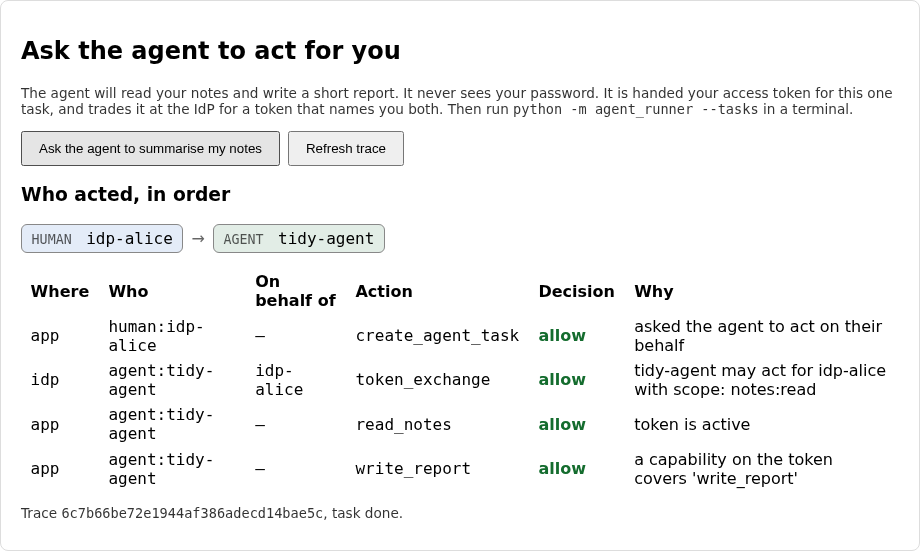
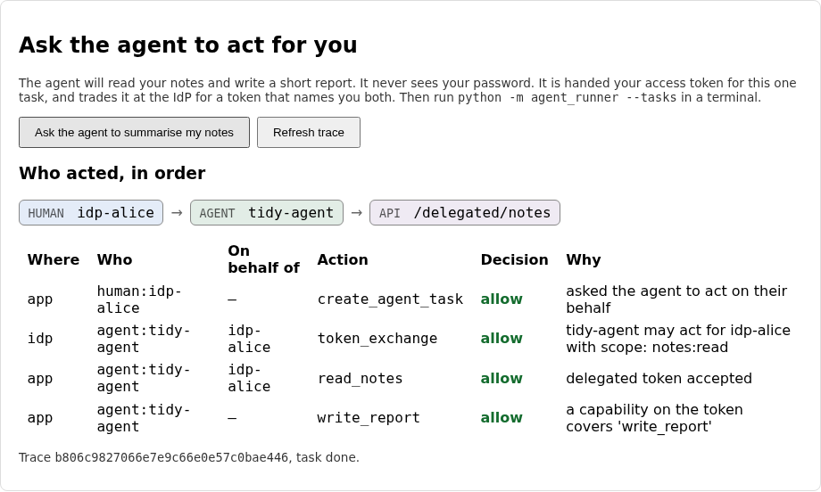

# Lab 09: acting on behalf of a person

So far the agent has acted as itself. It reads statistics and writes reports,
and every row in the audit log says `agent:tidy-agent`. That's the right
identity for work nobody asked for, but most useful agents do something else:
they act for a person. "Summarise my notes" needs Alice's notes, and the agent
has no business reading anyone else's.

This lab gives the agent a way to act for Alice without becoming Alice. It
trades her access token at the IdP for a new one that names both of them, then
uses that token against a downstream API. When the API logs the call, the person
whose authority was used and the agent that used it show up as two separate
identities, and one trace id ties the whole chain together.

## What you'll learn

- Why an agent acting for a person shouldn't use the person's own token, and
  shouldn't act as itself either
- How a token exchange keeps the original subject and records who is acting
- Why a delegated token can only ever carry the overlap of what was asked for,
  what the person holds and what the agent is trusted with
- Why a downstream API has to refuse valid tokens that are missing the person
  or the agent

??? note "Closing the loop on lab 08 (skip this if you finished it)"

    ### The three fixes

    **Putting only the granted capabilities on the token.** The starter put
    every registered capability on every token. The fix keeps only those whose
    scope was granted, and drops the `scope` key, since the token needs the
    tool and its limits and nothing else:

    ```python title="solution/idp/lab_idp/oauth.py"
    def capabilities_for_scopes(capabilities: list[dict], granted: set[str]) -> list[dict]:
        """Which of a client's registered capabilities belong on a token that was
        granted `granted`? A capability is only as good as the scope it hangs off:
        asking for fewer scopes has to mean fewer capabilities. The `scope` key is
        registration detail, so it is left off what goes into the token."""
        # LAB:SOLUTION >>>
        return [{k: v for k, v in cap.items() if k != "scope"} for cap in capabilities if cap["scope"] in granted]
        # LAB:SOLUTION <<<
        # LAB:STARTER >>>
        # TODO(lab-08): this puts every registered capability on the token, even
        # when the agent asked for fewer scopes, so a token meant to only read
        # stats still carries the right to write reports. Keep a capability only
        # if its `scope` is in `granted`, and drop the `scope` key from what you
        # return (the token needs the tool and its limits, nothing else).
        return [{k: v for k, v in cap.items() if k != "scope"} for cap in capabilities]
    ```

    Asking for fewer scopes now means carrying fewer capabilities, which is what
    lets the gateway treat the token as the whole truth about the agent.

    **Failing closed.** The starter allowed anything OPA didn't explicitly
    refuse, so an outage or an empty answer opened every tool. The fix gives each
    kind of non-answer its own denial, and only the boolean `True` is a yes:

    ```python title="solution/backend/app/opa_client.py"
    def decision_from_opa(body: dict | None) -> Decision:
        """Turn OPA's HTTP answer into a `Decision`. `body` is the parsed JSON, or
        None when OPA could not be reached or answered with an error.

        A healthy answer looks like `{"result": {"allow": false, "policies": [...],
        "reasons": [...]}}`. If the policy has no answer for this input, OPA
        replies `{}`. Either way, the call is only allowed when OPA clearly said
        so."""
        # LAB:SOLUTION >>>
        if body is None:
            return Decision(False, ("policy-engine-unreachable",), ("the policy engine could not be reached, so the call is denied",))
        result = body.get("result")
        if not isinstance(result, dict):
            return Decision(False, ("policy-engine-no-decision",), ("the policy engine returned no decision, so the call is denied",))
        return Decision(result.get("allow") is True, tuple(result.get("policies", ())), tuple(result.get("reasons", ())))
        # LAB:SOLUTION <<<
        # LAB:STARTER >>>
        # TODO(lab-08): this allows anything OPA doesn't explicitly refuse, so an
        # outage, an empty answer or a typo in the policy opens every tool. Fail
        # closed. `body` is None when OPA can't be reached: deny, with a policy
        # name of "policy-engine-unreachable". If `body["result"]` is missing or
        # isn't an object, deny with "policy-engine-no-decision". Otherwise allow
        # only when `result["allow"]` is exactly True.
        result = (body or {}).get("result", {})
        return Decision(result.get("allow", True), tuple(result.get("policies", ())), tuple(result.get("reasons", ())))
    ```

    The `is True` is deliberate. A policy that returned the string `"true"`, or
    `1`, is a bug in the policy, and a bug shouldn't read as permission.

    **The Rego rule.** The starter had no limit on a report's length. The fix
    adds a third entry to `deny`, shaped like the two before it:

    ```rego title="solution/policy/agent_tools.rego"
    deny contains {
    	"policy": "report-too-long",
    	"reason": sprintf("the report body is %d characters; this capability allows %d", [count(input.tool.args.body), grant.max_body_chars]),
    } if {
    	input.tool.name == "write_report"
    	some grant in grants
    	count(input.tool.args.body) > grant.max_body_chars
    }
    # LAB:SOLUTION <<<
    # LAB:STARTER >>>
    # TODO(lab-08): nothing limits how long a report can be, so an agent with the
    # `write_report` capability can write a body of any size. The capability on
    # the token says how much (`max_body_chars`). Add a `deny` entry named
    # "report-too-long", in the same shape as the two above, that fires when the
    # tool is `write_report` and `count(input.tool.args.body)` is more than the
    # grant's `max_body_chars`. Give it a `reason` that says both numbers.
    # LAB:STARTER <<<
    ```

    The limit comes from the grant (`grant.max_body_chars`), not from the rule,
    so another agent could be given a different limit under the same policy.

    ### Discussing lab 08's going further questions

    One perspective, not a graded answer key.

    **When OPA is down.** Refusing everything is the right default, and the cost
    is real: an agent that needed to do something urgent is stuck. Resist the
    urge to soften it with a fallback that allows. What you can add safely is
    redundancy (run two OPA instances behind the same address), a short timeout
    so a slow engine doesn't hang every request, and an alert that fires on
    `policy-engine-unreachable`, since that audit entry is now a symptom you can
    page on. A cached decision for identical inputs is tempting and mostly fine
    for a few seconds, but it means a policy change takes that long to bite.

    **Limits in the token or in OPA.** Lowering `max_body_chars` in the registry
    doesn't touch tokens already issued, so the old limit lives for up to two
    minutes. If it has to bite immediately, move the limit into OPA's data
    (policy data can be pushed without a restart) and have the policy look the
    agent up by id. The price is that the token no longer tells you the whole
    story, and the gateway depends on OPA holding fresh data. For a two-minute
    token I'd leave it where it is.

    **Matching an API key in a report.** A Rego rule can do it with
    `regex.match`, and for obvious shapes (a long hex string, a `sk-` prefix) it
    catches real mistakes. It also catches nothing a model decides to encode or
    split up. Treat it as a seatbelt: cheap, worth having, and not a reason to
    stop worrying about what an agent can read in the first place.

    **Two refusals, one tool.** The runner's offer list and the policy overlap
    on purpose, and they fail differently. Remove the offer list and a model
    tries `list_users` every run, you read a screenful of denials, and a prompt
    injection can name a tool it knows exists. Remove the policy and a buggy or
    hostile client skips the runner entirely, as `--probe` did. The runner is a
    courtesy. The policy is the guard.

## The flow, one message at a time

Alice asks, the agent claims the task, and the IdP exchanges her token for a
delegated one. Step through and watch where `sub` and `acting_as` get set, and
which token the runner uses for which call.

<!-- stepper: flows/on-behalf-of.flow -->
<div class="stepper" markdown>

<figure class="stepper-diagram">
<svg class="flow" viewBox="0 0 700 652" role="img" aria-label="Sequence diagram: Alice, This app, Agent runner, Lab IdP">
<g class="actor"><rect x="45" y="8" width="110" height="34" rx="6"/><text x="100" y="30" text-anchor="middle">Alice</text></g>
<g class="actor"><rect x="212" y="8" width="110" height="34" rx="6"/><text x="267" y="30" text-anchor="middle">This app</text></g>
<g class="actor"><rect x="378" y="8" width="110" height="34" rx="6"/><text x="433" y="30" text-anchor="middle">Agent runner</text></g>
<g class="actor"><rect x="545" y="8" width="110" height="34" rx="6"/><text x="600" y="30" text-anchor="middle">Lab IdP</text></g>
<line class="life" x1="100" y1="42" x2="100" y2="642"/>
<line class="life" x1="267" y1="42" x2="267" y2="642"/>
<line class="life" x1="433" y1="42" x2="433" y2="642"/>
<line class="life" x1="600" y1="42" x2="600" y2="642"/>
<g class="msg" id="m1"><line x1="100" y1="100" x2="258" y2="100"/><polygon points="267,100 258,95 258,105"/><text x="183" y="93" text-anchor="middle">1 ask the agent</text></g>
<g class="secret" id="s1_1"><rect x="277" y="106" width="150" height="22"/><text x="352" y="121" text-anchor="middle">stores task + trace id</text></g>
<g class="msg" id="m2"><line x1="433" y1="158" x2="276" y2="158"/><polygon points="267,158 276,153 276,163"/><text x="350" y="151" text-anchor="middle">2 claim a task</text></g>
<g class="msg" id="m3"><line x1="267" y1="216" x2="424" y2="216"/><polygon points="433,216 424,211 424,221"/><text x="350" y="209" text-anchor="middle">3 task + her token</text></g>
<g class="msg" id="m4"><line x1="433" y1="274" x2="591" y2="274"/><polygon points="600,274 591,269 591,279"/><text x="516" y="267" text-anchor="middle">4 exchange tokens</text></g>
<g class="secret" id="s5_1"><rect x="416" y="338" width="174" height="22"/><text x="503" y="353" text-anchor="middle">requested, held, delegable</text></g>
<g class="msg" id="m6"><line x1="600" y1="390" x2="442" y2="390"/><polygon points="433,390 442,385 442,395"/><text x="516" y="383" text-anchor="middle">6 delegated token</text></g>
<g class="msg" id="m7"><line x1="433" y1="448" x2="276" y2="448"/><polygon points="267,448 276,443 276,453"/><text x="350" y="441" text-anchor="middle">7 read notes + token</text></g>
<g class="msg" id="m8"><line x1="267" y1="506" x2="591" y2="506"/><polygon points="600,506 591,501 591,511"/><text x="433" y="499" text-anchor="middle">8 POST /introspect</text></g>
<g class="secret" id="s8_1"><rect x="277" y="512" width="150" height="22"/><text x="352" y="527" text-anchor="middle">accepts delegated only</text></g>
<g class="msg" id="m9"><line x1="267" y1="564" x2="424" y2="564"/><polygon points="433,564 424,559 424,569"/><text x="350" y="557" text-anchor="middle">9 Alice&#x27;s notes</text></g>
<g class="secret" id="s9_1"><rect x="277" y="570" width="150" height="22"/><text x="352" y="585" text-anchor="middle">audit: agent for alice</text></g>
</svg>
</figure>

<div class="step" data-title="Alice asks the agent to do something for her" data-hl="m1 s1_1" markdown>
Alice is signed in through the Lab IdP, so her session has an access
token. The app queues a task, remembers her token with it and notes the trace
id, which will follow the whole job.
</div>

<div class="step" data-title="The agent claims the task as itself" data-hl="m2" markdown>
The runner uses its own token for this, the same client credentials as
lab 07. Only an agent acting as itself may claim tasks.
</div>

<div class="step" data-title="The app hands over the task and Alice&#x27;s token" data-hl="m3" markdown>
Alice's token is lent for this one task. The agent never sees her
password or her session, and it can't use her token for anything the IdP
hasn't agreed to.
</div>

<div class="step" data-title="The agent trades her token for a delegated one" data-hl="m4" markdown>
This is the token exchange. The runner sends its own credentials and
Alice's token, and asks for the scopes it needs.
</div>

<div class="step" data-title="The IdP narrows the scopes and names both of them" data-hl="s5_1" markdown>
The scopes granted are the overlap of three lists: what the agent asked
for, what Alice holds, and what this agent is ever trusted with. The new token
keeps `sub` as Alice and adds `acting_as` for the agent.
</div>

<div class="step" data-title="The delegated token comes back, short-lived" data-hl="m6" markdown>
It expires in two minutes, or sooner if Alice's own token does. A
delegation can't outlive the authority behind it.
</div>

<div class="step" data-title="The agent calls the downstream API for Alice" data-hl="m7" markdown>
The tool `read_notes` is marked as delegated, so the runner attaches
the delegated token. The report it writes afterwards uses the agent's own
token instead.
</div>

<div class="step" data-title="The API checks that a person and an agent are both in the token" data-hl="m8 s8_1" markdown>
A person's own token has no agent in it. An agent's own token has no
person in it. Neither belongs here, however valid it is.
</div>

<div class="step" data-title="The audit row names both identities, and the trace ties them together" data-hl="m9 s9_1" markdown>
The row says `agent:tidy-agent` acting `on_behalf_of: idp-alice`, and
carries the same trace id as the request, the exchange and the read.
</div>

</div>
<!-- /stepper -->

Three ideas carry the lab.

**Neither Alice's token nor the agent's own is the right one.** If the agent
used Alice's token, every service would see Alice, and nobody could tell her
actions from the agent's. If it used its own, the API would have no idea whose
notes to return. A delegated token says both: `sub` stays Alice, the person
whose authority this is, and `acting_as` names the agent exercising it. (RFC
8693 calls that claim `act`. The name here is ours, because it reads aloud.)

**Delegation can only narrow.** The scopes on a delegated token are the overlap
of three lists: what the agent asked for, what Alice holds, and what this agent
is registered to be trusted with. Alice can't delegate what she doesn't have,
and the agent can't be handed more than its registration allows, however much
Alice would be willing to share.

**The API checks what's in the chain.** A downstream API that only asks "is this
token valid" will take a person's own token and an agent's own token as happily
as a delegated one. Each is missing half of what the API needs to know, and the
API has to say so.

Try the whole chain in this widget before you write any code. Alice holds some
scopes, the agent asks for some, and the API checks whichever token you present.
Your task: untick `notes:read` under "What Alice holds" while the agent still
asks for it, and see what comes out. Then switch on each "starter behaviour" box,
one at a time, and watch which bug lets something through that shouldn't be.

<iframe class="widget-frame" src="../widgets/delegation-chain.html" title="Interactive: a delegation chain from a person to an agent to an API" height="720" loading="lazy"></iframe>

??? note "Background: why not just pass Alice's token along"

    The shortcut is for the app to give the agent Alice's access token and let it
    call the API directly. It works, and it has three problems that all come from
    the same place: the token says nothing about the agent.

    ```mermaid
    flowchart LR
        subgraph shortcut["The shortcut"]
            A1["Alice's token<br/>sub: alice"] --> API1["API sees: alice<br/>(the agent is invisible)"]
        end
        subgraph exchange["Token exchange"]
            A2["Alice's token"] -->|"agent credentials<br/>+ her token"| IDP["IdP"]
            IDP --> D["Delegated token<br/>sub: alice<br/>acting_as: agent"]
            D --> API2["API sees: agent, for alice"]
        end
    ```

    With the shortcut, the audit log can't separate Alice from the agent, the
    agent holds every scope Alice does and not just the one it needs, and a
    stolen token is a stolen Alice for as long as hers lives. With the exchange,
    the agent holds a narrower, shorter token that says what it is, and the IdP
    gets a say (and a log line) at the moment of delegation.

    **Where the person's token goes.** In this lab the app parks it in a table
    for the agent to collect and wipes it when the task completes. That keeps the
    lab to one process boundary you can see, and it is the weakest part of the
    design. The row says so in a comment. A real system passes it over an
    authenticated channel and never stores it, or avoids passing it at all by
    having the IdP issue a one-use delegation ticket.

## Prerequisites and setup

- Python 3.12, Node.js (any recent version, built on Node 24), `uv` or `pip`
- The OPA binary on your `PATH`, as in lab 08
- Lab 08 completed, since this lab's starter is lab 08's solution plus the token
  exchange, the task queue, the downstream API and three gaps

Check that ports 5173, 8000, 8181 and 9000 are free, then start the same four
processes as lab 08:

```sh
cd labs/lab-09-on-behalf-of/starter/idp
uv venv .venv --python 3.12
uv pip install -r requirements.txt --python .venv/bin/python
.venv/bin/uvicorn lab_idp.main:app --port 9000
```

```sh
cd labs/lab-09-on-behalf-of/starter
opa run --server --addr 127.0.0.1:8181 policy
```

```sh
cd labs/lab-09-on-behalf-of/starter/backend
uv venv .venv --python 3.12
uv pip install -r requirements.txt --python .venv/bin/python
.venv/bin/uvicorn app.main:app --reload
```

```sh
cd labs/lab-09-on-behalf-of/starter/frontend
npm install
npm run dev
```

(Or `docker compose up --build` from `labs/lab-09-on-behalf-of/starter`.) Open the
app, choose **Sign in with Lab IdP** and sign in as `alice` (password
`alice-lab-pass`, fixed and localhost only), then create two or three notes. A new
**Ask the agent to act for you** panel appears once you're signed in through the
IdP. Click its button, then run the agent from `starter/agent`:

```sh
python -m agent_runner --tasks
```

## Your tasks

Three gaps: two at the IdP, one at the downstream API.

!!! danger "Intentionally vulnerable code: localhost teaching only"
    The starter issues a delegated token that has lost the person, hands over
    scopes the person never agreed to, and lets any valid token into the
    downstream API. They are real flaws, in the spirit of ADR-0008. Fix each one
    here, and never copy the starter's versions anywhere real. The app also parks
    a person's token in a table for the agent, which is fine on a laptop and not
    something to copy.

### Task 1: a token that names the person and the agent

??? question "With the starter as it is, ask the agent to summarise your notes and run `python -m agent_runner --tasks`. What does the trace panel show, and what is wrong with the chain?"
    The task runs and both actions say `ok`, but the chain stops after the agent:
    `human idp-alice → agent tidy-agent`, with no API hop. The `read_notes` row
    says "token is active" and has nothing under "On behalf of". The IdP's own
    `token_exchange` row does name Alice (the exchange knows who asked), but the
    token it issued doesn't, so the downstream API never learns. The notes it
    read were the agent's, which is to say none.



Open `starter/idp/lab_idp/oauth.py` and find `compose_delegated_claims`:

```python title="starter/idp/lab_idp/oauth.py"
def compose_delegated_claims(
    subject: dict, *, agent_id: str, agent_name: str, sponsor: str | None, scope: str,
    issuer: str, now: int, ttl: int,
) -> dict:
    """The claims of a token an agent holds while acting for a person (the
    idea of RFC 8693 token exchange). `subject` is the introspected token of
    the person, as returned by `introspect_token`.

    The token has to say two things at once, and downstream services need both:
    whose authority this is, and who is exercising it."""
    # TODO(lab-09): this issues the agent a token of its own with the notes
    # scope, so the person has vanished from it: a downstream API sees only
    # "tidy-agent" and cannot tell whose notes are being read. Build the
    # delegated claims instead. `sub` stays the person's (`subject["sub"]`).
    # Add `acting_as`: an object with the agent's id as `sub` and its
    # `sponsor`. `client_id` is the agent. `exp` is the sooner of now + ttl and
    # the person's own token expiry (`subject["exp"]`), so a delegation never
    # outlives the authority behind it. Keep the claims the other tokens have
    # (iss, aud, iat, jti, client_type, client_name, sponsor, scope).
    return {
        "iss": issuer, "sub": agent_id, "aud": issuer, "client_id": agent_id, "client_type": "agent",
        "client_name": agent_name, "sponsor": sponsor, "scope": scope,
        "iat": now, "exp": now + ttl, "jti": secrets.token_hex(8),
    }
```

The `subject` is the introspected token of the person. Build the claims so that
`sub` is still Alice's, `acting_as` names the agent (an object with the agent's
id as `sub`, and its `sponsor`), and `client_id` is the agent. The expiry is
the sooner of the agent's normal lifetime and the person's own token expiry,
so a delegation never outlives the authority behind it. Keep the other claims
the starter already sets.

### Task 2: only scopes the person holds

??? question "Alice unticks `notes:read` on the consent screen, then asks the agent to summarise her notes. With the starter, can the agent read them?"
    Yes, and that's the bug. The starter grants whatever the agent asks for that
    it is registered for, without looking at what Alice actually shared. Alice
    said no to `notes:read` at the consent screen and the agent got it anyway,
    because the exchange never compared the request with her token.

Open `starter/idp/lab_idp/oauth.py` again and find `narrow_delegated_scope`:

```python title="starter/idp/lab_idp/oauth.py"
def narrow_delegated_scope(subject_scope: set[str], requested: set[str], delegable: set[str]) -> set[str]:
    """Which scopes may a delegated token carry? An agent acting for a person
    can never hold more than the person has, and never more than the agent was
    registered to be trusted with, whatever it asks for."""
    # TODO(lab-09): this hands over whatever the agent asks for that it is
    # registered for, even if the person never agreed to it at the consent
    # screen. An agent that is trusted to read notes could then read the
    # notes of someone who only shared their profile. A delegated token may
    # carry only scopes that are in all three sets: requested, held by the
    # person (`subject_scope`), and delegable by this agent.
    return requested & delegable
```

A delegated token may carry only a scope that appears in all three sets. When the
result is empty the IdP already refuses the exchange with `invalid_scope`, so the
function only has to get the overlap right. (You can see that refusal for
yourself with a second account: sign in as `carol`, untick `notes:read`, and ask
the agent.)

### Task 3: the downstream API accepts only delegated tokens

??? question "A person's own token and the agent's own token are both valid. What should the downstream API say to each, and what does the starter say?"
    It should refuse both, each for what it's missing. A person's own token has no
    agent in it, so nobody is accountable for the agent's part. The agent's own
    token has no person in it, so there is nobody whose notes to return. The
    starter checks only that the token is active, so it lets both in.

Open `starter/backend/app/oidc_client.py` and find `delegated_token_allowed`:

```python title="starter/backend/app/oidc_client.py"
def delegated_token_allowed(result: dict, required_scope: str) -> tuple[bool, str]:
    """Should a request carrying this introspected token be let in to an API
    that serves agents acting for people? Returns `(allowed, reason)`.

    Three kinds of valid token look alike here: a person's own, an agent's
    own, and an agent's token for acting on a person's behalf. Only the last
    belongs at this door. A person's own token means no agent is in the chain,
    and an agent's own token means no person is, so each is refused for what
    it is missing."""
    # TODO(lab-09): this lets in any active token. A person's own token, or an
    # agent's own token, would open an API that is meant to be reached only by
    # an agent acting for a person. Check four things in order, each with its
    # own reason: the token is active; it carries `acting_as` (it is delegated);
    # `sub` is not the same as `acting_as["sub"]` (there is a person behind the
    # agent, not just the agent twice); and it holds `required_scope` (use
    # `has_scope`).
    return bool(result.get("active")), "token is active"
```

Check four things, in the order the TODO gives, and return a specific reason for each
failure. Lab 06's `service_token_allowed` has the same shape. Restart the backend,
ask the agent again and run `--tasks`. Now the chain has three hops, and the
`read_notes` row says it was an agent acting on behalf of `idp-alice`:



Notice the last row. `write_report` has nothing under "On behalf of", and that's
correct: the agent wrote the report with its own token and its own capability.
One task used two tokens, and the audit log keeps them apart.

!!! note "Optional stretch: let a model choose"
    `python -m agent_runner --llm` still runs the lab 07 agent through the gateway.
    Acting for a person goes through the same runner and the same delegated tool,
    so a model driving it gets the same token, the same narrowing and the same
    audit. Nothing here needs one.

## You're done when

Run the self-check suite from `starter/backend` (the OPA binary has to be on your
`PATH`, or set `OPA_BIN`):

```sh
.venv/bin/pytest tests/ -v
```

- [ ] The four `test_the_delegated_token_...` tests pass, and so do
      `test_the_exchanged_token_names_alice_and_the_agent` and
      `test_the_exchange_is_audited_at_the_idp_with_both_identities`
- [ ] The `test_a_delegated_scope_...`, `test_the_agent_cannot_be_given_...` and
      `test_asking_for_nothing_gets_nothing` tests pass, along with
      `test_a_person_who_withheld_notes_read_at_consent_cannot_be_delegated_it`
- [ ] The five `delegated_token_allowed` tests pass, and
      `test_an_agents_own_token_is_refused_downstream` and
      `test_a_persons_own_token_is_refused_downstream` pass with them
- [ ] `test_the_downstream_audit_log_has_the_persons_sub_distinct_from_the_agents`
      passes, so the person and the agent are two identities in one log
- [ ] `test_the_trace_shows_the_person_the_agent_and_the_api` and
      `test_the_whole_chain_shares_one_trace_id` pass
- [ ] Every other test still passes, including everything carried over from
      labs 00-08
- [ ] `python -m agent_runner --tasks` prints `read_notes: ok` and
      `write_report: ok` for a task you queued from the app
- [ ] The **Ask the agent to act for you** panel shows `human → agent → api`
      with `idp-alice` under "On behalf of" on the `read_notes` row

## Going further

No self-check for these.

1. The app keeps Alice's token in a table until the task completes. What does
   that risk, and how would you hand it to the agent without storing it?
2. Revoking Alice's token stops new exchanges but not a delegated token already
   issued. How short is short enough, and how would you revoke a delegation
   itself?
3. `delegable_scopes` caps what anyone can delegate to this agent. Who should own
   that list: an IdP admin, the agent's sponsor, or Alice at consent time? What
   would "let the agent read my notes for an hour" take?
4. The audit row names both identities. On a "who has read my notes" page shown
   to Alice, which name should she see?

## Further reading

- [RFC 8693: OAuth 2.0 Token Exchange](https://datatracker.ietf.org/doc/html/rfc8693), especially section 4.1 on the `act` claim
- [Microsoft identity platform: the on-behalf-of flow](https://learn.microsoft.com/en-us/entra/identity-platform/v2-oauth2-on-behalf-of-flow), a production version of the same idea
- [The confused deputy problem](https://en.wikipedia.org/wiki/Confused_deputy_problem), which lab 11 is built on
