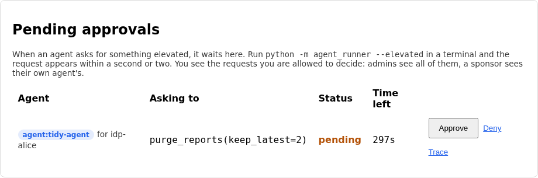
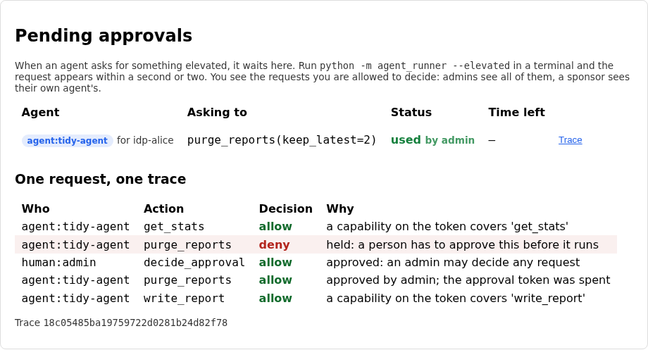
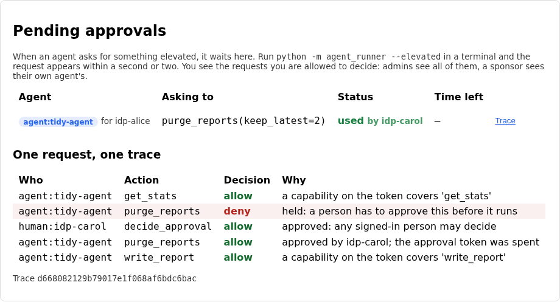

# Lab 10: a person approves the elevated action

Until now every tool an agent could call was one you were happy for it to call
on its own. It reads statistics, writes a short report, and the policy from lab
08 decides whether each call is in bounds. Some actions are different. Deleting
reports can't be undone, and "the policy says this agent is allowed to" is a
weak answer when the agent has just been fed a prompt it shouldn't have
trusted.

This lab adds a gate. When the agent asks for an elevated action, the call stops
and becomes a request in a queue. A person who is allowed to decide sees it,
approves or denies it, and an approval mints a token that works for one minute,
once, for exactly the call that was approved. The agent waits, collects the
token, repeats the call and only then does the work happen.

## What you'll learn

- Why "allowed by policy" and "approved by a person" are two different answers
- How a request moves through pending, approved, denied, expired and used, and
  why a decision has to be final
- Why an approval token must be tied to one agent, one tool and one set of
  arguments, not just be "a token that was approved once"
- Who gets to approve, and what happens when the answer is "anyone signed in"

??? note "Closing the loop on lab 09 (skip this if you finished it)"

    ### The three fixes

    **A token that names the person and the agent.** The starter handed the agent
    a token of its own, so Alice had vanished from it. The fix keeps `sub` as
    Alice, adds `acting_as` for the agent, and caps `exp` at the person's own
    expiry so a delegation can't outlive the authority behind it:

    ```python title="solution/idp/lab_idp/oauth.py"
    def compose_delegated_claims(
        subject: dict, *, agent_id: str, agent_name: str, sponsor: str | None, scope: str,
        issuer: str, now: int, ttl: int,
    ) -> dict:
        """The claims of a token an agent holds while acting for a person (the
        idea of RFC 8693 token exchange). `subject` is the introspected token of
        the person, as returned by `introspect_token`.

        The token has to say two things at once, and downstream services need both:
        whose authority this is, and who is exercising it."""
        claims = {
            "iss": issuer,
            "sub": subject["sub"],
            "aud": issuer,
            "client_id": agent_id,
            "client_type": "agent",
            "client_name": agent_name,
            "sponsor": sponsor,
            "scope": scope,
            "acting_as": {"sub": agent_id, "sponsor": sponsor},
            "iat": now,
            "exp": min(now + ttl, subject["exp"]),
            "jti": secrets.token_hex(8),
        }
        return claims
    ```

    The same token now says two things at once. `sub` answers "whose authority is
    this" and `acting_as` answers "who is using it", and a downstream API needs
    both.

    **Only scopes the person holds.** The starter granted whatever the agent asked
    for that it was registered for, whether or not Alice had agreed to it at the
    consent screen. The fix is a set intersection:

    ```python title="solution/idp/lab_idp/oauth.py"
    def narrow_delegated_scope(subject_scope: set[str], requested: set[str], delegable: set[str]) -> set[str]:
        """Which scopes may a delegated token carry? An agent acting for a person
        can never hold more than the person has, and never more than the agent was
        registered to be trusted with, whatever it asks for."""
        return requested & subject_scope & delegable
    ```

    Three lists, and a scope survives only if it is in all of them. That is what
    "delegation can only narrow" means in code, and an empty result is already
    refused by the exchange endpoint with `invalid_scope`.

    **A downstream API that checks what's in the chain.** The starter let in any
    active token, so a person's own token and the agent's own token both opened an
    API meant for an agent acting for a person. The fix checks four things in
    order, each with its own reason:

    ```python title="solution/backend/app/oidc_client.py"
    def delegated_token_allowed(result: dict, required_scope: str) -> tuple[bool, str]:
        """Should a request carrying this introspected token be let in to an API
        that serves agents acting for people? Returns `(allowed, reason)`.

        Three kinds of valid token look alike here: a person's own, an agent's
        own, and an agent's token for acting on a person's behalf. Only the last
        belongs at this door. A person's own token means no agent is in the chain,
        and an agent's own token means no person is, so each is refused for what
        it is missing."""
        if not result.get("active"):
            return False, "token is not active (expired, revoked or invalid)"
        acting = result.get("acting_as")
        if not acting:
            return False, "token is not delegated: it does not say which agent is acting for the person"
        if result.get("sub") == acting.get("sub"):
            return False, "token has no person behind the agent"
        if not has_scope(result.get("scope", ""), required_scope):
            return False, f"insufficient_scope: needs '{required_scope}', token grants '{result.get('scope', '')}'"
        return True, "delegated token accepted"
    ```

    The order matters for the audit log. A person's own token fails on the second
    check ("not delegated"), the agent's own fails there too, and a delegated token
    with the wrong scope gets past both and fails on the fourth, so the reason on
    the row always names the first thing that was actually wrong.

    ### Discussing lab 09's going further questions

    One perspective, not a graded answer key.

    **Storing Alice's token.** The app keeps it in a table until the task is done.
    Anyone who can read that table, or a backup of it, holds a live token that can
    do whatever Alice consented to for up to fifteen minutes, and the agent could
    skip the exchange and use it directly. The way out is to never store it. The
    app hands the agent a one-use ticket instead, something like an authorization
    code that only the named agent can redeem at the IdP, once, for a delegated
    token. Alice's real token then never leaves the app.

    **Revoking a delegation.** Revoking Alice's token stops new exchanges, but a
    delegated token already issued carries on until it expires. Two minutes is
    short, and here every service introspects on every call, so revoking the
    delegated token's own `jti` works immediately. To make revoking Alice's token
    cascade, put her token's `jti` into the delegated one as a parent claim and
    have introspection check both. A service that validated the JWT locally
    would never see either revocation, which is the real argument for
    introspection on anything an agent can reach.

    **Who owns `delegable_scopes`.** I'd split it. An IdP admin, with the agent's
    sponsor signing off, sets the ceiling at registration, since that is a
    statement about how much the agent can be trusted at all. Alice narrows it
    at consent, since only she knows what she's comfortable sharing. "Read my
    notes for an hour" needs a consent row with an expiry that the exchange checks
    at the moment of delegation, which is a small change and the right shape.

    **What Alice should see.** Both names, in a form she can read: "Tidy agent
    (run by Bob) read your notes at 14:02". The agent's id string means nothing to
    her. Her own identity is the authority, so it doesn't need repeating, but the
    sponsor does, because that is the person she would ask if the read looked
    wrong.

## The flow, one message at a time

The agent asks, the gateway holds the call, and Alice decides. Step through and
watch where the request becomes a row, where the token is born, and what the
token is tied to.

<!-- stepper: flows/approval-gate.flow -->
<div class="stepper" markdown>

<figure class="stepper-diagram">
<svg class="flow" viewBox="0 0 700 652" role="img" aria-label="Sequence diagram: Agent runner, This app, OPA, Alice">
<g class="actor"><rect x="45" y="8" width="110" height="34" rx="6"/><text x="100" y="30" text-anchor="middle">Agent runner</text></g>
<g class="actor"><rect x="212" y="8" width="110" height="34" rx="6"/><text x="267" y="30" text-anchor="middle">This app</text></g>
<g class="actor"><rect x="378" y="8" width="110" height="34" rx="6"/><text x="433" y="30" text-anchor="middle">OPA</text></g>
<g class="actor"><rect x="545" y="8" width="110" height="34" rx="6"/><text x="600" y="30" text-anchor="middle">Alice</text></g>
<line class="life" x1="100" y1="42" x2="100" y2="642"/>
<line class="life" x1="267" y1="42" x2="267" y2="642"/>
<line class="life" x1="433" y1="42" x2="433" y2="642"/>
<line class="life" x1="600" y1="42" x2="600" y2="642"/>
<g class="msg" id="m1"><line x1="100" y1="100" x2="258" y2="100"/><polygon points="267,100 258,95 258,105"/><text x="183" y="93" text-anchor="middle">1 purge_reports</text></g>
<g class="msg" id="m2"><line x1="267" y1="158" x2="424" y2="158"/><polygon points="433,158 424,153 424,163"/><text x="350" y="151" text-anchor="middle">2 may it?</text></g>
<g class="msg" id="m3"><line x1="433" y1="216" x2="276" y2="216"/><polygon points="267,216 276,211 276,221"/><text x="350" y="209" text-anchor="middle">3 allow + approval</text></g>
<g class="secret" id="s3_1"><rect x="443" y="222" width="162" height="22"/><text x="524" y="237" text-anchor="middle">capability says approval</text></g>
<g class="msg" id="m4"><line x1="267" y1="274" x2="109" y2="274"/><polygon points="100,274 109,269 109,279"/><text x="183" y="267" text-anchor="middle">4 202 pending</text></g>
<g class="secret" id="s4_1"><rect x="277" y="280" width="156" height="22"/><text x="355" y="295" text-anchor="middle">request + trace id kept</text></g>
<g class="msg" id="m5"><line x1="100" y1="332" x2="258" y2="332"/><polygon points="267,332 258,327 258,337"/><text x="183" y="325" text-anchor="middle">5 poll the request</text></g>
<g class="msg" id="m6"><line x1="600" y1="390" x2="276" y2="390"/><polygon points="267,390 276,385 276,395"/><text x="433" y="383" text-anchor="middle">6 approve</text></g>
<g class="secret" id="s6_1"><rect x="277" y="396" width="186" height="22"/><text x="370" y="411" text-anchor="middle">may_decide, then a 60s token</text></g>
<g class="msg" id="m7"><line x1="267" y1="448" x2="109" y2="448"/><polygon points="100,448 109,443 109,453"/><text x="183" y="441" text-anchor="middle">7 approval token</text></g>
<g class="msg" id="m8"><line x1="100" y1="506" x2="258" y2="506"/><polygon points="267,506 258,501 258,511"/><text x="183" y="499" text-anchor="middle">8 purge + token</text></g>
<g class="secret" id="s8_1"><rect x="277" y="512" width="156" height="22"/><text x="355" y="527" text-anchor="middle">token tied to this call</text></g>
<g class="msg" id="m9"><line x1="267" y1="564" x2="109" y2="564"/><polygon points="100,564 109,559 109,569"/><text x="183" y="557" text-anchor="middle">9 deleted 3</text></g>
<g class="secret" id="s9_1"><rect x="277" y="570" width="132" height="22"/><text x="343" y="585" text-anchor="middle">held, approved, run</text></g>
</svg>
</figure>

<div class="step" data-title="The agent asks to delete old reports" data-hl="m1" markdown>
The runner makes the call with the agent's own token, like any other
tool. Nothing about the request says it is special.
</div>

<div class="step" data-title="The gateway asks the policy" data-hl="m2" markdown>
Same question as lab 08, same document: the agent, the capabilities on
its token and the tool with its arguments.
</div>

<div class="step" data-title="The policy says yes, and flags it" data-hl="m3 s3_1" markdown>
The capability for `purge_reports` carries `"approval": "required"`.
The policy copies that into its answer as `requires_approval`. It has not
said "run it". It has said "run it once a person agrees".
</div>

<div class="step" data-title="The app queues a request and answers 202" data-hl="m4 s4_1" markdown>
The row records the agent, its sponsor, the tool and a fingerprint of the
exact arguments. Nothing has been deleted.
</div>

<div class="step" data-title="The agent waits and asks how it is getting on" data-hl="m5" markdown>
The runner polls once a second. While the request is pending the answer
holds no token.
</div>

<div class="step" data-title="Alice sees the request in the queue and approves it" data-hl="m6 s6_1" markdown>
Alice is the agent's sponsor, so she is allowed to decide. Approving
mints a token that lives for a minute. The queue never shows it.
</div>

<div class="step" data-title="The next poll hands the agent its token" data-hl="m7" markdown>
Only the agent that asked can collect it. A denial would have come back
here too, with no token.
</div>

<div class="step" data-title="The agent repeats the call with the token" data-hl="m8 s8_1" markdown>
The call carries the approval id and token. The app checks that the token
is live and belongs to this agent, this tool and these arguments, then spends
it.
</div>

<div class="step" data-title="The work runs, and the audit log tells the whole story" data-hl="m9 s9_1" markdown>
One trace id covers the first request, Alice's decision and the run. Spent
tokens are wiped, so the same approval can't be used twice.
</div>

</div>
<!-- /stepper -->

Three ideas carry the lab.

**Allowed is not the same as approved.** The policy answers a question about
the agent: is this tool inside what it was registered for? An elevated action
needs a second answer about this particular call: does a person want it to
happen now? Lab 08's policy keeps the first job and gains one extra field in its
answer, `requires_approval`, taken from the capability on the token. The
gateway, not the policy, does the waiting.

**A decision is final, and an approval is narrow.** A request is in exactly one
state, and the only moves are the ones in the diagram below. Once denied it stays
denied. Once used it can't be used again. The token that comes with an approval
is tied to the agent that asked, the tool and a fingerprint of the arguments, so
approving "keep the newest 2" can't be spent on "keep none". It dies after a
minute whether or not anyone used it.

**Who may decide is part of the design.** The queue shows each person only what
they are allowed to decide: an admin sees everything, a sponsor sees their own
agent's requests, and everyone else sees nothing. If that check is too generous
the whole gate becomes theatre, because the approval is only worth the person
who gave it.

??? note "Background: the states a request can be in"

    ```mermaid
    stateDiagram-v2
        [*] --> pending: the gateway holds the call
        pending --> approved: a person approves
        pending --> denied: a person denies
        pending --> expired: nobody answers in 5 minutes
        approved --> used: the agent spends the token
        approved --> expired: the token runs out after 1 minute
        denied --> [*]
        used --> [*]
        expired --> [*]
    ```

    Expiry is checked every time the queue, the agent or a decision touches a
    request, and again at the moment a token is presented, so a lapsed approval is
    refused even if nothing has swept it yet. That second check is deliberate: the
    clock, not the cleanup job, is what decides.

    **Where the token lives.** The gate stores the approval token in the request's
    row so the agent can collect it, wipes it the moment it is used or expires, and
    never shows it in the queue. The row says so in a comment. A real system would
    store a hash and hand the token over exactly once.

    **What changed underneath.** A signed-in page now polls the queue every two
    seconds, and for an IdP session every one of those requests is introspected at
    the IdP. That exposed a flaw in the earlier labs: the audit log and the app
    each opened the same SQLite file on two connections, and under load a request
    failed with "database is locked", which the app read as "token inactive" and
    logged the user out. Both databases now run in WAL mode, which lets a reader
    and a writer work side by side.

## Prerequisites and setup

- Python 3.12, Node.js (any recent version, built on Node 24), `uv` or `pip`
- The OPA binary on your `PATH`, as in labs 08 and 09
- Lab 09 completed, since this lab's starter is lab 09's solution plus the
  approval gate, the queue panel and three gaps

Check that ports 5173, 8000, 8181 and 9000 are free, then start the same four
processes as before, this time from `labs/lab-10-approval-gate/starter`:

```sh
cd labs/lab-10-approval-gate/starter/idp
uv venv .venv --python 3.12
uv pip install -r requirements.txt --python .venv/bin/python
.venv/bin/uvicorn lab_idp.main:app --port 9000
```

```sh
cd labs/lab-10-approval-gate/starter
opa run --server --addr 127.0.0.1:8181 policy
```

```sh
cd labs/lab-10-approval-gate/starter/backend
uv venv .venv --python 3.12
uv pip install -r requirements.txt --python .venv/bin/python
.venv/bin/uvicorn app.main:app --reload
```

```sh
cd labs/lab-10-approval-gate/starter/frontend
npm install
npm run dev
```

(Or `docker compose up --build` from `labs/lab-10-approval-gate/starter`.) Sign in
as `admin` (password `lab02-admin-do-not-reuse`, fixed and localhost only) and
find the **Pending approvals** panel. It is empty. Now run the agent with the
elevated task from `starter/agent`:

```sh
python -m agent_runner --ticks 3 --interval 0   # leaves a few reports to delete
python -m agent_runner --elevated
```

The second command prints `purge_reports needs approval` and stops. Within two
seconds a request appears in the panel. Click **Approve** and the terminal
carries on.

??? question "Before you click Approve: what do you expect the agent's third action, `write_report`, to do if you click Deny instead?"
    It never runs. The agent's plan only writes the "I deleted some reports"
    note when the deletion succeeded, so a denial ends the run with
    `approval denied` and the exit code is not zero. The runner treats a denial
    as an answer, not as an error to retry.



After you approve, click **Trace** on the row. One request, one trace id, five
rows: the agent's earlier read, the call being held, your decision, the call
running with the token, and the report. The row marked `deny` is the held call,
which is exactly what it was.



## Your tasks

Three gaps, all in `starter/backend/app/approvals.py`, which holds the gate's
rules apart from the web layer so each can be tested on its own.

!!! danger "Intentionally vulnerable code: localhost teaching only"
    The starter lets a decided request be decided again, lets an approval be
    spent on a different call, and lets anyone signed in approve anything. They
    are real flaws, in the spirit of ADR-0008. Fix each one here, and never copy
    the starter's versions anywhere real. The approval token also sits in the
    database so the agent can fetch it, which is fine on a laptop and not
    something to copy.

### Task 1: a decision is final

??? question "In the starter, a request has been denied. Someone sends `approve` for the same request afterwards. What state does it end up in?"
    `approved`, and it now has a live token. The starter's `transition` ignores the
    state a request is in and moves it wherever the event says. You can see it
    without the app: from `starter/backend`, run
    `python -c "from app.approvals import transition; print(transition('denied', 'approve'))"`.

Open `starter/backend/app/approvals.py` and find `transition`:

```python title="starter/backend/app/approvals.py"
def transition(status: str, event: str) -> str:
    """The state a request moves to when `event` ("approve", "deny", "use" or
    "expire") happens to a request that is in `status`. Raises
    `InvalidTransition` when that is not allowed: a decision, once made, is
    final."""
    # TODO(lab-10): this moves any request anywhere, so a denied request can be
    # approved later and a used one can be used again. The states are pending,
    # approved, denied, expired and used. From pending, `approve`, `deny` and
    # `expire` are allowed. From approved, `use` and `expire` are. Denied,
    # expired and used are final: every event raises `InvalidTransition`. So does
    # an event that doesn't belong to the state it arrives in.
    return {"approve": APPROVED, "deny": DENIED, "use": USED, "expire": EXPIRED}[event]
```

Fill in the rules from the diagram above. A pending request can be approved,
denied or expired. An approved one can be used or expired. The three final
states accept nothing, and neither does an event that doesn't fit the state it
arrives in. Both cases raise `InvalidTransition`; the endpoints already turn it
into a `409`.

### Task 2: an approval belongs to one exact call

??? question "Alice approves a request to keep the newest 2 reports. The agent then presents the right token, but asks to keep 0. What does the starter do?"
    It deletes everything. The starter checks that the token string matches and
    nothing else, so an approval for one call can be spent on a different one, by
    a different agent, or after it should have lapsed. The self-check test
    `test_an_approval_for_one_set_of_arguments_cannot_run_a_bigger_purge` shows it
    failing.

Find `approval_token_allowed` in the same file:

```python title="starter/backend/app/approvals.py"
def approval_token_allowed(
    row, presented: str, *, agent_id: str, tool: str, digest: str, now: float,
) -> tuple[bool, str]:
    """Should this call go ahead on the strength of the approval `row` and the
    token `presented` with it? Returns `(allowed, reason)`.

    `row` has the stored `status`, `approval_token`, `token_expires_at`,
    `agent_id`, `tool` and `args_digest`. A token that is real is not enough:
    it has to be live, and it has to belong to this exact call."""
    # TODO(lab-10): this accepts any request that holds the right token string.
    # An approval for one agent, one tool and one set of arguments could be spent
    # by another agent, on another tool, with other arguments, long after. Check,
    # in order, each with its own reason: the request's `status` is approved; the
    # token matches (`secrets.compare_digest`, and a request with no stored token
    # never matches); `now` is before `token_expires_at`; `agent_id` is the
    # agent the request was made by; `tool` is the tool it asked for; and
    # `digest` equals the stored `args_digest`.
    return bool(row["approval_token"]) and secrets.compare_digest(row["approval_token"], presented or ""), "token matches"
```

The arguments are fingerprinted with `args_digest` when the request is made, and
the gateway computes the same fingerprint for the call it is looking at, so
`digest` and `row["args_digest"]` are directly comparable. Check the six things in
the order the TODO gives, with a different reason for each. The reasons go straight
into the audit log, which is why they are worth writing carefully.

### Task 3: who may decide

??? question "Sign in as `carol` through the Lab IdP (she is an ordinary user, and not the agent's sponsor), then run `python -m agent_runner --elevated`. What do you expect to see in her queue?"
    The request, with an Approve button, and it works. The starter lets any
    signed-in person decide any request, and the same function decides who sees
    what in the queue. That is the screenshot below.



Find `may_decide`:

```python title="starter/backend/app/approvals.py"
def may_decide(*, role: str, idp_sub: str | None, sponsor: str | None) -> tuple[bool, str]:
    """May this signed-in person approve or deny a request from an agent whose
    sponsor is `sponsor`? Returns `(allowed, reason)`; the reason is audited."""
    # TODO(lab-10): this lets any signed-in person decide any request, so an
    # ordinary user could approve an agent's purge for someone else. Allow the
    # decision only for an admin (`role == "admin"`) or for the agent's sponsor
    # (`idp_sub` equal to `sponsor`, and `sponsor` actually set). Give each
    # answer its own reason.
    return True, "any signed-in person may decide"
```

An admin may decide any request. The agent's sponsor may decide that agent's
requests. Nobody else may. Be careful with the second rule: a person with no IdP
identity has `idp_sub` of `None`, and an agent with no sponsor has `sponsor` of
`None`, and those two must not count as a match. Restart the backend, sign in as
carol again and her queue is empty. Sign in as `alice`, the sponsor, and the
request is there.

!!! note "Optional stretch: let a model choose"
    `python -m agent_runner --llm` still runs the lab 07 agent through the gateway.
    A model that asks for `purge_reports` hits the same gate, waits the same way
    and gets the same token, so a prompt injection that talks it into asking still
    needs a person to say yes. Nothing here needs one.

## You're done when

Run the self-check suite from `starter/backend` (the OPA binary has to be on your
`PATH`, or set `OPA_BIN`):

```sh
.venv/bin/pytest tests/ -v
```

- [ ] The `test_the_allowed_transitions` and `test_a_finished_request_cannot_move_again`
      cases pass, along with the four other state-machine tests
- [ ] The `approval_token_allowed` tests pass: a live token for the same call is
      accepted, and each of the six refusals has its own test
- [ ] The `may_decide` tests pass, and so do
      `test_a_user_who_is_neither_admin_nor_sponsor_cannot_decide_through_the_app`
      and `test_the_queue_shows_a_person_only_what_they_may_decide`
- [ ] `test_an_elevated_call_waits_instead_of_running` and
      `test_the_approved_call_runs_once_with_the_token_and_deletes_the_reports` pass
- [ ] `test_an_approval_token_works_only_once` and
      `test_a_request_nobody_answers_lapses_and_can_no_longer_be_approved` pass
- [ ] `test_the_request_the_decision_and_the_spend_share_one_trace` passes
- [ ] Every other test still passes, including everything carried over from
      labs 00-09
- [ ] `python -m agent_runner --elevated` waits, and finishes after you approve
      the request as `admin` or as `alice`
- [ ] The **Pending approvals** panel shows nothing to `carol`, and **Trace**
      shows held, approved and run under one trace id

## Going further

No self-check for these.

1. The runner polls once a second. What would the agent gain from being told
   instead, and what would the gate have to hold on to in order to tell it?
2. The approval is tied to a fingerprint of the arguments. If the arguments are
   text a model wrote, can Alice meaningfully read them before she clicks? What
   would you show her?
3. The token lives for one minute and covers one call. What do you do about an
   action that is really twenty calls, or one that takes ten minutes?
4. If Alice approves everything within a second of it appearing, the gate has
   stopped being a gate. How would you notice, and what would you change?

## Further reading

- [OWASP: Top 10 for LLM applications, excessive agency](https://genai.owasp.org/llmrisk/llm062025-excessive-agency/), which is the failure this gate exists for
- [Open Policy Agent: policy language reference](https://www.openpolicyagent.org/docs/policy-reference), for how `requires_approval` can grow richer rules
- [The confused deputy problem](https://en.wikipedia.org/wiki/Confused_deputy_problem), which lab 11 is built on
