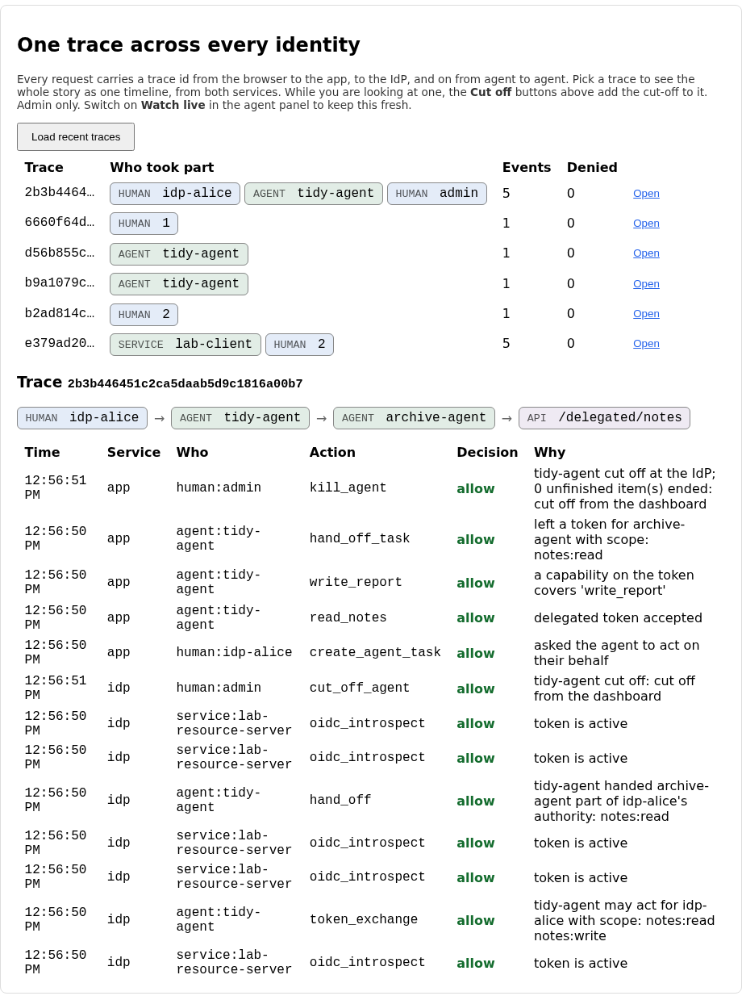
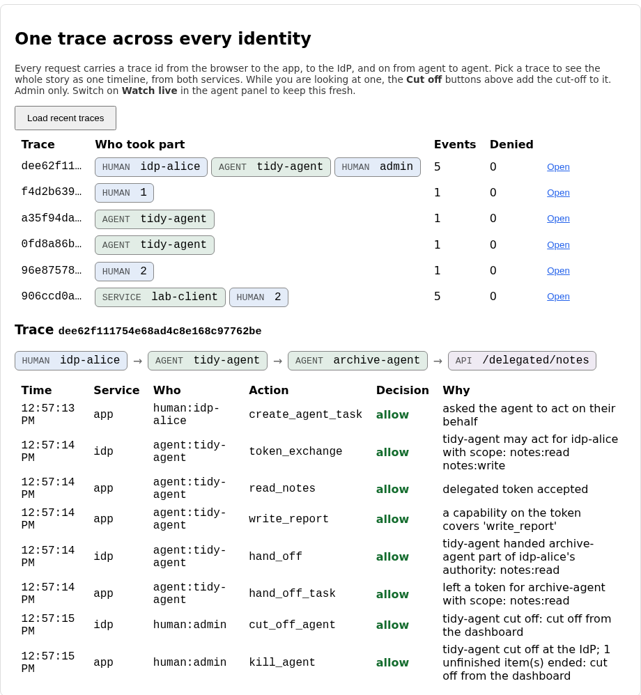
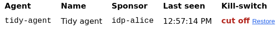

# Lab 12: one trace, one kill-switch

By now a single job can touch a person, two agents, an approval queue, the app and
the IdP, and each of those writes its own audit rows. When something looks wrong
(an agent is deleting notes, or reading things it has no reason to) an operator
needs two things quickly: the whole story in one place, and a way to make it stop.

This lab builds both. The first is a timeline for one trace id that merges the
app's log and the IdP's, whoever acted, human, service or agent. The second is a
kill-switch that cuts an agent off at the IdP, so that its very next request, to
anything, is refused, and so is every request from an agent it passed work on to.

## What you'll learn

- Why a trace id is only useful if every service writes it, and what it takes to
  turn two logs into one story
- The difference between revoking a token and cutting off an identity, and why the
  second has to look at a token's whole history
- Why the check has to be made fresh on every request, never remembered
- What a dead agent leaves behind (pending approvals, half-finished hand-offs,
  borrowed tokens), and why cleaning that up is part of the switch

??? note "Closing the loop on lab 11 (skip this if you finished it)"

    ### The three fixes

    **A hop gets only what was handed over on purpose.** The starter passed on
    everything the first agent held. The fix is the overlap of three sets, so
    nothing is inherited:

    ```python title="solution/idp/lab_idp/oauth.py"
    def narrow_hop_scope(held: set[str], regranted: set[str], ceiling: set[str]) -> set[str]:
        """Which scopes may the token for the next agent in a chain carry? The
        agent passing the work on holds `held`. It names, explicitly, the part it is
        re-granting (`regranted`). The receiving agent is registered for at most
        `ceiling`. Nothing is inherited: a hop gets only what was handed to it on
        purpose, and never more than either side could use alone."""
        return held & regranted & ceiling
    ```

    A hop that re-grants nothing gets nothing, and an agent can't be given more than
    its own registration allows, however much the agent calling it holds.

    **The second token names the second agent.** The starter re-issued the first
    agent's own token, so the archive agent's actions were filed under the tidy
    agent's name. The fix builds a token that is the second agent's, remembers the
    route, and cannot outlive the one it came from:

    ```python title="solution/idp/lab_idp/oauth.py"
    def compose_hop_claims(
        subject: dict, *, target_id: str, target_name: str, target_sponsor: str | None, scope: str,
        issuer: str, now: int, ttl: int,
    ) -> dict:
        """The claims of the token the next agent in a chain holds. `subject` is the
        introspected token of the agent handing the work on, which is itself a
        delegated token with `acting_as`.

        The new token has to stay Alice's authority, say who is exercising it now,
        and remember who it came through, so that whatever the second agent does
        can be traced back along the chain and never lands on the first agent."""
        via = [*subject["acting_as"].get("via", []), subject["acting_as"]["sub"]]
        claims = {
            "iss": issuer,
            "sub": subject["sub"],
            "aud": issuer,
            "client_id": target_id,
            "client_type": "agent",
            "client_name": target_name,
            "sponsor": target_sponsor,
            "scope": scope,
            "acting_as": {"sub": target_id, "sponsor": target_sponsor, "via": via},
            "iat": now,
            "exp": min(now + ttl, subject["exp"]),
            "jti": secrets.token_hex(8),
        }
        return claims
    ```

    `via` is what lets the audit log say "the archive agent, through the tidy agent"
    rather than just one of them, and it is also what this lab's kill-switch reads.

    **Who may pass a token on.** The starter let anyone holding a delegated token
    pass it to anyone. The fix is six checks in order, each with its own reason:

    ```python title="solution/idp/lab_idp/oauth.py"
    def may_redelegate(subject: dict, presenter_id: str, target_id: str, registry: dict) -> tuple[bool, str]:
        """May `presenter_id` pass the delegated token `subject` on to `target_id`?
        Returns `(allowed, reason)`. `registry` is `SERVICE_CLIENTS`: each agent's
        `hand_off_to` says who it may pass work to."""
        if not subject.get("active"):
            return False, "the token is not active (expired, revoked or invalid)"
        acting = subject.get("acting_as")
        if not acting:
            return False, "the token is not delegated, so there is nothing to pass on"
        if presenter_id != acting.get("sub"):
            return False, f"only {acting.get('sub')}, the agent this token was issued to, may pass it on"
        if target_id not in registry.get(presenter_id, {}).get("hand_off_to", set()):
            return False, f"{presenter_id} is not registered to hand work to {target_id or 'that agent'}"
        if target_id == presenter_id or target_id in acting.get("via", []):
            return False, "work cannot be handed back along the chain"
        if len(acting.get("via", [])) >= MAX_HAND_OFFS:
            return False, f"a person's authority may pass through at most {MAX_HAND_OFFS} extra agent"
        return True, "hand-off allowed"
    ```

    Handing on authority is itself an exercise of it, so it gets the same care as
    using it.

    ### Discussing lab 11's going further questions

    One perspective, not a graded answer key.

    **Sender-constrained tokens.** DPoP or mutual TLS bind a token to a key that
    only its holder has, so a leaked hop token is useless to anyone else. That
    closes the replay gap and nothing more. In lab 11 the agent holding the token
    was the one that did the damage, so the token being unreplayable would not have
    helped at all.

    **Where a defence against instructions in data lives.** Not in one place. The
    model can be told which text is data, and that works much of the time and never
    all of it. The runner can't read intent. The API can only limit what a token is
    able to do. So the dependable defence is the least interesting one: treat
    everything the agent reads as untrusted, and make sure the worst thing it can be
    talked into is bounded by what its token carries.

    **Should the hop be seen by Alice.** The more useful question is why the tidy
    agent held `notes:write` on a job that never writes. Ask for the narrowest
    scope at the exchange and most of the problem goes away. A person (or lab 10's
    gate) belongs on hops that widen authority or write, and a read-only hop to a
    registered agent doesn't need one.

    **A longer chain.** At three hops you gain specialist agents composing, and you
    lose the ability to say who answers for what, since each hop adds a sponsor. I'd
    keep the limit at one or two until a real case needs more. To show a long chain
    to a person, write it as a sentence with each sponsor in it, and fold anything
    past the third hop behind "and two more".

## The flow, one message at a time

An archive job is in flight and the operator cuts off the first agent. Step through
and watch which checks look at which part of the token, and what the timeline shows
afterwards.

<!-- stepper: flows/kill-switch.flow -->
<div class="stepper" markdown>

<figure class="stepper-diagram">
<svg class="flow" viewBox="0 0 700 536" role="img" aria-label="Sequence diagram: Operator, This app, Lab IdP, Archive agent">
<g class="actor"><rect x="45" y="8" width="110" height="34" rx="6"/><text x="100" y="30" text-anchor="middle">Operator</text></g>
<g class="actor"><rect x="212" y="8" width="110" height="34" rx="6"/><text x="267" y="30" text-anchor="middle">This app</text></g>
<g class="actor"><rect x="378" y="8" width="110" height="34" rx="6"/><text x="433" y="30" text-anchor="middle">Lab IdP</text></g>
<g class="actor"><rect x="545" y="8" width="110" height="34" rx="6"/><text x="600" y="30" text-anchor="middle">Archive agent</text></g>
<line class="life" x1="100" y1="42" x2="100" y2="526"/>
<line class="life" x1="267" y1="42" x2="267" y2="526"/>
<line class="life" x1="433" y1="42" x2="433" y2="526"/>
<line class="life" x1="600" y1="42" x2="600" y2="526"/>
<g class="msg" id="m1"><line x1="100" y1="100" x2="258" y2="100"/><polygon points="267,100 258,95 258,105"/><text x="183" y="93" text-anchor="middle">1 open the trace</text></g>
<g class="msg" id="m2"><line x1="100" y1="158" x2="258" y2="158"/><polygon points="267,158 258,153 258,163"/><text x="183" y="151" text-anchor="middle">2 cut off tidy-agent</text></g>
<g class="secret" id="s2_1"><rect x="277" y="164" width="186" height="22"/><text x="370" y="179" text-anchor="middle">may_decide? admin or sponsor</text></g>
<g class="msg" id="m3"><line x1="267" y1="216" x2="424" y2="216"/><polygon points="433,216 424,211 424,221"/><text x="350" y="209" text-anchor="middle">3 cut off, by whom</text></g>
<g class="secret" id="s3_1"><rect x="443" y="222" width="144" height="22"/><text x="515" y="237" text-anchor="middle">client marked cut off</text></g>
<g class="secret" id="s4_1"><rect x="277" y="280" width="180" height="22"/><text x="367" y="295" text-anchor="middle">approvals, tasks, hand-offs</text></g>
<g class="msg" id="m5"><line x1="600" y1="332" x2="276" y2="332"/><polygon points="267,332 276,327 276,337"/><text x="433" y="325" text-anchor="middle">5 read notes</text></g>
<g class="msg" id="m6"><line x1="267" y1="390" x2="424" y2="390"/><polygon points="433,390 424,385 424,395"/><text x="350" y="383" text-anchor="middle">6 POST /introspect</text></g>
<g class="secret" id="s6_1"><rect x="443" y="396" width="156" height="22"/><text x="521" y="411" text-anchor="middle">via tidy-agent, cut off</text></g>
<g class="msg" id="m7"><line x1="267" y1="448" x2="591" y2="448"/><polygon points="600,448 591,443 591,453"/><text x="433" y="441" text-anchor="middle">7 401 not active</text></g>
<g class="secret" id="s7_1"><rect x="277" y="454" width="102" height="22"/><text x="328" y="469" text-anchor="middle">audit: refused</text></g>
</svg>
</figure>

<div class="step" data-title="An archive job is in flight, and the operator is watching its trace" data-hl="m1" markdown>
One trace id covers the request, the token exchange, the hand-off and every
call so far, from both services. The tidy agent has already passed the filing
on, and the archive agent is part way through it.
</div>

<div class="step" data-title="The operator hits the switch for the first agent" data-hl="m2 s2_1" markdown>
Only an admin or that agent's sponsor may do this. The request carries the
trace id the operator is looking at, so the cut-off lands in the same story.
</div>

<div class="step" data-title="The app asks the IdP to stop honouring it" data-hl="m3 s3_1" markdown>
The IdP records the client as cut off, with who did it and why. From now on
it issues that agent no token and accepts it as no one's delegate.
</div>

<div class="step" data-title="The app ends what the agent left waiting" data-hl="s4_1" markdown>
Pending approvals, claimed tasks and unfinished hand-offs belonging to the
agent are ended and their tokens wiped, so nobody can approve a request from
an agent that no longer exists.
</div>

<div class="step" data-title="The archive agent makes its next call" data-hl="m5" markdown>
Its token was made for it, not for the tidy agent, but it came through the
tidy agent. The API asks the IdP whether it is active, as it does on every call.
</div>

<div class="step" data-title="The IdP looks at the whole history of the token" data-hl="m6 s6_1" markdown>
The check is made fresh, and it covers the client the token was issued to,
the agent acting, and every agent in `via`. One of them is cut off.
</div>

<div class="step" data-title="The next action is refused, and the trace shows who stopped it" data-hl="m7 s7_1" markdown>
One request cycle after the switch, the chain stops. The same timeline now
has the operator's cut-off, the IdP's record of it, and the refusal.
</div>

</div>
<!-- /stepper -->

Three ideas carry the lab.

**Correlation is a join, and it is only as good as what you join on.** Each
request carries a trace id, and every service writes it on every audit row, so
putting two logs together is a filter on one field and a sort on another. Get either
wrong and the story is either noisy (rows from other traces, introspection calls
on every hop) or out of order (the IdP's rows all after the app's). The identities
come for free: the same row shape serves a human, a service and an agent.

**Revoking an identity is not revoking a token.** Lab 05's revocation stopped one
token by its `jti`. An agent holds many tokens, and the ones it handed on are made
from its own. A kill-switch records the identity as cut off, and the introspection
check asks of every token: was it issued to someone cut off, is someone cut off
acting in it, and did it pass through anyone cut off. Anything less leaves a
live route around the switch.

**The check has to be made now.** The app asks the IdP whether a token is active on
every call, and the IdP reads the list of cut-off clients from its database each
time. A cache would make the switch take effect "within a minute", which is a long
time for a deleting agent. The cost is one introspection per request, which this
course already pays.

??? note "Background: what a dead agent leaves behind"

    ```mermaid
    flowchart TD
        K["Cut off tidy-agent"] --> I["IdP: client marked cut off"]
        K --> W["App: end its unfinished work"]
        I --> T1["its own tokens: inactive"]
        I --> T2["tokens it handed on, via tidy-agent: inactive"]
        I --> T3["new tokens, exchanges, hand-offs to it: refused"]
        W --> A["pending and approved approvals: ended, tokens wiped"]
        W --> H["hand-offs it gave or was given: cancelled, tokens wiped"]
        W --> TK["tasks it claimed: cancelled, the person's token wiped"]
    ```

    The left branch is enforcement and the right branch is hygiene. Without the
    right one, the switch still works (no token passes), but a person could approve
    a request from an agent that no longer exists, and a borrowed token for someone
    would sit in a table until it expired.

    **Who may pull it.** An admin, or the agent's own sponsor, since the sponsor is
    the person who answers for it. Restoring is admin only: whoever can switch an
    agent off isn't automatically the one who decides it is safe again.

    **What changed underneath.** An admin page that polls several endpoints a second
    exposed one more flaw from the earlier labs: the app and the IdP each shared one
    SQLite connection between FastAPI's worker threads, and two threads on one
    connection give "bad parameter or other API misuse". Both databases now go through
    a small `LockedConnection` that takes one lock per call, which is what the audit
    log has done since lab 07.

    **What it does not do.** It doesn't undo anything the agent already did, and it
    can't stop a request that was already past the introspection check when the
    switch was pulled. "Within one request cycle" means the next one, not the one
    in flight.

## Prerequisites and setup

- Python 3.12, Node.js (any recent version, built on Node 24), `uv` or `pip`
- The OPA binary on your `PATH`, as in labs 08 to 11
- Lab 11 completed, since this lab's starter is lab 11's solution plus the
  kill-switch, the unified trace view and three gaps

Check that ports 5173, 8000, 8181 and 9000 are free, then start the same four
processes as before, from `labs/lab-12-audit-killswitch/starter`:

```sh
cd labs/lab-12-audit-killswitch/starter/idp
uv venv .venv --python 3.12
uv pip install -r requirements.txt --python .venv/bin/python
.venv/bin/uvicorn lab_idp.main:app --port 9000
```

```sh
cd labs/lab-12-audit-killswitch/starter
opa run --server --addr 127.0.0.1:8181 policy
```

```sh
cd labs/lab-12-audit-killswitch/starter/backend
uv venv .venv --python 3.12
uv pip install -r requirements.txt --python .venv/bin/python
.venv/bin/uvicorn app.main:app --reload
```

```sh
cd labs/lab-12-audit-killswitch/starter/frontend
npm install
npm run dev
```

(Or `docker compose up --build` from `labs/lab-12-audit-killswitch/starter`.) You
need two people at once, so open two browser windows, one of them private. In the
first, choose **Sign in with Lab IdP** as `alice` (password `alice-lab-pass`) and
create a note. In the second, log in as `admin` (password
`lab02-admin-do-not-reuse`). Then, in Alice's window, click **Ask the agents to
archive my notes**, and from `starter/agent` run the first agent:

```sh
python -m agent_runner --hand-off
```

Don't run the archive agent yet. In the admin window, open **Agent activity** and
choose **Watch live**. The agents appear with a **Cut off** button each, and the
**One trace across every identity** panel lists the job you just ran. Click **Open**
on it.

??? question "The trace panel merges the app's log and the IdP's. Compare the Time column to the order of the rows in the starter. What do you expect?"
    Out of order, and padded. The starter glues the two logs together as they came,
    so every IdP row sits after every app row regardless of when it happened, and
    the introspection calls the app makes on each hop are in there too. Sorting and
    filtering is the first thing the timeline needs.



## Your tasks

Three gaps. Two are in the kill-switch (the IdP's check and the app's cleanup) and
one is in the timeline.

### Task 1: a cut-off that follows the chain

??? question "You cut off `tidy-agent` while the job is half done, then run `python -m agent_runner --archive`. The archive agent's token was made for it, not for the tidy agent. What do you expect when it tries to read Alice's notes?"
    In the starter, it reads them. `token_cut_off` only looks at the client the
    token was issued to, which is the archive agent, and that one is fine. The
    token came through the tidy agent, which is cut off, and the check never looks
    at that. The kill-switch has a live route around it.

Open `starter/idp/lab_idp/oauth.py` and find `token_cut_off`:

```python title="starter/idp/lab_idp/oauth.py"
def token_cut_off(claims: dict, cut_off: set[str]) -> str | None:
    """Has this token been cut off because of who it belongs to, or who it came
    through? Returns the reason, or None when it is fine. `claims` is the decoded
    token, `cut_off` the set of client ids that have been revoked.

    A token is only as trustworthy as every agent in its history. A delegated
    token made for the archive agent by the tidy agent carries `acting_as.via`,
    and cutting the tidy agent off has to cut off what it handed on."""
    # TODO(lab-12): this only looks at the client the token was issued to. A
    # token made for the archive agent by the tidy agent still works after the
    # tidy agent is cut off, so the kill-switch leaks through the chain. Return a
    # reason (a short sentence naming the agent) when any of three things is in
    # `cut_off`: the token's `client_id`; the agent in `acting_as["sub"]`; or any
    # agent in `acting_as["via"]`. Return None when none is.
    if claims.get("client_id") in cut_off:
        return f"{claims['client_id']} has been cut off"
    return None
```

Return a reason when any of three things is in `cut_off`: the client the token was
issued to, the agent in `acting_as`, or any agent in the `via` list. Restart the IdP
and the next `--archive` read is refused. That is the answer to "within one request
cycle": the check is made on the request itself, from the database, with nothing
remembered. (Once task 3 is done, the archive agent won't find the job at all, which
is also correct. The self-check covers the case where it had already started.)

### Task 2: one timeline from two services

Open `starter/backend/app/traces.py` and find `correlate`:

```python title="starter/backend/app/traces.py"
def correlate(trace_id: str, app_events: list[dict], idp_events: list[dict]) -> list[dict]:
    """One timeline for `trace_id`. `app_events` and `idp_events` are audit rows
    as dicts, each with a `trace_id`, a timestamp `ts` and an `action`. Tag each
    row with where it came from (`source`: "app" or "idp"), keep only rows of this
    trace, drop the introspection calls (they happen on every hop and say nothing
    about who acted), and put the rest in the order they happened."""
    # TODO(lab-12): this glues the two logs together as they came. It keeps rows
    # from other traces, keeps the introspection noise, and leaves the IdP's rows
    # after all of the app's, so the story reads out of order. Return only the
    # rows whose `trace_id` is this one, without the `oidc_introspect` ones, each
    # tagged with `source` as above, sorted by `ts`.
    return [{**e, "source": "app"} for e in app_events] + [{**e, "source": "idp"} for e in idp_events]
```

Keep only this trace's rows, tag each with where it came from, drop the
introspection calls and put what is left in the order it happened. Reload the panel
and the clock now runs forwards, with the IdP's rows where they belong between the
app's:



While the trace is open, click **Cut off** on `tidy-agent` in the agent panel. The
cut-off lands in the trace you are looking at, as the operator's `kill_agent` and
the IdP's own `cut_off_agent`, and the agent's row in the table says so:



### Task 3: ending what a dead agent left behind

??? question "Before you cut off `tidy-agent`, run `python -m agent_runner --elevated` in another terminal so a purge request sits in the approval queue. Cut the agent off, then approve the request. What happens?"
    In the starter, the approval works. The switch stopped every token, but it
    didn't touch the request, which is still pending, so a person can approve it and
    a token is minted for an agent that no longer exists. Nothing can use that
    token, which is why it is easy to miss, and it is exactly the kind of loose end
    that matters when the agent is restored.

Find `cut_off_pending_work` in `starter/backend/app/approvals.py`:

```python title="starter/backend/app/approvals.py"
def cut_off_pending_work(conn: sqlite3.Connection, agent_id: str, now: float) -> int:
    """Lab 12: an agent has been cut off. Whatever it had waiting has to die with
    it, or a person could still approve a request from an agent that no longer
    exists, and a token minted for it would sit in a table. End every approval
    request of this agent that is still pending or approved (the state machine's
    `expire` event gives the final state, and the token is wiped), cancel hand-
    offs it gave or was given that are not finished (wipe their tokens), and
    cancel tasks it claimed but did not complete (wipe the person's token).
    Returns how many rows were ended, across all three tables."""
    # TODO(lab-12): this leaves everything the agent had in flight exactly as it
    # was. Do three updates and return the number of rows they changed in total.
    # Approval requests of this agent that are `pending` or `approved`: set the
    # status to what `transition(status, "expire")` gives, null `approval_token`,
    # and note who ended it (`decided_by = 'kill-switch'`). Rows in
    # `agent_handoffs` where it is `from_agent` or `to_agent` and the status is
    # `pending` or `claimed`: status `cancelled`, `token` null. Rows in
    # `agent_tasks` it `claimed_by` and not finished: status `cancelled`,
    # `subject_token` null. Commit when you are done.
    return 0
```

Three updates, and a count. The state machine already knows what a request that
ends this way becomes, so use it rather than writing the status yourself. Restart
the backend, repeat the experiment, and the request is gone from the queue's
pending list with `kill-switch` as who ended it.

!!! note "Optional stretch: let a model choose"
    `python -m agent_runner --llm` still runs the lab 07 agent through the gateway.
    A cut-off agent driven by a model is refused exactly like a scripted one: the
    switch is about the identity's tokens, not about the thing deciding what to do
    with them.

## You're done when

Run the self-check suite from `starter/backend` (the OPA binary has to be on your
`PATH`, or set `OPA_BIN`):

```sh
.venv/bin/pytest tests/ -v
```

- [ ] The `token_cut_off` tests pass, including the ones that put the agent in
      `acting_as` and in `via`, and so do the tests that cut off real agents at the IdP
- [ ] `test_cutting_off_the_first_agent_also_kills_the_token_it_handed_to_the_second`
      passes, so the switch does not leak down the chain
- [ ] The `correlate` tests pass, and so do `test_an_admin_reads_one_trace_that_spans_the_human_both_agents_and_the_idp`
      and `test_the_recent_traces_list_includes_the_job`
- [ ] `test_an_admin_cuts_an_agent_off_and_its_very_next_tool_call_is_refused` and
      `test_cutting_off_the_first_agent_after_the_second_has_started_stops_the_seconds_next_call` pass
- [ ] The four `cut_off_pending_work` tests pass: approvals, granted approvals,
      hand-offs and claimed tasks are ended and their tokens wiped
- [ ] `test_the_agents_sponsor_may_cut_it_off_but_an_ordinary_user_may_not` and
      `test_a_sponsor_cannot_cut_off_someone_elses_agent` pass
- [ ] Every other test still passes, including everything carried over from
      labs 00-11
- [ ] In the browser, cutting off `tidy-agent` while its trace is open adds a
      `kill_agent` row to that trace, and `python -m agent_runner --ticks 1` then
      prints that the IdP refused the agent's credentials

## Going further

No self-check for these.

1. The app asks the IdP on every request. At a thousand requests a second that is
   a lot of introspection. What could you cache without making the switch slower to
   bite, and what must you never cache?
2. Cutting off an agent also ends the work of the agents it handed on to, because
   their tokens carry `via`. Should it also cut off the second agent's *identity*?
   What would you want to know first?
3. The kill-switch is one button, and it can be pressed by a sponsor. What would
   you add so that pressing it by mistake, or maliciously, is recoverable and
   visible?
4. The unified trace only works because every service honours `X-Trace-Id`. What
   happens to the story when one service in the middle doesn't pass it on, and how
   would you notice?

## Further reading

- [RFC 7009: OAuth 2.0 Token Revocation](https://datatracker.ietf.org/doc/html/rfc7009), for what revoking a single token means
- [OpenID Shared Signals and the Continuous Access Evaluation Profile](https://openid.net/wg/sharedsignals/), the standards route to "stop this identity everywhere now"
- [W3C Trace Context](https://www.w3.org/TR/trace-context/), the real format of what this course calls `X-Trace-Id`
