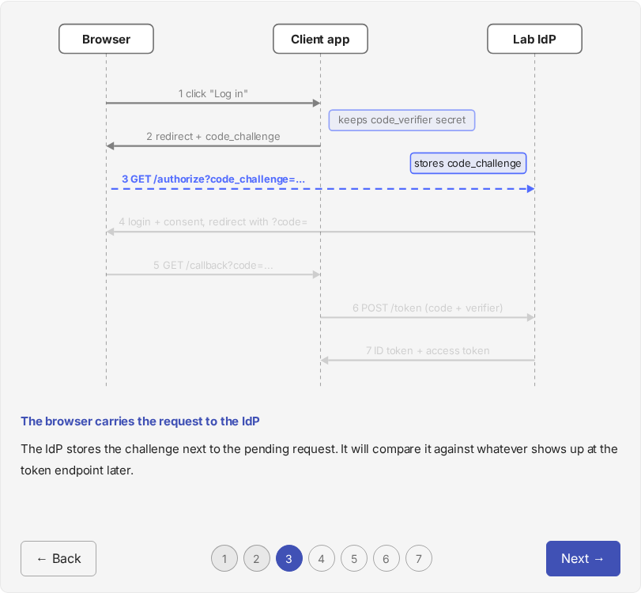
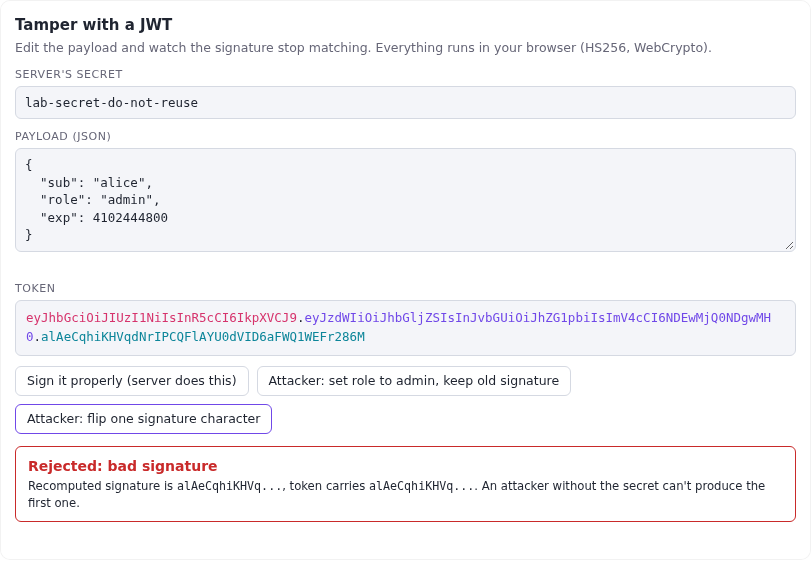

# What makes a good lab handout (AAL-11 spike)

Status: accepted. The decisions are recorded in ADR-0011. This file holds the
evidence behind them.

## The short version

Our handouts are well structured but they are still mostly prose. Across labs
00-03 there are 2-4 Mermaid diagrams each, three screenshots in total, and
nothing a learner can click, break or replay. At 1,500-2,900 words a lab, the
reader's only way to engage is to read.

The cheapest, highest-value change is to stop explaining mechanisms in
paragraphs and let learners watch them: a **clickthrough** that animates a
diagram one message at a time, a small **embedded widget** they can break on
purpose, and a **predict-then-reveal** question before each payoff. All three
work in Zensical today with no plugin and no build step. I prototyped them
(see "What I built") and checked them in headless Chromium in light and dark
mode.

## How I researched this

Honest accounting, because the evidence is uneven:

- **Read directly:** Diátaxis on tutorials, Zensical's customization docs and
  compatibility page, and the existing handouts and ADR-0010.
- **From search summaries, not read in full:** Nicky Case and Bret Victor on
  explorable explanations, Andy Matuschak's note on sandboxes, the
  worked-example and cognitive-load literature (Paas and van Gog 2006,
  Atkinson et al. 2000).
- **Not verified:** my searches returned nothing on Bartosz Ciechanowski,
  Julia Evans, jwt.io or the oauth.com playground. I know them as good
  models of interactive and illustrated explanation, but I haven't confirmed
  details from a source this session, so treat them as leads to study, not
  citations.
- **No real learners yet.** Diátaxis says hidden flaws only show up when
  people attempt the material. Everything below is informed opinion until
  someone actually works a lab.

## Reader flow

A learner moves through a handout in a loop: read a bit, switch to the
terminal or editor, run something, come back to check. The handout loses
people at the switches, not in the reading. That points to a few rules,
most of them straight from Diátaxis:

- **Set the destination first.** Say what they will build or see by the end,
  without promising what they will "learn". Our objectives section does the
  second part and could do more of the first.
- **Visible results early and often.** Every task should end in something
  observable (a panel, a denial, a trace line). CLAUDE.md already requires
  one named outcome per lab. The finer point is one per task.
- **Say what the output should look like, and what to notice.** Show the
  expected response or a screenshot, then point at the one detail that
  matters. This is also the best defence against a learner silently going
  off the rails.
- **Keep explanation out of the task flow.** Background belongs in the
  explainer section or behind a fold, linked from the task. This is the one
  place our current structure fights Diátaxis: the background comes first as
  one long block, then tasks follow much later. A learner who is keen to
  start has to get through it all first.
- **Let people re-enter.** Keep the "you're done when" checklist and make
  each task independently checkable, so someone who closes the laptop
  mid-lab can find their place.

The previous-lab walkthrough (ADR-0010 rule 3) is a good idea that pushes the
real content down the page. I'd keep it and fold it by default, so a learner
who finished the previous lab can skip it and one who didn't can open it.

## Language

Diátaxis gives concrete phrasings that match our peer voice well: "In this
lab, we will...", "First, do x. Now, do y.", "The output should look
something like...", "Notice that...". Use "we" for shared effort and
"you" only for a direct instruction. Praise at the end when it's earned.

Two cautions specific to us:

- Our handouts explain a lot while also giving instructions. Diátaxis treats
  that as the hardest habit to break. Put the "why" in one sentence at the
  point of action and link out.
- The natural-writing rules still apply, and they matter more in a handout
  than in a blog post. A stiff, machine-flavoured sentence in a tutorial
  makes the reader doubt the commands next to it.

## Medium: which job each one does

Nicky Case's workshop notes give a useful split, and it matches what we
need: text for abstract concepts, graphs for relationships at a glance,
animation for things that happen over time, interactives for processes and
systems. Auth is almost all process over time (redirects, token exchange,
delegation hops), so our default should lean on animation and interaction,
not text.

| Concept in our labs | Best medium | Why |
|---|---|---|
| Multi-party flows (OIDC, token exchange, on-behalf-of) | Clickthrough over a sequence diagram | The order of messages is the lesson |
| "Why does the signature matter" (JWT, PKCE, scopes) | Break-it widget | Failing on purpose teaches faster than being told |
| Policy decisions (ABAC, OPA, scope checks) | Trace screenshot plus a "predict the verdict" question | Our trace viewer already shows the rule that fired |
| Architecture (lab 04 onward) | Static C4 or Mermaid | Shape, not sequence |
| Exploit then fix (labs 02, 11) | Side-by-side before/after tabs | Content tabs are already enabled |
| Any claim the learner can check | Predict-then-reveal fold | Retrieval beats re-reading |

Cautions from the sources:

- Bret Victor's point is that interactivity only counts when it is woven into
  the explanation. Andy Matuschak's is that a sandbox bolted on the end of an
  article rarely leads anywhere. So a widget goes next to the sentence it
  illustrates, with a task attached ("flip a character, read the verdict"),
  not in a toy section at the bottom.
- The worked-example research argues for partially completed examples and for
  labelling or segmenting what is shown. A stepper is a direct form of
  segmenting, and our starter-with-TODO is already a partially completed
  example.
- Don't animate for decoration. The test is whether removing it would make a
  mechanism harder to follow.

## What our tools can do

Checked against Zensical's docs and my builds:

| Capability | Status |
|---|---|
| `extra_css` and `extra_javascript` | Work as in Material. Used by the prototypes |
| Instant navigation | On in our config. Scripts must init through `document$.subscribe`, which the prototypes do |
| Raw HTML and inline SVG in markdown | Works. Put it in a block with no `markdown` attribute, or `md_in_html` mangles the SVG (I hit this) |
| `pymdownx.details` folds, tabs, admonitions, tooltips | Already enabled, unused for checkpoints |
| Mermaid | Already enabled. No animation, so it can't drive a clickthrough |
| Non-markdown files under `docs_dir` | Copied as is, so widgets can live in `docs/course/widgets/` |
| Template overrides via `custom_dir` | Supported, not needed yet |
| MkDocs plugins | Only some supported. I did not rely on any |
| Playwright screenshots | Work here, documented in `write-lab-handout` |

Not checked: whether Zensical's grids, buttons and image zoom behave as in
Material (the compatibility page doesn't say). Worth a ten-minute test before
anyone leans on them.

One thing worth considering later is serving the real Svelte observability
dashboard in "replay" mode from a recorded audit log. That would let the
handout embed the actual panel the learner will see, with no backend running.
I haven't tried it, so it's an idea, not a finding.

## What I built

On branch `spike/engaging-handouts`, with a demo page at
`docs/course/spike-engaging-handouts.md` (in the nav, marked draft):

1. **Stepper** (`javascripts/stepper.js`, `stylesheets/extra.css`). About 110
   lines of plain JS. Wrap steps in `
`, give each step a
   `data-hl` listing SVG ids to light up. Arrow keys and buttons work. With JS
   off, every step renders as ordinary prose. Respects reduced motion. The
   demo animates the authorization code flow with PKCE for lab 04.
2. **Embedded widget** (`widgets/jwt-tamper.html`, `javascripts/embed.js`). A
   single self-contained HTML file using WebCrypto: edit a JWT payload, try
   two tampering attacks, see the verdict. It follows the site's light/dark
   toggle through `postMessage`.
3. **Predict-then-reveal**: the existing `??? question` fold, no new code.

Verified with Playwright: stepper renders in light and dark, widget verdicts
flip correctly (forged role rejected, re-signed accepted, flipped signature
rejected), `zensical build --clean --strict` is clean. Not verified: touch and
narrow-screen layout beyond the SVG's `viewBox` scaling, screen-reader
behaviour beyond `aria-current` and labels, and any real learner's reaction.

### Known rough edges

- Widgets are iframes, so they don't inherit site CSS. The theme relay
  handles dark mode but fonts and spacing are duplicated. A shared
  stylesheet would fix it.
- Iframe height is fixed. Long output will scroll inside the frame.
- The stepper's SVG is hand-written. That's tedious past about seven
  messages. A small generator from a text sequence description (or from the
  Mermaid source) would remove the cost. This is the main adoption risk.
- The widget uses a throwaway secret in the browser. That's fine for a
  teaching toy and should say so. It must never take a real secret.
- Interactive pieces are extra things to maintain when a lab changes, which
  Diátaxis flags as the tutorial maintenance cost.

## Recommendations

In order of value for effort:

1. **Adopt the stepper for every multi-party flow**, starting with lab 04.
   Write the SVG generator first or the authoring cost will stall it.
2. **Add one predict-then-reveal fold before each payoff** (denied request,
   failed signature, trace line). Zero tooling.
3. **Build one break-it widget per arc**, not per lab: JWT tamper (done),
   a scope/policy evaluator for arc 2 or 3, a delegation-chain builder for
   labs 09 and 11.
4. **Restructure handouts so the first task is visible within the first
   screen or two.** Move the previous-lab walkthrough into a fold and push
   long background into a linked explainer block.
5. **Make every screenshot say what to notice** and add one per task, not
   one per lab.
6. **Test with a real learner** on one existing lab before rolling any of
   this out. Even one person working lab 02 start to finish would tell us
   more than another round of research.

Things I would not do yet: video (high production cost, hard to keep in sync
with code), a quiz plugin (we have no way to grade and no need to), or a
Svelte rebuild of the docs site.

## Proposed follow-up cards

- Build a generator from a short sequence description to the stepper SVG.
- Convert lab 04's flow background to a stepper as the first real use.
- Add predict-then-reveal folds to labs 00-03.
- Restructure lab 02 as a trial of the "first task above the fold" layout.
- Run one real learner through a lab and record where they stall.
- Draft ADR-0011 once the user has approved a direction. It should amend
  ADR-0010 rule 2 ("at least one diagram per explainer") to allow a stepper
  to count as the diagram, and add a rule for checkpoints.

## Sources

- [Diátaxis: tutorials](https://diataxis.fr/tutorials/)
- [Zensical: customization](https://zensical.org/docs/customization/)
- [Zensical: compatibility](https://zensical.org/compatibility/features/)
- [Zensical: diagrams](https://zensical.org/docs/authoring/diagrams/)
- [Nicky Case, Explorable Explanations](https://blog.ncase.me/explorable-explanations)
- [Bret Victor, Explorable Explanations](https://worrydream.com/ExplorableExplanations/)
- [Andy Matuschak's notes on explorable explanations](https://notes.andymatuschak.org/zU6upTVz687icnQegpMhLY8)
- [Nix tutorial-writing guide](https://nix.dev/contributing/documentation/writing-a-tutorial)
- Paas and van Gog (2006) and Atkinson et al. (2000) on worked examples,
  known here only through search summaries
